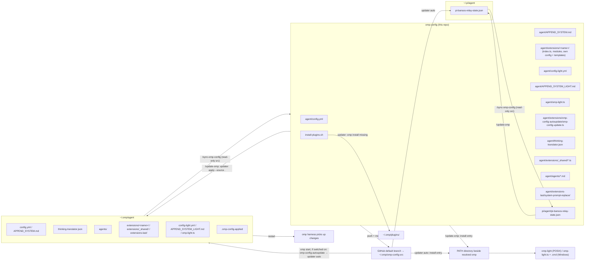

# Repository Guidelines

## Project Overview

`omp-config` is the auditable, version-controlled slice of the user's Oh My Pi
(`omp`) coding-harness configuration — **not** a full `~/.omp` backup
(`README.md:1-3`). It holds only reviewable inputs: harness config, full and
light system prompts, light-mode config and launcher source, custom subagent
definitions, local TypeScript extensions (one directory each, with the
extension's own config files and templates beside its code), the agent-root
`thinking-translator.json` for `omp-thinking-translator`, the `pi-bansos`
plugin state (`pi/agent/pi-bansos-relay-state.json`), the plugin install
list, the repo → machine updater (`agent/extensions/omp-config-autoupdate/omp-config-update.ts`) with its
startup hook, the maintenance commands that move state between this repo
and a machine's live `~/.omp/agent` (plus `~/.pi/agent` for the `pi-bansos`
state) and install its PATH launcher, the configuration check (CI) that
runs the config in a real omp session (`ci/`), and the dev tooling that
formats, lints and type-checks the TypeScript (`package.json`, `biome.json`,
`tsconfig.json`). Runtime state (databases, sessions, caches, credentials)
is deliberately excluded.

The repo is consumed by `omp` in two directions:
- **repo → machine**: `/update-omp` runs `omp-config-update.ts apply` against the
  working checkout. Opt-in per machine (`/omp-config-autoupdate on`, off by
  default), `extensions/omp-config-autoupdate/` runs `omp-config-update.ts auto`
  at every `omp` start, which fetches the GitHub default branch into its own
  clone (`~/.omp/omp-config-src`) and applies it when the commit differs from
  the one recorded in `<agent dir>/.omp-config-applied`.
- **machine → repo**: `/sync-omp-config` captures eligible local state back here.

## Architecture & Data Flow



- **Config vs behavior are separated.** Agent *responsibilities* live in
  `agent/APPEND_SYSTEM.md` + `agent/agents/*.md`; agent *model bindings* live only
  in `agent/config.yml` under `task.agentModelOverrides`. Changing a model never
  changes an agent's capability boundary (`README.md`).
- **Extensions are loaded per session** from native discovery and the
  `config.yml` `extensions` paths. Each extension is a directory
  `extensions/<name>/` whose `index.ts` default-exports the factory that
  registers tools/commands or subscribes to lifecycle events on the
  `ExtensionAPI` (`pi`); the directory name is the extension id
  (`extension-module:<name>`). Native discovery looks one level deep: a direct
  `*.ts`, `<dir>/index.ts`, or `<dir>/package.json#omp.extensions`, so the
  other modules of a directory and `_shared/` (no `index.ts`) are never loaded
  as extensions.
- **Load order is hook order.** `before_agent_start` handlers run extension by
  extension in load order, each receiving the system prompt the previous one
  returned (not every event is serial: `session_shutdown` handlers run
  concurrently). Order: native discovery (`~/.omp/agent/extensions/`, plus the
  TS/JS module entries of a legacy `settings.json` `extensions` list, loaded whether
  or not `config.yml` exists; only its extension-pack roots are ignored when
  `config.yml` exists) → hooks → plugin extensions → `-e` paths →
  `config.yml` `extensions` in list order → OMP's inline factories
  (SDK-supplied extensions, autoresearch, the custom-tools wrapper); a path loads
  once, at its first occurrence. `extensions-last/system-prompt-replace/` must
  therefore stay the last `config.yml` `extensions` entry and outside
  `extensions/`, which makes it last among path-loaded extensions; inline
  factories still run after it (autoresearch rewrites the prompt only in
  autoresearch mode). Within `extensions/` the order is whatever the native
  `glob` walk returns — no sort, not filename order — so filename prefixes
  cannot order extensions.
- **Two one-way syncs, never one "sync".** `/sync-omp-config` never writes the
  machine; its sync range includes the three light assets, the agent-root
  `thinking-translator.json`, the extension modules (the updater script included) and shipped templates, the structured
  extension configs, and `~/.pi/agent/pi-bansos-relay-state.json`, but excludes installed
  PATH launchers, `.omp-config-applied`, and every host-owned file inside an extension
  directory. It stops on a machine still on the flat extension layout and asks for
  `/update-omp` first. Repo → machine is the updater
  (`agent/extensions/omp-config-autoupdate/omp-config-update.ts`; its header is the contract): automatically at
  start, or via `/update-omp`. It writes the machine and installs `omp-light`
  beside the resolved `omp` executable. Its managed set (`managedPlain`,
  `STRUCTURED`) must match the sync range in `.omp/commands/sync-omp-config.md`.
- **Inside an extension directory, only modules and shipped templates are the
  repo's.** `managedPlain` takes `extensions[-last]/<name>/*.ts`,
  `extensions/user-prompt-inject/PROMPT-INJECT-*.md` and
  `extensions/turn-judge/TURN-JUDGE-*.md`; `STRUCTURED` takes the extension JSON
  configs. Any other file there (`bro-settings.json`, `omp-config-autoupdate.json`,
  `doc-polish.json`, `APPEND_SYSTEM_MODEL.md`, the machine's own `WATCHDOG-*.md`
  and templates) belongs to the host and is never written, deleted or synced back.
- **The repo wins on managed items; everything else is the host's.** The updater
  overwrites managed files and managed keys, host edits included (in `auto`
  mode only when the fetched commit differs from the applied one; `/update-omp`
  applies the working tree whenever run). It never touches host-only files,
  host-only keys (unless the repo turns their parent map into a non-map),
  `config.yml`'s machine-local fields (`LOCAL_CONFIG_FIELDS` in the updater,
  also used by `/sync-omp-config`; their ancestors are never replaced by a
  non-map), machine entries of `config.yml` `extensions` (`MACHINE_LIST_FIELDS`:
  entries the repo's list does not have, kept ahead of the repo's entries and
  never synced back, e.g. `~/.claude`), app-managed files, unparsable host
  structured files, or runtime state. It deletes only what git shows the repo
  dropped between the applied commit and the new one (managed files,
  structured keys, and `extensions` entries; a whole dropped structured file
  leaves the live file alone); `/update-omp` deletes nothing beyond the
  relocations below.
- **Relocations from the flat layout run in both modes** (updater header,
  RELOCATIONS): a flat `extensions/<name>.ts` superseded by a shipped
  `<name>/index.ts` is deleted (two modules with one id would both load), and
  so is the agent-root `omp-config-update.ts` the updater replaced;
  structured configs are merged from their old path (`legacyRel`) and the old
  copy deleted; agent-root data (`APPEND_SYSTEM_MODEL.md`, `bro-*`,
  `omp-config-autoupdate.json`, `extensions/doc-polish.json`, `WATCHDOG-*.md`,
  the machine's own `PROMPT-INJECT-*` / `TURN-JUDGE-*`) is renamed into its
  extension directory when the new path is free; the retired `config.yml`
  `extensions` entry `…/extensions-last/system-prompt-replace.ts` is dropped.
  Machines whose installed updater predates the move fetch from the old
  `agent/omp-config-update.ts` path, fail with "has no agent/omp-config-update.ts",
  and need one `/update-omp` to install the updater at its new path.
- **Structured configs are compared field by field.** `config.yml`, the
  agent-root `thinking-translator.json`,
  `extensions-last/system-prompt-replace/system-prompt-replace.json`,
  `extensions/{lang-nag,input-polish,tool-policy-nag}/<name>.json`, and `pi-bansos-relay-state.json` are regular
  items of both directions. `/sync-omp-config` reads both files, diffs fields,
  and edits only the differing repo lines — never a whole-file overwrite or
  re-serialization. The updater overlays repo keys onto the host mapping and
  writes only when the parsed result differs: the repo file verbatim when the
  result equals it, otherwise a re-serialized file (key order kept). Agent
  definitions and their `config.yml` model bindings land in the same apply.
  Every structured source must parse (`Bun.YAML.parse` / `JSON.parse`) to a
  mapping before any write. This is **not** like `doc-polish.json`
  (machine-local, prompt-overridable) or `commandcode-models.json`
  (machine-generated, never migrated).
- **Plugins are runtime state**, installed via `omp install` into
  `~/.omp/plugins/` and never copied into this repo (`README.md`).

## Key Directories

| Path | Purpose |
| --- | --- |
| `agent/` | Managed harness config. Only listed items are portable; the whole dir is **not**. |
| `agent/extensions/` | Local TypeScript extensions (the code core), one directory per extension: `<name>/index.ts` is the entry, other `*.ts` there are its private modules, and the extension's own config files and templates sit beside them, read via `import.meta.dir`. `_shared/` holds the helpers used by two or more extensions (`errors`, `messages`, `config` (`loadJsonConfig`), `models` (`resolveModelChain`), `helper-session` (`runHelperPrompt`), `judge` (`openNativeJudge`), `spec-files` (`discoverSpecFiles`, `parseFrontmatter`), `task-log`, `todo-more` (`readTodoMore`)); it has no `index.ts`, so omp never loads it as an extension. 20 extensions: `omp-config-autoupdate/`, which, when switched on with `/omp-config-autoupdate on` (off by default), runs `omp-config-update.ts auto` as a child process once per process from the root session's `session_start` and reports the result; `bro/`, the built-in-AI rewrite of the former `pi-bro` plugin; `input-polish/`, which polishes the input-box draft on the configured chord (default Ctrl+Enter) and shows the result in an overlay over the input box, where Enter sends it and Esc discards it; `watchdog-agent/`; `user-prompt-inject/`, which renders the root session's user prompts into `PROMPT-INJECT-*.md` templates and prepends them, request-only, to every model call of the targeted subagents (mentor and discussants by default); `turn-judge/`, which, after every main-session turn the model ended itself (`stopReason: "stop"`), asks a judgment-API model (Jev) each `TURN-JUDGE-*.md` question about that turn (the human's prompts and the model's text only) and either types the option's prompt once its probability reaches the option's threshold or shows the verdict as one info notification per turn; `tool-policy-nag/`, which watches main-session shell commands and eval code for operations a built-in tool covers: by default a command parser counts hits and, past three, steers a generic nag (at most three per context); with `tool-policy-nag.json` set to `{"detector": "jev", ...}` every watched call goes to Jev as one independent yes/no question per policy rule, and each call with any rule at or above `threshold` gets an aside listing every violated rule and the required tool, uncapped; `append-system-model/`, which appends the `APPEND_SYSTEM_MODEL.md` blocks whose `model`/`provider` regexes match the session's model to the system prompt on every `before_agent_start`; `fork-task/`, which seeds native `task` children with a copy of the caller's conversation; `task-split-check/`, which blocks main-agent `task` items for `task:low`/`task:mid`/`task:free` that cover more than one topic, and any `task`/`fork_task` call that caps a `task:*` worker's report length; `todo-more/`, the replacement for native todo (`config.yml` sets `todo.enabled: false`), rebuilt from OMP's own code: the `todo` tool (`tool.ts`; list with a goal `{objective, measure, doneWhen}`, items `{title, explanation}`, an `explain` op), the TodoTracker reminders (`reminders.ts`: stop reminder via `session_stop` in main sessions and `agent_end` + wake in subagents, mid-run nudge, eager prelude, goal-mode context), and its renderer (`render.ts`); state is the session branch (`mouriya.omp.todo-more` snapshots joined with host `user_todo_edit` writes by `_shared/todo-more.ts`), projected into the host TodoTracker so the HUD and `/todo` keep working; it also puts `todo` back on every `task:*` worker that OMP strips it from; `task-completion-judge/`, which bounces a `task:low`/`task:mid`/`task:free` worker's first final `yield` once when a model judges the slice unfinished (judging against the assignment and the worker's todo goal), and once more when it is finished but the worker's todo list still has open items; `ctx-tool/` (the `ctx` tool plus the post-compact `ctx` injection) and `ctx-tasklog/`; and `wt-tool/`, which gives the main agent of the interactive TUI two queued session-move tools: `wt` runs the human-only `/wt` through the TUI's own slash-command dispatcher on the live InteractiveMode once the turn has ended and the session is idle (when the session is already in a linked worktree, it first returns that worktree's details and a `confirm` value and creates only on a second call with it), and `wt_remove` first checks (read-only report plus a state-bound `confirm` value) and, when called again with that value, runs the human `/move` to the main checkout and force-removes the linked worktree it left, keeping the branch. Config beside its extension: `input-polish/input-polish.json`, `lang-nag/lang-nag.json` and `tool-policy-nag/tool-policy-nag.json` are synced both ways; `doc-polish/doc-polish.json` is a machine-local example (see Important Files). |
| `agent/extensions-last/` | Extensions that must run after every other path-loaded extension, loaded by path as the last `config.yml` `extensions` entry (`~/.omp/agent/extensions-last/system-prompt-replace/index.ts`); `README.md` there documents load order and is repo-only. Holds `system-prompt-replace/`, which applies the rules in its `system-prompt-replace.json` (`literal` or `regex` + `replace`) to the system prompt on every `before_agent_start`, main session and subagents; it rewrites built-in tool descriptions that conflict with `APPEND_SYSTEM.md`. The rules file is a structured item synced both ways (field-level diff and edit; validate with `JSON.parse`), read per prompt, so edits apply without restart; a rule whose target is absent from the main session's system prompt raises a visible warning (UI notification, or stderr when headless) once per rule per process. Excluded in light mode by `config-light.yml`'s empty `extensions` override; `omp-light` passes every other `config.yml` `extensions` entry back with `-e`. |
| `agent/agents/` | Custom subagent definitions (`*.md`) + `README.txt` authoring pitfalls. |
| `agent/thinking-translator.json` | Agent-root translator config for `omp-thinking-translator` (the plugin fixes its path). Portable regular item: `/sync-omp-config` carries machine → repo, the updater carries repo → machine. |
| `agent/extensions/user-prompt-inject/PROMPT-INJECT-*.md` | User-level templates for `user-prompt-inject` (frontmatter `target`/`name`/`enabled`, body with `{{user_prompt[i]}}` / `{{user_prompt[a:e]}}`). Shipped ones are repo-managed and copied whole; the machine's own templates in that directory are host-owned and never deleted. |
| `agent/extensions/turn-judge/TURN-JUDGE-*.md` | User-level judge configs for `turn-judge` (frontmatter `judge`/`name`/`enabled`/`maxChars`/`option.<label>[.prompt\|.threshold]`, body = the question). Shipped ones are repo-managed and copied whole; the machine's own are host-owned. Re-read at every turn end, so edits apply to the next turn without restart. |
| `agent/extensions/append-system-model/APPEND_SYSTEM_MODEL.md` | Per-model system-prompt appendix for `append-system-model` (`---`-fenced YAML headers with `model`/`provider` regexes, each followed by its body). Host-owned: the repo ships none, and the updater and `/sync-omp-config` leave it alone. Read per prompt, so edits apply without restart. |
| `pi/agent/pi-bansos-relay-state.json` | `pi-bansos` plugin state (relay on/off, relay URL, saved relays, `statusBar`), read by the plugin from `~/.pi/agent/`, not `~/.omp/agent`. Written by the plugin's `/bansos` command; no credentials. Portable regular item in both directions. |
| `.omp/commands/` | Project-level slash-command definitions run from repo root. |
| repo root | `install-plugins.sh`, `plugin-audit.sh`, `README.md` (authoritative, in Chinese), and the dev tooling `package.json` / `biome.json` / `tsconfig.json` (`bun run check`). |
| `ci/`, `.github/workflows/config-check.yml` | The configuration check (CI): `ci/check.ts` installs the latest omp in a throwaway HOME, applies the repo with its own updater (plugins included), runs one real RPC session per mode (full, `omp-light`) on a keyless free model, and collects updater and session diagnostics (every session stderr line, `extension_error`) and omp log warn/error; install output is collected only when a step fails. The report groups them into findings keyed by a SHA-256 of kind + normalized text, so one fault appears once with its per-phase counts and keeps its id across runs while kind and normalized text stay the same. `ci/README.md` holds its design, criteria, and coverage boundary. |
| `agent/config-light.yml`, `agent/APPEND_SYSTEM_LIGHT.md`, `agent/omp-light.ts` | Light-mode assets are included in both sync directions; the updater copies them to `~/.omp/agent` and installs the PATH entry beside the resolved `omp`. Generated `omp-light` / `omp-light.cmd` entries are not repo files. |
| `agent/extensions/omp-config-autoupdate/omp-config-update.ts` | The repo → machine updater: a standalone Bun script that sits beside the extension that spawns it (not an extension module; only `index.ts` is loaded), copied like the extension's other modules. `auto` mode runs at every start when the machine's auto-update switch is on; `apply --source <dir> [--check]` backs `/update-omp`. Its header documents what it touches, deletes, and never touches. |

## Development Commands

Slash commands run inside `omp` started at the repo root:

```
/update-omp [check]           # working checkout -> machine via the updater's `apply --source .`; asks about plugin uninstall candidates and missing machine-local init files
/sync-omp-config [check]      # machine -> repo (repo write only); syncs light assets, never installed PATH entries. Full mode commits+pushes
/migrate-omp-keys <target>    # SSH-copy auth_credentials to a remote omp host (not a snapshot path)
/omp-config-autoupdate [status|on|off|run]   # machine-local switch for startup auto-update (off by default; applies from next start); run = update from GitHub now, full report in the transcript
```

Shell scripts and dev tooling run from repo root:

```bash
./plugin-audit.sh             # read-only: diff install-plugins.sh (history from base 5974c4fa) vs `omp plugin list`
./install-plugins.sh          # `omp install` each declared plugin into ~/.omp/plugins (network required)
bun agent/extensions/omp-config-autoupdate/omp-config-update.ts apply --source . [--check] [--no-plugins] [--agent-dir DIR]   # what /update-omp runs
bun ~/.omp/agent/extensions/omp-config-autoupdate/omp-config-update.ts auto [--branch NAME]                                   # what the startup hook runs
bun install                   # dev dependencies (Biome, TypeScript, omp host packages for types); node_modules/ and bun.lock are not committed
bun run check                 # biome check . && tsc --noEmit: format, lint and type-check agent/**/*.ts and ci/**/*.ts
bun run format                # biome check --write .: apply formatting and safe fixes
```

Post-change / verification:

```bash
omp config list --json        # confirm applied config values
omp plugin list --json        # confirm plugin names/versions/enabled
git status --short            # confirm no runtime/db/cache files leaked into the repo
```

There is no build or unit-test command. `bun run check` must pass before a
change lands; CI runs it as the `code` job. The configuration check runs locally with
`bun ci/check.ts` (writes a throwaway temp root plus the report on stdout, and `$GITHUB_STEP_SUMMARY` when set; exit 0 clean, 1 diagnostics, 2 free model
unavailable) and in GitHub Actions on push to `master`, pull requests, daily, and on
dispatch (see Testing & QA).

## Code Conventions & Common Patterns

### Extensions (`agent/extensions/<name>/`)

Enforced by `bun run check` (Biome + `tsc --noEmit`; CI job `code`). A change is
done only when `bun run check` passes and the touched extension has been
exercised in a real omp session.

- **Layout:** one directory per extension, kebab-case, named after the
  extension id. `index.ts` begins with a header comment (what the extension
  does; the events, tools and commands it registers; the files it reads and
  writes; main or sub scope; failure policy) and default-exports a camelCase
  factory named after the directory (`ctxTool`, `toolPolicyNag`): a
  `(pi: ExtensionAPI) => void` (or async) function that registers and/or
  subscribes. Other `*.ts` files in the directory are the extension's private
  modules, one level only. Nothing directly under `extensions/` or
  `extensions-last/` is a `.ts` file. Only the default export, unless another
  file of the same extension imports a name; no test seams. The one
  exception is `omp-config-autoupdate/omp-config-update.ts`, the updater: a
  standalone script whose exports (`applySnapshot`, `LOCAL_CONFIG_FIELDS`, …)
  are its contract with older updaters and the sync command.
- **No cross-extension imports.** Code used by two or more extensions lives in
  `extensions/_shared/` and is imported by relative path with the `.ts`
  extension (`../_shared/config.ts`). `_shared` provides mechanics, not policy:
  retries, timeouts, throttling, user-visible wording and failure-to-null rules
  stay in the caller.
  - JSON config: `loadJsonConfig(name, schema, [ctx.cwd, import.meta.dir])` — a
    project copy wins over the one beside the extension; invalid copies are
    reported in `skipped`.
  - Model specs `provider/id[:level]`, comma chains: `resolveModelChain`,
    `findModel`, `splitLevel`.
  - One-shot model calls in a helper session: `runHelperPrompt` (never throws;
    `taskDepth: 1`, in-memory, no tools, MCP, LSP or extensions unless asked).
    Every other `createAgentSession` an extension builds for its own model
    calls (`fork-task`'s shake) also sets `taskDepth: 1`: without it the SDK
    classifies the helper as a main session, and its `dispose()` tears down
    the global `AgentLifecycleManager`, releasing every idle subagent (they
    become `Unknown agent` and can no longer be messaged).
  - Native judges (Jev): `openNativeJudge`.
  - `*-<label>.md` spec files: `discoverSpecFiles` (extension directory, then
    cwd up to the git root and each `.omp/`), `parseFrontmatter`, `unquote`.
  - Message text: `textOf`, `lastAssistantText`; errors: `errorText`.
  - Todo list on a session branch: `readTodoMore` plus `hostPhases`,
    `actionableItems`, `unexplainedItems`, `goalLines`, `explanationText`
    (`todo-more.ts`; `todo-more` writes the `mouriya.omp.todo-more` entries it reads).
- **Code copied from OMP** is wrapped in `// @upstream <verbatim|adapted>
  <package>@<version> <src path>#<symbol>` … `// @upstream-end` (`verbatim` =
  character-for-character upstream; `adapted` = changed; `#*` = a whole prompt
  file). Annotation only, no checker; after an OMP upgrade, compare marked
  blocks with the new source and bump the version.
- **Files an extension owns sit beside it** and are read via `import.meta.dir`,
  never via `getAgentDir()` or the agent root. Only files whose path is fixed by
  someone else stay where they are (`thinking-translator.json` by its plugin,
  `commandcode-models.json` by the commandcode plugin, omp's own files).
- **Format:** Biome only (tabs, double quotes, semicolons, trailing commas,
  width 140). Run `bun run format`; never hand-format.
- **Types:** strict `tsc` with `noUncheckedIndexedAccess`; no `any`. An `as`
  cast only where no runtime check is possible (a host type the runtime value
  cannot be checked against), with a one-line reason; never on external
  input. External input — JSON files, tool parameters, session entries,
  `unknown` event payloads, child-process output — is parsed once at the
  boundary with `z` from `@oh-my-pi/pi-coding-agent` (the omptype subset:
  string/number/boolean/literal/enum/union/array/object/record/unknown with
  optional/nullable/default/refine/transform/min/max) or a type guard;
  inside, only typed values.
- **State:** variants are a discriminated union on `kind` handled by an
  exhaustive `switch` with a `never` default arm. Independent facts stay
  independent fields; booleans never encode mutually exclusive states.
- **Errors:** expected failures are result unions; exceptions are for
  programmer errors. A hook or tool never throws into omp: catch at the
  handler boundary and `pi.logger.warn(message, { error: errorText(error) })`.
  An empty `catch {}` carries a comment naming the expected failure.
- **Main vs sub session:** `ctx.agent.kind` (`"main" | "sub"`), never the
  session-file name.
- **Injected user-role messages carry `attribution: "agent"`:** every
  `pi.sendUserMessage` an extension sends on its own behalf (`watchdog-agent`,
  `turn-judge`, `tool-policy-nag`, `ctx-tool`'s post-compact hint, `doc-polish`) passes it.
  The default is `user`, and `user-prompt-inject` treats `user`-attributed
  messages as the human's own prompts.
- **Imports:** omp host package roots (`pi-agent-core`, `pi-ai`, `pi-catalog`,
  `pi-coding-agent`, `pi-natives`, `pi-tui`, `pi-utils`), node built-ins, and
  relative paths. Other `@oh-my-pi/*` packages fail to load, and so do host
  subpaths the omp binary does not map (`@oh-my-pi/pi-tui/thinking` fails); a
  subpath is used only when an extension already loads it in a real omp
  session. Dev type-checks resolve these packages from `node_modules/`, which
  proves nothing about runtime loading; load-check from a path with no
  `node_modules` above it (as `~/.omp/agent` has none).
- **Size:** a function over ~150 lines (typically a default export with inline
  handlers) is split into named module-level functions.
- **Two idioms:** tool/command registration (`pi.registerTool`,
  `pi.registerCommand`, `pi.setLabel`) vs pure hooks (`pi.on(event, handler)`).
  Hook-only extensions register nothing (e.g. `repo-rules`,
  `tool-policy-nag`, `user-prompt-inject`).
- **Lifecycle events used:** `session_start`, `before_agent_start`, `input`,
  `context`, `tool_call`, `tool_result`, `message_end`, `agent_start`,
  `agent_end`, `session_compact`, `auto_compaction_end`, `before_subagent_spawn`,
  `session_shutdown`, `session_switch/branch/tree`. Only `context` fires on every model call,
  including IRC wakes of idle/parked subagents; `before_agent_start` does not.
- **State storage:** in the extension closure or module-level caches; durable
  state goes through session custom entries (e.g. `tool-policy-nag`'s heuristic detector persists
  `mouriya.omp.tool-policy-nag.state` and rebuilds it on restore) or, for
  `ctx-tasklog`, append-only files under the local root
  (`task-log/<agent-id>.md`, format in `_shared/task-log.ts`). `todo-more` keeps the
  whole todo list as full-snapshot `mouriya.omp.todo-more` entries, appended at once
  because a batch's earlier tool results are not on the branch yet.

### Subagent definitions (`agent/agents/*.md`)

- YAML frontmatter: `name`, `description`, and optionally `spawns` (comma list) or
  `tools` (discussants `tools: read, grep, glob`, mentor `tools: []`). **No `model`
  field** — model binding lives in `config.yml`.
- Prefer an explicit `spawns` allowlist over `"*"`; the **first** listed name is
  the silent default for an omitted `agent`. `task-high.md` is the only worker
  that spawns `task:*` and lists `task:mid` (the default worker tier) first; `task-free.md`,
  `task-low.md`, and `task-mid.md` spawn only `mentor:default`
  (`agent/agents/README.txt:24-36`).
- Read `agent/agents/README.txt` before editing — it documents hard traps:
  `task.disabledAgents` (`task`, `scout`, `sonic`, `reviewer`,
  `security-reviewer`) fail even if allowlisted; recursion depth caps at 2
  (grandchildren cannot spawn); a `yield`-only agent can lose its answer; edits
  apply on next spawn (no hot reload); a broken definition is skipped with a log
  warning, not a call-site error.
- **Keep non-agent notes as `.txt`** — every `.md` here is parsed as an agent
  candidate and a plain note becomes permanent per-dispatch log noise
  (`agent/agents/README.txt:131-140`).

## Important Files

- `agent/config.yml` — harness + UI config. Key sections: `extensions` (only
  `~/.omp/agent/extensions-last/system-prompt-replace/index.ts`, which must stay last; a
  machine adds its own entries such as `~/.claude` in its live copy, and the updater
  keeps them ahead of the repo's entries),
  `task.agentModelOverrides` (model/fallback chains per tier),
  `task.disabledAgents`, `compaction.methodOrder` (`compaction.thresholdTokens` is machine-local),
  feature toggles (`astGrep.enabled: true`, `github.enabled: true`,
  `fetch.enabled: true`, `browser.enabled: false`, `todo.enabled: false` — native
  todo is off; `todo-more` provides `todo`).
- `agent/APPEND_SYSTEM.md` — global system-prompt appendix (user-instruction precedence, orchestration stance,
  no-token-saving rule, design-document read-in-full rule, spawn briefing, agent chat and lifecycle,
  agent tiers, shared-checkout vs `isolated: true` rules, tool policy). Task children
  never receive it, so rules they need are repeated in the `task:*` definitions. Rules about
  how to use one tool (`todo` timing and revision, explicit `agent`, per-spawn `effort`,
  `task` vs `fork_task`) live in that tool's description instead — built-in ones and `todo`'s
  (written by `todo-more`, keeping the native sentences) rewritten by
  `system-prompt-replace.json`, `fork_task`'s in `fork-task/index.ts` — so subagents see them too;
  this relies on `config.yml` `inlineToolDescriptors: "on"`, which renders every tool
  description into the system prompt.
- `agent/config-light.yml` — declarative light-mode config overlay: disables thirteen
  optional behavior extensions (including `task-completion-judge`, `turn-judge` and
  `user-prompt-inject`); the other seven (`append-system-model`, `bro`, `input-polish`, `repo-rules`,
  `todo-more`, `omp-config-autoupdate`, and the `commandcode-model-spec` compatibility fix) stay loaded,
  as listed in `README.md`, so `omp-light` also auto-updates when the switch is on.
  It overrides `extensions` to `[]` to drop `system-prompt-replace`:
  `disabledExtensions` filters discovered `extension-module:<name>` entries, so it
  cannot drop an extension listed as a file path (in `extensions` or `-e`); modules
  found inside a listed directory are still filtered by name. `omp-light.ts` then passes each live
  `config.yml` `extensions` entry outside `extensions-last/` (the machine's own,
  such as `~/.claude`) with `-e`, a load lane the override does not reach, so
  only `extensions-last/` stays full-mode-only.
- `agent/APPEND_SYSTEM_LIGHT.md` — system-prompt appendix used only by
  `omp-light` (currently empty); the normal `APPEND_SYSTEM.md` remains the full-mode prompt.
- `agent/omp-light.ts` — portable `#!/usr/bin/env bun` launcher source. The updater
  (auto-update and `/update-omp`) installs it as executable `omp-light` on POSIX/macOS/Linux, or as
  `omp-light.ts` plus a generated `omp-light.cmd` on Windows, beside the resolved
  `omp`; generated entries are not part of the repo copy set.
- `agent/extensions/omp-config-autoupdate/` (`index.ts` + `omp-config-update.ts`) —
  the updater and its startup hook. The hook is off by default:
  `/omp-config-autoupdate` (`status` reads; `on`/`off` write) manages the machine-local switch
  `omp-config-autoupdate.json` beside the extension (`{"enabled": bool}`; missing or
  invalid = off), which neither the updater nor `/sync-omp-config` carries, and
  which the hook reads once per start. When on, the hook spawns the updater beside it with
  `bun` from a managed `ctx.setTimeout` (an in-process fault must not take OMP
  down) and notifies only on changes or failures (up to date, a busy lock, and
  a failed fetch only log); `/omp-config-autoupdate run`
  spawns the same child on demand, whatever the switch says, and posts the full
  report of that run only as a display-only transcript message. `auto` takes
  the lock dir `~/.omp/omp-config-update.lock`, fetches into
  `~/.omp/omp-config-src` (a failed fetch, first clone included, applies
  nothing and returns `offline`), then
  imports `applySnapshot` from the fetched clone's copy of the updater, so a
  commit is applied by its own rules; keep `applySnapshot(options)`
  backward-compatible. It parses the child's JSON result with a schema
  (`moved` included). The marker `<agent dir>/.omp-config-applied` is written
  only after an error-free apply. Plugin URLs are matched with `#ref` stripped,
  so a host install pinned to a branch counts as installed. Never put the Otty
  marker literal in the updater: the marker check matches anywhere in a file
  and the updater is itself a managed file.
- `agent/thinking-translator.json` — agent-root config read by
  `omp-thinking-translator` at `~/.omp/agent`. Managed regular item in both
  directions (field-level diff and edit; validate with `bun -e` + `JSON.parse`). Unlike
  `agent/extensions/doc-polish/doc-polish.json` below, it is portable, not machine-local.
- `agent/extensions/user-prompt-inject/PROMPT-INJECT-user-goal.md` — the shipped `user-prompt-inject` template:
  targets `mentor:default`, `discuss:steady`, `discuss:divergent`, injects every
  root user prompt (`{{user_prompt[0:e]}}`), and tells them to judge their
  advisee against those requests rather than its restatement. Templates are read
  at subagent session start, so edits apply on the next spawn without restart.
- `agent/extensions/turn-judge/TURN-JUDGE-甩锅.md` — the shipped `turn-judge` config: asks Jev
  (`commandcode/typesafe/jev`) “模型是不是在甩锅？” with options `是`/`否`, and types
  a prompt telling the model to finish the work it pushed onto the user when `是`
  reaches 0.5; otherwise the verdict shows as info.
- `agent/extensions/tool-policy-nag/tool-policy-nag.json` — detector switch for `tool-policy-nag`:
  `{"detector": "heuristic"}` (the shipped value, and the fallback when no valid
  config exists) or `{"detector": "jev", "judge": "<provider>/<model>", "threshold": <(0, 1]>}`.
  A cwd-local copy wins, then the one beside the extension; re-read at every watched
  call, so edits apply without restart. Managed regular item in both directions
  (field-level diff and edit; validate with `JSON.parse`). The Jev questions themselves
  live in the extension (`SHELL_RULES` / `EVAL_RULES`), not in this file.
- `pi/agent/pi-bansos-relay-state.json` — state file of the `pi-bansos` plugin
  (`{enabled, url, relays, statusBar}`), which the plugin reads from and writes
  to `~/.pi/agent/pi-bansos-relay-state.json` via `/bansos`. The status bar
  `relay: ON/OFF` is shown by default; `statusBar: "hidden"` lives only in
  this file, so a machine without it shows the entry again. Managed regular
  item in both directions (field-level diff and edit; validate with `JSON.parse`).
- `agent/extensions/doc-polish/doc-polish.json` — example config for `doc-polish`
  (`splitModel`, `polishModel`, `concurrency`; `checkModel` optional, omitted
  here). The live copy beside the extension is machine-local and prompt-overridable:
  the updater never writes it (it only moves a pre-restructure
  `extensions/doc-polish.json` there); `/update-omp` asks before creating a missing one.
  A cwd-local `doc-polish.json` wins over it. **Distinct** from `ctx`
  `.md`/`.json` sidecar artifacts.
- `install-plugins.sh` — declared plugin list: `pi-commandcode-provider`,
  `pi-package-search`, `pi-pretty-codeblocks`, `pi-schedule`, and
  the GitHub URLs `mouriya-s-lab/pi-bansos` (our fork of npm `pi-bansos`, carrying
  fixes also submitted upstream to `mannnrachman/pi-bansos`), `mouriya-s-lab/omp-unified-exec`
  (our fork of `iamwrm/pi-unified-exec`, renamed, which skips the Pi-only compact codemode
  fix whose `createCodemodeExtension` import fails to link on OMP, uses Bun's native `Terminal`
  on macOS, Linux, and Windows under Bun, and loads `@homebridge/node-pty-prebuilt-multiarch`
  only under Node.js; its `fork-features/README.md` records the customizations and sync policy),
  `Mouriya-Emma/omp-thinking-translator`
  (its runtime config is the portable agent-root `thinking-translator.json` above), and
  `mouriya-s-lab/omp-codex-image-gen`. All unpinned: `omp install` resolves npm versions,
  and GitHub URLs track the default branch (re-run the same `omp install <url>` to update). An existing
  npm `pi-bansos` install must be removed with `omp plugin uninstall pi-bansos` before installing the fork URL,
  and an existing `pi-unified-exec` with `omp plugin uninstall pi-unified-exec` (both register the same tools).
  The former `pi-bro` plugin is now the local `agent/extensions/bro/`.
  `mouriya-s-lab/omp-remote-build` is listed commented out and unquoted as an optional
  plugin: not everyone needs remote build environments, and it depends on `omp-unified-exec`,
  Mutagen, the km CLI, Komodo Core/Periphery and an SSH-reachable build host. `/sync-omp-config`
  keeps commented entries commented even when the plugin is installed locally.
- `plugin-audit.sh` — drift report; base commit `5974c4fa`; requires `omp` on PATH
  and a git worktree. It counts only single-quoted entries inside `plugins=( … )`, so a
  commented optional plugin that is installed locally reports as `[保留]`.
- `.omp/commands/{update-omp,sync-omp-config,migrate-omp-keys}.md` — the command
  contracts; read these for exact copy/exclusion/validation rules. `update-omp.md`
  only wraps the updater, whose header and code are the repo → machine rules.

Direct-migration copy set (never copy the whole `agent/`; `README.md`):

```bash
mkdir -p "$HOME/.omp/agent"
cp agent/config.yml agent/APPEND_SYSTEM.md agent/thinking-translator.json \
  agent/config-light.yml agent/APPEND_SYSTEM_LIGHT.md agent/omp-light.ts \
  "$HOME/.omp/agent/"
cp -a agent/agents agent/extensions agent/extensions-last "$HOME/.omp/agent/"
mkdir -p "$HOME/.pi/agent"
cp pi/agent/pi-bansos-relay-state.json "$HOME/.pi/agent/"
./install-plugins.sh
```

The copy set overwrites whole files: the target's machine-local `config.yml`
fields (e.g. `compaction.thresholdTokens`) and its machine `extensions` entries
(e.g. `~/.claude`) are replaced, the example `extensions/doc-polish/doc-polish.json`
overwrites a live copy there, and the repo-only `extensions-last/README.md` comes along;
it does not relocate files a machine still keeps in the flat layout. On a
machine with existing config use `/update-omp` or restore those afterwards.
The installed `omp-light` / `omp-light.cmd` entries are generated outputs, not
copy-set files. Copying the three light assets alone does not make `omp-light`
resolvable: run `/update-omp` on the target, or `/omp-config-autoupdate on` and
restart, whose first automatic apply (no `.omp-config-applied` yet) installs
`omp-light` beside the resolved `omp` and any missing plugins.

## Runtime/Tooling Preferences

- **Harness/runtime is Bun-based** (`omp`). Extensions run under it; validation
  one-liners use `bun -e` (e.g. `Bun.YAML.parse`, `JSON.parse`). Most extensions
  use Node built-ins + Web APIs; `append-system-model` uses `Bun.YAML.parse`
  for its headers, and the updater `omp-config-update.ts` uses `Bun.YAML`,
  `Bun.which`, `Bun.deepEquals`, and `import.meta.main`; its startup hook needs
  `bun` on `PATH` to spawn it. `omp-unified-exec` owns its PTY backend: Bun's native
  `Terminal` on macOS, Linux, and Windows, and
  `@homebridge/node-pty-prebuilt-multiarch` only under Node.js.
- **Dev tooling:** `bun install` fetches Biome, TypeScript and the omp host
  packages (for types only; at runtime extensions get the copies bundled in
  the omp binary). Every dev dependency is `latest`; `bun.lock` is not
  committed, so `bun install` always resolves current versions.
- **Plugins:** installed with `omp install` (network) into `~/.omp/plugins/`
  (`package.json`, `bun.lock`, `node_modules/`, `omp-plugins.lock.json`). These are
  machine state, not repo content.
- **Agent dir:** `~/.omp/agent`. The updater's clone (`~/.omp/omp-config-src`) and
  lock dir (`~/.omp/omp-config-update.lock`) sit one level above it.
- The installed `omp-light` entry is not stored in `~/.omp/agent`: it is
  placed beside the resolved `omp` executable so the existing `PATH` finds it.
- **Restart required:** `APPEND_SYSTEM.md`, extension code, new extensions, and plugins take effect on
  the next `omp` start (`.omp/commands/update-omp.md`, 生效时机); `config.yml`
  hot-reloads, so `extensions` / `disabledExtensions` changes suspend or resume
  already-loaded extensions live, and agent `*.md` edits apply on next spawn
  without restart. An automatic update lands during the
  session that started it, so that session can run new data under old
  extension code until restart.
- **Never commit** (`.gitignore` covers `agent/{agent,history,models}.db*`,
  `agent/*.lock`, `agent/models.yml` and `models.yml.bak-*`,
  `agent/commandcode-models.json`, `agent/last-changelog-version`,
  `agent/{sessions,terminal-sessions,blobs,cache}/`, `plugins/node_modules/`,
  `node_modules/`, `bun.lock`, `**/*.db`, `**/*.db-*`, `**/logs/`): runtime state and anything
  credential-bearing, including files the patterns miss.
- **Do not overwrite app-managed files:** files marked
  `// @orca-managed-pi-extension` or `marker: _otty` (e.g. `orca-*.ts`,
  `otty-integration.ts`) are maintained by their apps — presence of the marker,
  not the filename, controls exclusion.

## Testing & QA

- **No unit-test suite and no git hooks** (no `*.test.*`/`*.spec.*`). Static
  checks are `bun run check`: Biome (format + lint, `biome.json`) and
  `tsc --noEmit` (`tsconfig.json`, strict, `noUncheckedIndexedAccess`) over
  `agent/**/*.ts` and `ci/**/*.ts`, run in CI as the `code` job. Type-checking
  resolves host packages from `node_modules/`, so it cannot prove an import
  loads inside omp.
- **The configuration check (`ci/check.ts`, workflow `config-check`)** proves the
  repo config installs and loads on the latest omp: updater apply with all plugins,
  then one real prompt per mode on a free model, failing on any session stderr line,
  `extension_error`, failed reply, or omp log warn/error outside the listed host
  noise. It reports only; whether it blocks a merge depends on GitHub branch
  protection. Its prompt asks for no tools or subagents but does not disable or
  assert them, so it does not prove tool, subagent, or TUI behavior (`ci/README.md`,
  覆盖边界).
- **`plugin-audit.sh` validates the plugin *list*, not extension code** — it
  cannot prove anything about a `.ts` edit.
- **How to validate a change here:**
  1. `bun run check`, and a `bun -e` parse check for any changed YAML/JSON (`config.yml`, `*.json`) — including `agent/thinking-translator.json`, `agent/extensions-last/system-prompt-replace/system-prompt-replace.json`, and `pi/agent/pi-bansos-relay-state.json` via `JSON.parse` on both sync and update paths.
  2. For an extension change, the only real proof is runtime: apply via
     `/update-omp` (or the `cp` set), **restart `omp`**, and exercise the actual
     tool/command/hook (e.g. run `ctx list`, `/polish-doc <file>`, trigger the
     targeted hook) — then verify observed output/side effects. A `bun -e` parse
     or `cmp` is necessary but **not** sufficient.
  3. `omp config list --json`, `omp plugin list --json`, `git status --short` to
     confirm applied state and that no runtime/credential files leaked.
- If runtime verification isn't possible, say so explicitly — parse-clean +
  `cmp`-identical does not mean correct.
- **Credential safety:** `/migrate-omp-keys` copies only the `auth_credentials`
  table (and clears the remote `auth_credential_blocks` and
  `auth_credential_refresh_leases`), backs up the remote DB with SQLite `.backup`,
  requires confirmation, and never prints credential data. Never route secrets through the repo snapshot.
