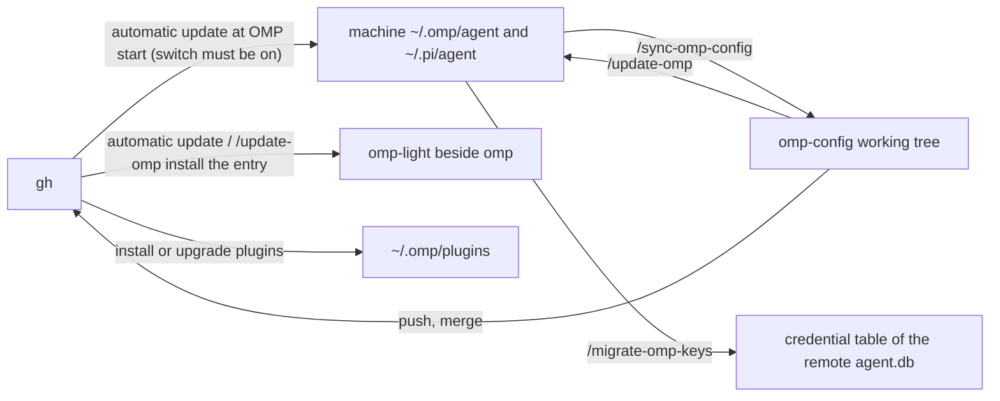

# omp-config

English | [简体中文](README.zh-CN.md)

The reviewable, portable part of an Oh My Pi (OMP) configuration, tuned for heavy programming work. This is not a full backup of `~/.omp`: databases, sessions, caches, logs, lock files and credentials never enter the repository.

- [Repository contents](#repository-contents)
- [Quick start](#quick-start)
- [Design](#design)
- [Sync and migration](#sync-and-migration)
- [Light mode](#light-mode)
- [Subagent system](#subagent-system)
- [Local extensions](#local-extensions)
- [Maintenance notes](#maintenance-notes)

## Repository contents

|Path|Content|Location on the machine|
|---|---|---|
|`agent/config.yml`|OMP config, UI behavior, subagent model bindings|`~/.omp/agent/`|
|`agent/SYSTEM_TEMPLATE.md`|Vendored Handlebars replacement for OMP's bundled base system prompt; live tool, skill, rule and runtime fields are still rendered by OMP|`~/.omp/agent/`|
| `agent/APPEND_SYSTEM.md`|Appended system prompt for full mode|`~/.omp/agent/`|
| `agent/PERSONALITY.md`|The speaking-style block for full mode: OMP's `personality: default` preset text verbatim, then this repository's `# Writing` register for research and analysis prose|`~/.omp/agent/`|
|`agent/extensions/append-system-model/APPEND_SYSTEM_MODEL.md`|Per-model appended system prompt for [append-system-model](#append-system-model); belongs to the machine, the repository ships none|`~/.omp/agent/extensions/append-system-model/`|
|`agent/omomp.yml` section `model-compaction`|Per-model automatic-compaction triggers for [model-compaction](#model-compaction); belongs to the machine, the repository ships none|`~/.omp/agent/omomp.yml`|
|`agent/config-light.yml`, `agent/APPEND_SYSTEM_LIGHT.md`, `agent/omp-light.ts`|Light mode's config overlay, appended prompt (currently empty) and launcher source|`~/.omp/agent/`|
|`agent/extensions/omp-config-autoupdate/omp-config-update.ts`|The repo → machine updater, shared by [automatic update at startup](#automatic-update-at-startup) and `/update-omp`; it sits in the directory of the extension that starts it and is a standalone script, not an extension module|`~/.omp/agent/extensions/omp-config-autoupdate/`|
|`agent/thinking-translator.json`|Ordered candidate chain and lowest reasoning effort for the [thinking translation](#thinking-translation) plugin|`~/.omp/agent/`|
|`agent/extensions/user-prompt-inject/PROMPT-INJECT-*.md`|Templates for [user-prompt-inject](#user-prompt-inject): inject the user's own words into the mentor and discussants|`~/.omp/agent/extensions/user-prompt-inject/`|
|`agent/extensions/turn-judge/TURN-JUDGE-*.md`|Judge configs for [turn-judge](#turn-judge): after each turn, ask one question through OMP's JUDGE role; the repository ships none, so a machine judges only the files it writes itself|`~/.omp/agent/extensions/turn-judge/`|
|`agent/agents/`|Subagent definitions; `README.txt` records authoring pitfalls|`~/.omp/agent/agents/`|
|`agent/extensions/`|Local extensions, one directory each: `<name>/index.ts` is the entry, the other `.ts` files in the directory are its own modules, and its own config and templates live there too; `_shared/` holds code shared by several extensions. Extension settings are sections of `omomp.yml`, not files here: `lang-nag`, `input-polish`, `tool-policy-nag`, `task-completion-judge` and `system-prompt-replace` are synced by the updater; `doc-polish` belongs to the machine and is only an example, see [`/update-omp`](#update-omp-repo--machine)|`~/.omp/agent/extensions/`|
|`agent/extensions-last/`|Extensions that must run after every other path-loaded extension, loaded explicitly as the last `extensions` entry of `config.yml`; currently only [system-prompt-replace](#system-prompt-replace), whose rules sit in the `system-prompt-replace` section of `omomp.yml`. `README.md` and `README.zh-CN.md` there are repo-only and not synced|`~/.omp/agent/extensions-last/`|
|`pi/agent/pi-bansos-relay-state.json`|`pi-bansos` plugin state|`~/.pi/agent/`|
|`install-plugins.sh`, `plugin-audit.sh`|Plugin installation and plugin drift check|—|
|`.omp/commands/`|Full rules of the three maintenance commands|—|
|`ci/`, `.github/workflows/config-check.yml`|The configuration check (CI), whose design and criteria are in `ci/README.md`|—|
|`package.json`, `biome.json`, `tsconfig.json`|Dev tooling: `bun run check` runs formatting, lint and type checks; conventions in [Layout and development conventions](#layout-and-development-conventions)|—|

## Quick start

Run all of the following after starting OMP at the repository root.

**A new machine:**

1. Run [`/update-omp`](#update-omp-repo--machine): it writes the config to the machine (including the [omp-config-autoupdate](#omp-config-autoupdate) extension and the updater `omp-config-update.ts` in its directory), installs `omp-light`, and runs `omp install` for every declared plugin (missing ones are installed, installed ones are upgraded).
2. To use Claude Code's skills, rules, commands and so on in OMP, add `~/.claude` at the start of `extensions` in the machine's `~/.omp/agent/config.yml`. OMP treats it as an extension package root and loads its `skills/`, `rules/`, `commands/`, `hooks/` and the like. The entry belongs to the machine: the updater keeps it, `/sync-omp-config` does not write it back to the repository, and `omp-light` loads it too, see [Rules shared by both directions](#rules-shared-by-both-directions). Do not add it on a machine without `~/.claude`, or every start reports a load failure.
3. Restart OMP. Appended prompts, extensions and plugins are all loaded at startup.
4. To [update automatically](#automatic-update-at-startup) from the GitHub default branch at every start, run `/omp-config-autoupdate on` (off by default); it applies from the next start, and `/update-omp` is no longer needed by hand.
5. Confirm the result with [Post-migration checks](#post-migration-checks).
6. To keep the provider logins of an old machine, run [`/migrate-omp-keys <new machine>`](#credential-migration-migrate-omp-keys-target) on the old machine.

**The machine's config changed and should go back into the repository:** run `/sync-omp-config check` to see the differences, then [`/sync-omp-config`](#sync-omp-config-machine--repo) to write them into the repository, and commit and push. With automatic update on, the next start after a new commit on the default branch overwrites the machine's managed items with the repository's version, and changes not brought back into the repository are lost.

## Design

### Scope

- This is not an ultracode-style solver for large tasks; other plugins cover that.
- Full mode keeps the native workflow and adds mandatory decision support, explicit evidence and runtime checks. Small or tightly coupled changes stay local when delegation adds more handoff cost than useful ownership. Use [light mode](#light-mode) when the optional behavior extensions are unnecessary.

### Constraining model behavior

These constraints do not assume that a model follows the system prompt reliably. In practice, models led by Claude follow its rules selectively; once they start bypassing the tool-call conventions, the other constraints (including `CLAUDE.md` and `*.rule.md`) tend to fail with them. The repository therefore constrains side effects, detects drift and adds reminders at runtime, all at once.

**Constrain side effects with hashline edit.** A hashline edit first reads the current file and names the edit range explicitly, binding the write to an observed snapshot. The `read` and `edit` tool descriptions own that protocol; neither the base template nor the appendix reprints it. The read description explains the unified source-and-view protocol and links its complete specification at `omp://tools/read.md`.

**Treat todo and ctx as one combined tool set in both modes.** todo maintains the task lifecycle; when the model stops on an ordinary end path while the todo is not finished, todo makes the agent continue (the native TodoTracker reminder, now implemented by [todo-more](#todo-more) following the native logic), so no loop has to inject prompts again and again. It also reduces asking the user too early after a small setback: when the last reply asks the user a question, the reminder does not push; otherwise, as long as pending / in_progress items remain, the agent keeps going. Marking an item blocked while waiting for an outside answer is part of the Todo tool's own protocol, not a condition the reminder checks. Automatic continuation can misjudge, and here we choose to take that risk rather than interrupt the operator often.

Every successful todo change is captured by the task-log hook in [omp-todo-more](#todo-more) (`src/ctx/tasklog.ts`); `ctx`, registered by the same plugin, replays those events into the final task state, giving a short work record that does not depend on the model summarizing itself. After the main session compacts, the plugin injects that record, together with the context tree, into the new context. `todo` here comes from the independent plugin [omp-todo-more](#todo-more): `config.yml` still turns native todo off (`todo.enabled: false`), and the config repository no longer copies its implementation. Every list carries a goal and an explanation per item; the plugin keeps the native reminders and restores todo for `task:*` workers, whose definitions also require each slice to keep its own list. The completion judge consumes a public contract (`omp-todo-more:read`) and does not import the plugin's reader.

**Treat an illegal tool call as a signal of overall drift.** [tool-policy-nag](#tool-policy-nag) detects whether the model bypasses the built-in tools; it only reminds and never blocks a command. When OMP's JUDGE role is available and its first choice is a native judgment model, the intent lane joins automatically and judges for every call which tool should have been used; otherwise the string lane counts and sends a generic reminder past a threshold. The aim is not formally perfect "classical" tool calls but correcting drift before it spreads to other rules.

**Use a watchdog for independent runtime review.** A watchdog reads the context automatically as a third-party observer and injects reminders by rule; it works like Claude's `/advisor`, with broader targets, triggers and delivery. When a judgment has few options, the options can be declared to use OMP's native JUDGE backend instead ([watchdog-agent](#watchdog-agent)).

**Judge every turn and correct directly.** After each main-session turn, [turn-judge](#turn-judge) judges that turn through OMP's native JUDGE against the questions you configure; when the matching option's confidence reaches its threshold it types the preset prompt, otherwise it only shows the verdict.

**Let advisors see the user's own words.** The mentor and discussants know only what the agent that spawned them tells them, so they can only advise along that agent's retelling and become echo amplifiers. [user-prompt-inject](#user-prompt-inject) injects the prompts the user wrote in the root session into every model call they make, through a template, so they check the other agent's plan against the user's goals and constraints rather than against the retelling.

**Compensate separately for a lost language setting.** After Claude's server-side compact, the re-injected system prompt may not restore the language constraint. [lang-nag](#lang-nag) therefore checks the reply language on its own and adds a reminder before the next input; it never rewrites a reply that was already sent.

**Treat the final reply as the only deliverable.** Its prose uses complete sentences with explicit subjects, identifies objects on first mention and puts decisive evidence beside conclusions. It avoids analogies; the native template chooses whether a table, diagram or prose fits. The local register lives in `# The user sees only the final reply` of `agent/APPEND_SYSTEM.md`.

**Give written work its own register.** Reports, articles and analyses are judged by information density, not by narration: evidence first, mechanism and commercial consequence before story, complex reasoning allowed, explanatory repetition removed. The paragraph opens with the finding, the number or the mechanism; one sentence carries time, actor, action, scale and source; several objects or metrics go in one table instead of a row-by-row restatement; sections follow the research question rather than an outline kept for completeness. The register names what to cut — narration of the process and self-assessment, a second explanation of a fact that already states its source, scope and meaning, repeated disclaimers, significance paragraphs, tutorial walkthroughs, a section restated after its own table, a summary that repeats the document — and gives the paragraph deletion test: if the reader's grasp of the facts, numbers, mechanism, conditions and conclusions is unchanged without a paragraph, it does not belong. The register lives in `# Writing` of `agent/PERSONALITY.md`, together with the repository's copy of OMP's default personality block.

### Context management

**Treat the context as intent state.** The context is not just file contents; it also holds requirements, trade-offs, confirmed facts and intent aligned with the human. Compaction squeezes all of that, so every compact in a long task is a lossy operation to avoid as far as possible.

Do not buy an apparent context saving with means that are just as lossy:

- Grepping instead of reading in full hardens partial information into wrong beliefs.
- Chaining many operations into one long bash widens side effects and makes failures harder to diagnose.
- External command output can explode; a git branch list, for example, can reach hundreds of entries after many iterations, yet cutting it with `head` or `tail` loses key evidence just the same.

Prefer the tools' own paging and default ordering, which keep output size under control while preserving a traceable read boundary.

**Put disposable work in subagent contexts.** A subagent's context is a disposable working branch; important conclusions and evidence come back over subagent IRC, and the main agent distills them into its own context. What gets discarded is the execution, not the task intent.

**Delegate for ownership, parallelism or independent evidence.** Keep investigation and implementation together when they form one cohesive slice. `SYSTEM_TEMPLATE.md` explains the workflow and its runtime delegation modes; do not split merely to minimize unit size. Core code and documents may be assigned to `task:high` only with explicit user permission; the other worker tiers retain their declared capability boundaries.

**Fork the context when the full background is needed.** Even if more than 1.5 million characters of pure design material fit into one context, one session should not carry the entire implementation. Forking the existing context to a subagent lets it focus on a local task while keeping intent that lives outside the files and was already aligned with the human; this is what `fork_task` adds to the original `task` ([fork-task](#fork-task)). If the main context still compacts in the end, the ctx chain forces the context tree and the task record replayed from todo into the compacted session; it restores recorded progress and does not assume that compaction preserves the original intent losslessly.

### Subagent tiers

A model's code generation is not the same as its overall judgment, planning or rule-following. Some models are unsuitable for a human to drive directly yet make efficient workers on well-bounded slices; the task tiers separate cost from the trust required accordingly. Each tier's `description` states the model class, cost, trust and the work it refuses, so the main agent picks a tier by cost and trust rather than by task difficulty (see [Subagent system](#subagent-system)).

Low-tier models may also deliver before the work is finished. [task-completion-judge](#task-completion-judge) checks completion before such a worker delivers; [task-split-check](#task-split-check) pushes each dispatch to cover a single topic, lowering the cost of acceptance and review.

### Other extensions

The remaining extensions are mostly patches, or additions to a particular tool, and are optional.

## Sync and migration



There are three repo → machine paths: `/update-omp` applies the current working tree; with [automatic update at startup](#automatic-update-at-startup) on, every start updates from the GitHub default branch; `/omp-config-autoupdate run` updates once from the default branch right away, whatever the switch says. The three maintenance commands run after starting OMP at the repository root; their full rules are in the files of the same name under `.omp/commands/`.

|Command|Direction|Writes|With `check`|
|---|---|---|---|
|`/update-omp`|Repository working tree → machine|Machine config, the `omp-light` entry, plugins (missing ones installed, installed ones upgraded)|Reports differences only, writes nothing|
|`/sync-omp-config`|Machine → repository|Only the repository; full mode commits and pushes|Reports differences only, writes nothing|
|`/migrate-omp-keys <target>`|Machine → remote host|Overwrites the remote credentials|—|

### Rules shared by both directions

- **Structured configs are handled field by field.** `config.yml`, `thinking-translator.json`, `omomp.yml` (its repo-owned sections) and `pi-bansos-relay-state.json` are compared field by field, and only differing fields change. When `/sync-omp-config` writes the repository it edits only those lines; it never overwrites the whole file or re-serializes it. Repo → machine is written by the updater: when the merged result equals the repository file exactly, the repository file is copied as is; otherwise the whole file is re-serialized (key order kept, formatting may differ from the original). Both sides must parse: YAML with `Bun.YAML.parse`, JSON with `JSON.parse`.
- **Inside an extension directory, only code and the templates the repository ships belong to the repository**: `extensions/<name>/*.ts`, `extensions-last/<name>/*.ts`, `extensions/user-prompt-inject/PROMPT-INJECT-*.md`, `extensions/turn-judge/TURN-JUDGE-*.md`, plus the structured `omomp.yml` above. Every other file in those directories belongs to the machine and neither direction touches it: `APPEND_SYSTEM_MODEL.md`, `WATCHDOG-*.md`, and the machine's own templates. Todo's eight retired paths and the five ctx paths are no longer synced back or written as ordinary modules; see [todo-more](#todo-more) for the list.
- **`config.yml`'s machine-local fields are left alone in both directions**, for example `modelRoles`, `theme`, `compaction.thresholdTokens`; the full list is `LOCAL_CONFIG_FIELDS` in the updater `omp-config-update.ts`.
- **`config.yml`'s `extensions` is shared by the repository and the machine** (`MACHINE_LIST_FIELDS` in the updater): entries in the repository's list belong to the repository, entries it does not have (such as `~/.claude`) belong to the machine. The updater keeps machine entries ahead of the repository's, so the extension under `extensions-last/` is still the last entry; `/sync-omp-config` does not write machine entries back to the repository. When the repository removes one of its own entries, automatic update removes it as usual (see "Deletion" below).
- **The machine's `settings.json` is not migrated.** OMP handles its `extensions` in two ways: as extension package roots (loading skills, rules, commands and so on from them), it is not read when the machine has a `config.yml`; as TS/JS extension modules, its entries load whether or not a `config.yml` exists.
- **App-managed extensions are skipped in both directions**: a first line of `// @orca-managed-pi-extension`, or `marker: _otty` anywhere in the file. The marker decides, not the file name. Such files (for example `orca-*.ts`, `otty-integration.ts`) are installed and rewritten by Orca and Otty themselves.
- **Runtime files are not migrated**: `*.db*`, WAL, `*.lock`, `models.yml` (contains API keys), `commandcode-models.json` (generated on the machine), `last-changelog-version`, `sessions/`, `terminal-sessions/`, `blobs/`, `cache/`, logs, and the automatic update's record `.omp-config-applied`.

### Automatic update at startup

The [omp-config-autoupdate](#omp-config-autoupdate) extension runs the updater `omp-config-update.ts auto` when OMP starts. It is off by default; `/omp-config-autoupdate on` turns it on and `off` turns it off, and the switch belongs to the machine alone, see that extension's section. The repository wins on managed items: a managed file or managed field edited on the machine behind the repository's back is overwritten by the next update. Everything else on the machine is left alone.

1. **Fetch the repository.** The updater keeps its own shallow clone in `~/.omp/omp-config-src` and fetches the `main` branch from `https://github.com/oh-my-omp/omp-config.git` (the repository's default branch, fixed in the updater's `DEFAULT_BRANCH`). When the clone's origin is still the pre-move address `https://github.com/mouriya-s-lab/omp-config.git`, it is repointed to the new address before fetching; when the directory exists but is not a clone of this repository, it is left alone and an error is reported. When the fetch fails (for example offline, including a failed first clone when there is no clone yet) nothing is updated this time: the clone is only a copy from the last fetch and cannot stand in for the default branch on GitHub; the next start fetches again.
2. **Apply only when the commit changed.** When the new commit equals the last applied commit recorded in `<agent dir>/.omp-config-applied`, nothing happens, so without a new commit, managed values changed through `/settings` or `/bansos` are not reverted at every start. The apply rules come from the `omp-config-update.ts` in the new commit, so a commit that changes the update rules is applied by its own rules.
3. **Plan and get plugins ready.** First every structured config in the repository (including `config-light.yml`) must parse to a mapping; then file writes, relocations and deletions are planned, and a preflight error stops the switch. Then every declared plugin goes through `omp install` (missing ones are installed, installed ones are upgraded), and the independent Todo's enablement, manifest entry and actual entry file are confirmed against OMP's owner catalog. A plugin that cannot be installed or upgraded, a disabled plugin, a bad entry or a retirement-target conflict means no consumer is written, no old implementation is deleted and nothing is recorded as done.
4. **Write and delete.** Once plugins are ready, moves come first, then plain files, JSON, `config.yml`, and finally deletions. Any error in the move/write phase of the Todo switch skips the whole delete phase and keeps the old reader/implementation; writes that already succeeded are reported truthfully and not rolled back. Every file is written to a temp file in the same directory first and then renamed; when an ordinary target is a symlink, the file it points to is written and the symlink kept. General deletions are computed only from git's "last applied commit → new commit": managed files, keys the repository removed from a structured config, and `extensions` entries; the machine's own keys and fields are kept, a mapping is deleted only when it ends up empty, and when a whole structured config file is deleted the machine's file is left alone. On the first run or when the old commit cannot be read there are no git-derived deletions, but the flat-layout relocations, the eight-path Todo retirement and the ctx retirement (only when the ready plugin ships `src/ctx`) after the plugin is ready are still planned; retirement only unlinks known leaves and never deletes a directory or a link's backing.
5. **Relocate from the flat layout** (both automatic update and `/update-omp` do this; the rules are RELOCATIONS in the updater's header). When the machine still has a flat `extensions/<name>.ts` while the repository ships `extensions/<name>/index.ts`, the flat file is deleted, or the same extension would load twice; a flat file that is app-managed is reported as an error and not deleted. The old updater `omp-config-update.ts` at the agent root is deleted too, replaced by the one in `extensions/omp-config-autoupdate/`. Extension settings the machine kept in old standalone JSON files (such as `extensions/lang-nag/lang-nag.json` or the root `system-prompt-replace.json`) are imported once as sections of `omomp.yml` and the old file deleted; a section the machine already has keeps it. The machine's own data at the root (`APPEND_SYSTEM_MODEL.md`, `WATCHDOG-*.md`, the machine's own `PROMPT-INJECT-*.md` / `TURN-JUDGE-*.md`) and `extensions/doc-polish.json` are renamed into their extension directories when the new location is free; when a file already sits there they stay in place and the report says so; symlinks are not moved. Old copies of templates the repository ships (in the current or last applied commit) are simply deleted. The old `~/.omp/agent/extensions-last/system-prompt-replace.ts` entry in `config.yml`'s `extensions` is removed.

   On a machine whose installed updater predates the move (still at the agent root), automatic update looks for the new updater at `agent/omp-config-update.ts` in the fetched commit, fails with `has no agent/omp-config-update.ts` and applies nothing. Such a machine needs one manual `/update-omp` in the repository to install the updater at its new location; automatic update then works again.
6. **Plugins.** Every entry declared in `install-plugins.sh` goes through `omp install` before the file operations: missing entries are installed, installed ones are re-resolved (npm to the latest version, GitHub URLs to the default branch's head). A change in `~/.omp/plugins/bun.lock` or `omp-plugins.lock.json` counts as a change for `restartNeeded`. A failed install or upgrade is an error and stops the switch before the file operations; a plugin whose upgrade fails keeps its installed version. Nothing is ever uninstalled. In general the comparison is against the dependency list; Todo additionally confirms handover readiness through the package identity and entry in OMP's catalog, which a dependency string cannot replace.
7. **Light entry.** Like `/update-omp`, it installs `omp-light` into the directory of `omp` on PATH.
8. **Record and errors.** Only an error-free run writes the new commit into `.omp-config-applied`; with errors the old record stays and the next start retries. An IO failure after the Todo switch has begun reports the actual partial result and `Cutover incomplete; do not restart OMP`; rerunning an unfixed failure keeps that warning even when this round made no new change. Fix the cause and rerun the full update first; do not treat a mixed state as a migration that is safe to restart on.

What is left alone:

- Keys in `config.yml` that the repository does not have, and machine-local fields; `extensions` entries that are not in the repository's list and that the repository did not just delete; keys that only the machine has in a structured config. A machine-local field missing on the machine is not filled in from the repository; when the repository turns the parent key of a machine-local field into a non-mapping value, the machine's mapping is kept. The exception: when the repository turns one of its own keys from a mapping into a scalar, the repository wins and keys the machine added under that mapping go with it.
- Files outside the managed set: extra extensions, agents and templates on the machine, the machine's files inside extension directories (machine-local sections of `omomp.yml` such as `doc-polish`), and runtime state.
- App-managed files: the marker is checked before every overwrite and deletion, structured configs included.
- Field-merged configs the machine cannot parse (the seven structured configs listed above): they are not overwritten and an error is reported; with preflight errors the whole switch does not run. `config-light.yml` is copied whole like an ordinary file, so a broken machine copy is simply overwritten.

**Concurrency.** The updater serializes "fetch + apply" with the lock directory `~/.omp/omp-config-update.lock`; other OMP processes starting at the same time and `/update-omp` skip when they cannot take the lock. The lock records the holder's pid: a lock whose holder has exited is stale and can be taken over; a process only releases a lock it holds.

**When changes take effect.** The update lands while the current session is running. `config.yml` hot-reloads, and changes to its `extensions` / `disabledExtensions` immediately suspend or resume extensions this process already loaded; `APPEND_SYSTEM_MODEL.md`, the `system-prompt-replace` and `tool-policy-nag` sections of `omomp.yml`, `TURN-JUDGE-*.md`, `PROMPT-INJECT-*.md` and `agents/` apply from the next prompt, the next turn, the next shell / eval call or the next dispatch. `SYSTEM_TEMPLATE.md`, `APPEND_SYSTEM.md`, `PERSONALITY.md`, extension code changes (including extension files deleted or moved during relocation), new extensions and plugins wait for the next start; when such changes landed and the update had no error, the notification reminds you to restart. In other words, one session may briefly run new data under old prompt or extension code; restart makes them consistent.

**Notifications.** With changes and no error, one info notification states which commit it updated to and how many files were written, moved and deleted and how many plugins were installed or upgraded, with a restart reminder when needed; with errors, a single warning shows the first error and no restart reminder (partial writes may already have landed; use `/omp-config-autoupdate run` for the detailed report). Already up to date, a failed fetch and a held lock are only logged. Headless mode shows no notification and only logs. The notification is a summary; the detailed report of `/omp-config-autoupdate run` lists only that run's own result: after an update applied successfully at startup, `run` only reports up to date; after an apply error at startup (no `.omp-config-applied` written), `run` applies again and lists every item, see [omp-config-autoupdate](#omp-config-autoupdate). A fetch that keeps failing produces no reminder at startup; use `run` to see the git error.

### `/update-omp`: repo → machine

One manual update from the working tree (unpushed changes included): `bun agent/extensions/omp-config-autoupdate/omp-config-update.ts apply --source .`, with the same write rules as automatic update. Use it when the working tree rather than the GitHub default branch should be applied, for example to install the updater on a new machine for the first time or to try unpushed changes on the machine first. Differences from automatic update:

- Apart from the flat-layout relocations and the finite Todo and ctx retirements after the plugin is ready, it deletes no files and no structured-config keys: the working tree has no "last applied commit" to compare with.
- It does not rewrite `.omp-config-applied`. With automatic update on, the next start overwrites the manually applied content whenever the default branch's commit differs from the record; once the changes are pushed and merged, a restart brings both sides in line.
- It finds `[卸载候选]` (uninstall candidates) with `./plugin-audit.sh` and uninstalls them after asking; the updater installs missing plugins and upgrades installed ones.
- Machine initialization items are left alone when they exist; when missing, it first asks whether to create them and with what content, and without confirmation skips them and says so in the report: the `doc-polish` section of `omomp.yml` and `commandcode-models.json`, which [commandcode-model-spec](#commandcode-model-spec) depends on. Automatic update never creates them.

It reports actual writes, moves, deletions, plugin installs, upgrades and uninstalls, and items skipped while awaiting confirmation. It reminds you to restart only when there is no error and `restartNeeded` is set; when the switch has errors, fix them and rerun first, and do not restart into a mixed state. Manual update does not change the applied marker. In a running session, `pi-bansos-relay-state.json` takes effect at the next session start or the next change through `/bansos`.

### `/sync-omp-config`: machine → repo

It only reads the machine and never writes `~/.omp`, `~/.pi`, the `omp` install directory, PATH or shell config; the machine's file mtimes stay unchanged.

- **Scope**: the root `config.yml`, `SYSTEM_TEMPLATE.md`, `APPEND_SYSTEM.md`, `PERSONALITY.md`, `thinking-translator.json`, the three light-mode assets, `agents/`, the files inside extension directories that belong to the repository (see [Rules shared by both directions](#rules-shared-by-both-directions); the updater is among them), and `~/.pi/agent/pi-bansos-relay-state.json`. This matches the updater's managed set. `config.yml`'s machine-local fields and the machine's `extensions` entries are not written back to the repository.
- **Not synced back**: the `omp-light`, `omp-light.ts` and `omp-light.cmd` installed beside `omp` (the three light-mode items are taken only from `~/.omp/agent`); files inside extension directories that belong to the machine; `.omp-config-applied`; the eight retired Todo paths and five ctx paths of [todo-more](#todo-more), which are never candidates even when an old machine still has them.
- When the machine is still on the flat layout (a `.ts` named after one of this repository's extensions directly under `extensions/`), it stops and asks for `/update-omp` to migrate first: comparing against the flat layout would misread the repository's whole set of extension directories as deleted on the machine. The excluded retired Todo and ctx paths do not trigger this flat-layout check.
- When the machine has no `pi-bansos-relay-state.json` (settings were never changed through `/bansos`), that does not count as "deleted on the machine"; the repository stays as it is.
- When the dependencies in `~/.omp/plugins/package.json` disagree with `install-plugins.sh`, the plugin list in the script is rewritten: URL/Git dependencies are kept as they are, npm dependencies lose their version; commented-out optional plugins stay commented, see [Plugins](#plugins).
- After writing the repository it verifies: plain files are `cmp`-identical to the machine's, structured configs agree field by field except for machine-local fields, YAML/JSON parse, `bun run check` passes, the repository contains no plaintext credentials (`sk-`, `ghp_`, overlong `apiKey:` values), and `git status --short` shows no runtime files or installed entries.
- Full mode finally commits and pushes with the commit message `chore: sync snapshot with local omp config`.

### Plugins

Plugin packages are runtime state and stay out of the repository (the repository only keeps `pi-bansos`'s state file, see [Manual migration](#manual-migration)). `install-plugins.sh` declares the plugin list and runs `omp install` for each entry:

- npm: `pi-commandcode-provider`, `pi-package-search`, `pi-pretty-codeblocks`, `pi-schedule`.
- GitHub: `mouriya-s-lab/pi-bansos`, `oh-my-omp/omp-unified-exec`, `oh-my-omp/omp-todo-more`, `oh-my-omp/omp-thinking-translator`, `oh-my-omp/omp-playbooks`, `oh-my-omp/omp-codex-image-gen`.
- Optional, commented out and not installed by default: `oh-my-omp/omp-remote-build`, which gives every git worktree a Mutagen replica and a Komodo-managed build container on a remote Docker host. Not everyone needs it, and it has many dependencies: `omp-unified-exec`, Mutagen, the km CLI, Komodo Core/Periphery and an SSH-reachable build host; its configuration is in that repository's README. To use it, wrap the line in single quotes to uncomment it.

No plugin is pinned: OMP resolves the current version of npm packages and GitHub URLs track the default branch. Every apply (`/update-omp`, and automatic update when the commit changed) runs `omp install` for each entry, so installed plugins are upgraded as well. The result goes into `~/.omp/plugins/` (`package.json`, `bun.lock`, `node_modules/`, `omp-plugins.lock.json`). The script needs the network and downloads and loads third-party code.

`pi-bansos` is the `mouriya-s-lab` fork, whose fixes were also submitted upstream. When the machine already has the npm `pi-bansos`, run `omp plugin uninstall pi-bansos` before installing the fork.

`omp-unified-exec` is the `oh-my-omp` fork of `iamwrm/pi-unified-exec` and provides `exec_command`, `write_stdin` and related tools. From 0.12.1 upstream imports pi's `createCodemodeExtension` directly; OMP has no codemode, so plugin validation fails and it cannot be installed. The fork skips that display optimization when the host lacks the export and renames the package to `omp-unified-exec`. On Bun 1.4 and later, TTY is implemented by Bun's native `Terminal`, one backend for macOS, Linux and Windows; only under Node.js is `@homebridge/node-pty-prebuilt-multiarch` loaded on demand. The list of customizations and the sync policy are in the fork's `fork-features/README.md`. When the machine has `pi-unified-exec`, run `omp plugin uninstall pi-unified-exec` before installing the fork: both register tools of the same name.

`./plugin-audit.sh` is read-only: it collects every plugin that appeared in `install-plugins.sh` since the base commit `5974c4fa`, compares them with `omp plugin list` and classifies them. It takes all single-quoted text inside `plugins=( … )` and does not skip comment lines: an optional plugin's comment line is only treated as unregistered because it has no quotes, so the `omp-remote-build` line deliberately has none and counts as `[保留]` (keep) even when installed. It reads only committed versions (`git show <commit>:install-plugins.sh`, with "current list" taken from `HEAD`), whereas `./install-plugins.sh` runs the file in the working tree, so commit a changed plugin list before running the audit. Repo → machine handles the categories like this:

|Category|Meaning|Handling|
|---|---|---|
|`[安装]` (install)|Required by the script, missing on the machine|Installed by the updater (both automatic update and `/update-omp`). In general this is decided from `~/.omp/plugins/package.json`: GitHub compares the URL without `#ref`, npm compares the package name; Todo confirms readiness through the `omp-todo-more` identity and actual entry in the owner catalog. Installed entries are upgraded by the same run, so the ref/URL spelling only changes how an entry is counted, not whether it is upgraded|
|`[卸载候选]` (uninstall candidate)|Removed from the script, still installed on the machine|Handled only by `/update-omp`: `omp plugin uninstall <name>` after asking; automatic update never uninstalls|
|`[保留]` (keep)|Installed by the user, never declared in the script|Left alone|
|`[已同步]` (in sync)|Script and machine agree|—|

A GitHub URL plugin's name is inferred from the URL's last segment; when the repository name and the package name differ the category may be off, and the name in `omp plugin list` is authoritative.

### Thinking translation

`omp-thinking-translator` reads its candidate chain from `~/.omp/agent/thinking-translator.json`; every request starts at the first entry and tries the next only on failure, and the config is re-read when the next message starts. The repository's chain uses `futureppo-pool/grok-4.7` (`minimal`) first, then `futureppo-pool/deepseek-v4.1-flash` (`low`), with the other models in configured order. Each available model's `effort` is set explicitly to the lowest level its catalog entry supports; `ministral-14b-latest`, missing from the current catalog, is kept with `off`, without claiming anything about its capability.

Writing `effort` does not guarantee that requests carry a reasoning parameter. The automatically discovered compatibility info of `futureppo-pool` omits `reasoning_effort`; when using these two models, add per-model overrides under the existing provider in the machine's `models.yml`, keeping the existing connection, credentials and discovery:

```yaml
providers:
  futureppo-pool:
    modelOverrides:
      grok-4.7:
        compat:
          supportsReasoningEffort: true
      deepseek-v4.1-flash:
        compat:
          supportsReasoningEffort: true
```

`models.yml` belongs to the machine and is not synced with the config repository. After changing provider compatibility info, start a new OMP process, run `/thinking-translator status` to check the candidate order and efforts, then trigger an actual thinking translation; the real requests should carry `reasoning_effort: minimal` and `reasoning_effort: low` respectively. Seeing the effort in status alone does not prove the upstream received the parameter.

### todo-more

[omp-todo-more](https://github.com/oh-my-omp/omp-todo-more) is an independent OMP/Tern plugin, declared in the install list and loaded through ordinary plugin discovery; full and light mode both use it. Native Todo stays `todo.enabled: false`; the old local implementation must not be loaded alongside it, and nothing relies on a same-named tool loading last to win.

- `todo` keeps `init/start/done/rm/drop/block/unblock/append/view/explain`. The goal is `{objective, measure, doneWhen}`, an item is `{title, explanation}`; tasks are addressed by their complete title. The tool description, reminders, planning edit guard and normal/restricted `task:*` behavior are maintained by the plugin.
- Type `/todo-more` in OMP/Tern to edit the goal or explanations. Save commits only the target field on the current branch and keeps the latest status/phase/blocker/order; a deleted title is not revived. Enter inserts a newline, Tab/Shift+Tab switches, Ctrl+Enter saves, Escape/Cancel discards; it does not replace the host's `/todo` and starts no extra model turn. Switch/branch/tree/shutdown cancel old drafts.
- The `mouriya.omp.todo-more` snapshot on the current session branch is the state record; the host TodoTracker and historical cards are only projections/copies; the reader keeps the title join with native edits and the empty barrier. A synchronous commit confirms that the branch accepted it, not a durable disk write; normal persistence is verified by an actual exit/resume.
- The plugin also registers `ctx` (the read-only context tree and its after-compact injection) and the task-log hook; they live in `src/ctx/` and are described under [ctx](#ctx) and [task log](#task-log). Light mode keeps them loaded, because `disabledExtensions` does not reach plugin entries.
- The plugin's async factory first waits for the Tern owner's normal copy install and re-check, then registers its features. A matching ready/disabled copy is not reinstalled; disabled is kept, and a linked conflict is not unlinked automatically. Without Tern, ANSI works, which does not mean the GUI is enabled. Native UI, history/reminder differences, the read wire and the asset lifecycle are described in the [plugin README](https://github.com/oh-my-omp/omp-todo-more#readme).

Once the independent plugin is ready, the updater retires these eight Todo paths in both manual and automatic mode. Once the ready plugin also ships `src/ctx` (the `ctx` tool and task log now live in it), it retires these five ctx paths too; until then the old ctx files stay, so nothing is lost and nothing loads twice:

```text
extensions/todo-more/index.ts
extensions/todo-more/tool.ts
extensions/todo-more/render.ts
extensions/todo-more/reminders.ts
extensions/todo-more/planning.ts
extensions/_shared/todo-more.ts
extensions/subagent-todo.ts
extensions/subagent-todo/index.ts
extensions/ctx-tool/index.ts
extensions/ctx-tool/inventory.ts
extensions/ctx-tool/post-compact-hint.ts
extensions/ctx-tasklog/index.ts
extensions/_shared/task-log.ts
```

Only the known file or the leaf link itself is unlinked; directories, host-owned neighbors and backing files are kept. An app-managed leaf, a parent-directory link or an unexpected leaf object is an error that blocks the switch; when the readiness gate is not met, the consumers and old modules are kept too. Reverse sync explicitly excludes these paths and never brings an old machine's implementation back. After an error-free switch, restart OMP to load the new code.

### Manual migration

The whole-file copy below is only for a new machine with no OMP config and no old local Todo. A machine with existing config must use `/update-omp`: a plain `cp -a` does not remove the old Todo modules, installing plugins afterwards leaves two implementations, and restoring machine-local fields cannot complete the retirement. Do not copy the whole `agent/`; it may also hold runtime state, `models.yml` and `commandcode-models.json`. Even into an empty target, this copy set writes `config.yml`, the repo's `omomp.yml` whole, local sections included, and the repo-only `extensions-last/README.md` whole; to keep machine content or migrate a flat layout, use the updater as well. Check the target and the differences before copying:

```bash
mkdir -p "$HOME/.omp/agent"
cp agent/config.yml agent/SYSTEM_TEMPLATE.md agent/APPEND_SYSTEM.md \
  agent/PERSONALITY.md agent/omomp.yml agent/thinking-translator.json agent/config-light.yml \
  agent/APPEND_SYSTEM_LIGHT.md agent/omp-light.ts \
  "$HOME/.omp/agent/"
cp -a agent/agents agent/extensions agent/extensions-last "$HOME/.omp/agent/"
mkdir -p "$HOME/.pi/agent"
cp pi/agent/pi-bansos-relay-state.json "$HOME/.pi/agent/"
./install-plugins.sh
```

A new machine can restart OMP after copying and installing plugins; a machine with an old implementation may restart only after `/update-omp` succeeds completely and the retirement is done, and on errors must fix and rerun first. Copying files alone does not install `omp-light` on PATH: run `/update-omp` on the target, or turn on `/omp-config-autoupdate on` and let the first automatic update install the entry and missing plugins. The first automatic apply has no `.omp-config-applied` yet and applies the default branch in full; new extensions and plugins still load only after a restart following an error-free run.

`pi-bansos-relay-state.json` lives in `~/.pi/agent/` rather than `~/.omp/agent/` because the plugin reads it there. It records the relay switch, the current relay, the saved relay list and the status-bar setting; it is written by `/bansos` and holds no credentials. The status bar shows `relay: ON/OFF` by default; the hidden setting (`statusBar: "hidden"`) exists only in this file, so a new machine without it shows the entry again.

### Post-migration checks

```bash
omp config list --json
omp plugin list --json
git status --short
```

Confirm that config values, plugin names, versions, paths and `enabled` states are as expected, that third-party plugins brought in no unwanted extensions, and that no database, WAL, log, session, cache or plugin runtime file appeared in the repository.

### Credential migration: `/migrate-omp-keys <target>`

No need to log in to every provider again on a new machine: the `auth_credentials` table of the machine's `~/.omp/agent/agent.db` is copied over SSH into the `agent.db` at the same path on the remote host. This path has nothing to do with the repository snapshot, which still keeps no database.

- `target` is an SSH address (`user@host` or an alias). When it is missing it asks first, and stops without touching any database when there is no answer.
- It overwrites existing remote credentials: it explains and confirms before writing, and backs up the remote database with SQLite `.backup` under a timestamp.
- Shut down the remote OMP first and restart it by hand afterwards; the command itself neither stops nor starts OMP.
- Only the `auth_credentials` table is migrated, not sessions, history, caches or models. Besides replacing that table wholesale, the remote side also clears `auth_credential_blocks` and `auth_credential_refresh_leases`. Keys are not rotated and credentials are never printed.

## Light mode

`omp-light` starts a trimmed OMP process for small, simple tasks:

- `APPEND_SYSTEM_LIGHT.md` replaces the full appended prompt.
- `config-light.yml` disables 11 behavior extensions: `doc-polish`, `fork-task`, `isolation-nudge`, `lang-nag`, `task-completion-judge`, `task-split-check`, `tool-policy-nag`, `turn-judge`, `user-prompt-inject`, `watchdog-agent`, `wt-tool`.
- `config-light.yml` sets `task.eager` to `default` (`config.yml` has `preferred`), so light mode pushes delegation less hard. It does not turn subagents off.
- Local extensions that are not disabled load as usual: `append-system-model`, [model-compaction](#model-compaction), `input-polish`, `repo-rules`, [child-memory-warning](#child-memory-warning), [omp-config-autoupdate](#omp-config-autoupdate) and the compatibility fix `commandcode-model-spec`. The independent [todo-more](#todo-more) and other plugins load through ordinary discovery, with no launcher change or extra `-e`. `APPEND_SYSTEM_MODEL.md` is therefore still injected and the `model-compaction` section of `omomp.yml` still sets compaction triggers, and with automatic update on, `omp-light` updates too. Native todo is off here as well.
- `ctx` and the task log stay loaded in light mode: they ship inside the [todo-more](#todo-more) plugin, which `disabledExtensions` cannot filter.
- `config-light.yml` overrides `extensions` with an empty list, dropping [system-prompt-replace](#system-prompt-replace), the last entry of `config.yml`. `disabledExtensions` filters by module name but cannot reach an extension written as a file path in `extensions` or `-e` (for a directory entry, modules found inside are still filtered by name), so this is the only way to exclude it. The override also drops the machine's entries (such as `~/.claude`), so `omp-light` reads the machine's `config.yml` and passes every `extensions` entry whose path does not contain `/extensions-last/` to `omp` with `-e`; `-e` is a separate load lane that the override does not reach. Extensions under `extensions-last/` therefore belong to full mode only (decided by the path string, so a relative path or a directory form is not recognized).
- Plugins, rules, skills, context files, and the model, thinking, profile, auth and session settings stay the same. Tools registered by disabled extensions (`ctx`, `polish_doc`, `fork_task`, `wt`, `wt_remove`) do not exist in light mode.
- `omp-light` reads `config-light.yml` and `APPEND_SYSTEM_LIGHT.md` from the agent directory: `PI_CODING_AGENT_DIR` when set, otherwise `~/.omp/agent`. If either is missing it exits immediately instead of falling back to another directory.
- Arguments after `omp-light` are passed to `omp` as they are and can override the same-named arguments the launcher presets.

These overrides apply only to that one process and change no file; managed files are still written by the updater (automatic update, `/update-omp`, `/omp-config-autoupdate run`), as in full mode. Running `omp` directly is full mode.

**Installation.** Automatic update and `/update-omp` both install `agent/omp-light.ts` into the directory of `omp` on PATH, so neither PATH changes nor symlinks are needed:

- POSIX (macOS, Linux): an executable `omp-light` whose content is `omp-light.ts`, run through `#!/usr/bin/env bun`; it works from bash, zsh, fish and Unix `pwsh`.
- Windows: `omp-light.ts` plus a generated `omp-light.cmd`; PowerShell starts it through the `.cmd`.

The installed entry is not part of the repository. On POSIX it is not rewritten when its content matches the repository and its mode is `0755`; on Windows only the content is compared. `/update-omp check` lists entries that need rewriting. When the `omp-light` resolved on PATH after writing is not the one just installed (paths compared case-insensitively), the report names the older copy that shadows it, without fixing it.


## Subagent system

Subagents come in three kinds: `task:*` execute, `discuss:*` hold read-only discussions, and `mentor:default` gives read-only guidance.

### Where to change things

|What to change|Where|
|---|---|
|OMP's base system-prompt structure and general runtime policy|`agent/SYSTEM_TEMPLATE.md`|
|Local user precedence, reply register, document-reading rules and mandatory advisors|`agent/APPEND_SYSTEM.md`|
|The speaking-style block: OMP's default personality preset and the `# Writing` register|`agent/PERSONALITY.md`|
|An agent's responsibilities (`description`) and its own role prompt (body)|`agent/agents/<name>.md`|
|Built-in/plugin tool-description policy; custom tool policy|the `system-prompt-replace` section of `omomp.yml`; the custom tool's own registration|
|Templates of the user's own words injected into some agents|`agent/extensions/user-prompt-inject/PROMPT-INJECT-*.md`, see [user-prompt-inject](#user-prompt-inject)|
|Models, reasoning effort, runtime switches, disabled entries|`agent/config.yml`|

The base template owns workflow and general policy. It renders the current tool inventory rather than duplicating tool instructions. `APPEND_SYSTEM.md` adds only local deltas; children do not receive it, so worker-specific requirements belong in their definitions or an explicit assignment.

`SYSTEM_TEMPLATE.md` is a locally maintained Handlebars override derived from OMP's `packages/coding-agent/src/prompts/system/system-prompt.md`. OMP still supplies live tools, skills, rules and runtime values. `SYSTEM.md` is a different, plain-text override and cannot compile those expressions.

Read `agent/agents/README.txt` before changing an agent definition; it lists pitfalls verified in practice: the default of `spawns`, names in `task.disabledAgents` cannot be spawned even when allowlisted, the recursion depth cap, a `yield`-only agent can lose its answer, a non-agent `.md` in the directory is parsed as a definition, and so on. Changes apply on the next dispatch without a restart; subagents already running are unaffected.

### Tiers

The second column below is what each agent's `description` says, i.e. the tier and cost the main agent sees; the actual models are in `task.agentModelOverrides` of `config.yml`. Changing a model does not change an agent's responsibilities, but the tier and cost in its `description` and in this table must be updated to match.

|Name|Tier and cost in `description` (per 1M tokens, blended)|Can spawn|Use|
|---|---|---|---|
|`task:high`|Claude Opus 5.5, about 0.45 USD|All `task:*`, both discussants, mentor|Work that must be right the first time, or that cheaper tiers cannot settle, and only with explicit user permission; owns the contracts, acceptance and integration of the batch it spawns|
|`task:mid`|Opus class, about 0.3 USD|mentor|The default tier: delegated implementation, investigation, debugging and verification; also settles disagreements between cheaper tiers|
|`task:low`|Opus class, about 0.01 USD|mentor|Cost-first work whose results can be delivered directly: bulk mechanical edits, lookups, routine checks; also validates `task:free` results|
|`task:free`|Opus class, zero cost, almost unlimited concurrency|mentor|Work whose results need no independent validation: finding candidate code or documents, listing options, exploratory probes|
|`discuss:divergent`|—|—|Divergent view: finds alternatives outside the problem's framing and their cost|
|`discuss:steady`|—|—|Conservative view: looks for risks, hidden assumptions, missed states and simpler options|
|`mentor:default`|—|—|Tool-less mentor: reviews the plan before an investigation, checks evidence and gaps after it|

### Dispatch rules

- **Pick a tier by cost and required trust, not by difficulty.** Dispatch `task:mid` by default; drop to `task:low` when cost matters more than the extra judgment (bulk mechanical edits, lookups, validating `task:free`). Validation is a cost too: a result that must be validated before it can be trusted costs more from `task:free` plus a validator than from `task:low` doing it once. Changes that land in the repository, conclusions acted on directly and verdicts go to `task:low` or above. `task:free` results never validate each other.
- **`task:free`, `task:low` and `task:mid` take no design or core work**: architecture, domain types and state model, interfaces and cross-slice contracts, the core logic of the change, and the design of documents, prompts, skills and agent definitions. `task:high` has no such limit.
- **Keep cohesive ownership.** Do not categorically reserve core code or documents for the main agent; `task:high` may own them. Delegate when parallelism or independent judgment repays the handoff, and prefer one investigator/implementer over tiny dependent slices.
- **Only `task:high` can spawn workers**, because cutting units, defining acceptance and assigning file ownership is contract design. Recursion is at most two levels: the grandchildren that `task:high` spawns take only directly executable leaf tasks and cannot spawn a mentor.
- **Every dispatch names `agent`.** When omitted, it falls to the first allowlist entry or to a disabled built-in agent.
- **Dispatch does not override `effort`.** Model and effort follow `config.yml`'s tier binding unless the user explicitly asks otherwise. The native task parameter is hidden by `task.enableEffort`; `fork_task` leaves its optional field unset. Their tool descriptions carry the rule.
- **Verification follows the spawn route.** Ordinary `task` workers do not run checks unless verification is their explicit assignment. `fork_task` adds a developer notice that explicitly requires scoped build/lint/tests and a real runtime smoke before handoff. The main agent owns final verification and may perform it or delegate an independent verifier. Mandatory mentor and two-discussant decision support remain.

Every `task:*` worker definition also requires:

- Before starting, read the actual code, write a plan and run it past its own `mentor:default`; skip this at the recursion cap, where there is no `task` tool.
- Use todo for every slice (the tool comes from [todo-more](#todo-more)): `init` with every step of the plan before changing anything, each with a title and explanation, and a goal copied from the assignment, never narrower; update status the moment it changes; do not `yield` while open items remain; only waiting for an outside answer counts as blocked, and `drop` / `rm` must not shrink the scope.

### Isolation for parallel writes

The dispatcher decides isolation for every spawn; it is not written into agent definitions:

- A `task:*` without `isolated: true` runs in the dispatcher's directory. When one repository has two or more writers at once (in one batch, or while an earlier one is still running), every writer needs `isolated: true`. Research-only spawns stay shared and can still be continued with `write agent://<id>` after they finish.
- `fork_task` is isolated by default; write `isolated: false` explicitly for research only. While the parent session is in plan mode the directory is always shared and `isolated` has no effect.
- Give isolated workers repository-relative paths. OMP's isolation is enforced only by prompting, and an absolute path sends the worker's commands back into the dispatcher's directory.
- An isolated worker finishing does not mean its changes landed: they are applied only when the result shows `Applied patches: yes`; a failed or aborted isolated run keeps no changes.
- Isolation does not replace file ownership; overlapping changes just become patches that fail to apply.
- Where the rules live: the task-description rewrites and `fork_task` registration define dispatcher isolation; worker definitions carry the parent-checkout boundary. [isolation-nudge](#isolation-nudge) catches a missing isolation choice.

### The built-in `task` and `sonic`

`task` and `sonic` are OMP's built-in subagents; they are not in `agent/agents/` and are listed in `task.disabledAgents`. Vibe mode's first-level dispatch always uses them, so `config.yml` keeps their model overrides for that case only; ordinary work does not use them.

## Local extensions

The extensions in `agent/extensions/` and `agent/extensions-last/` patch defects in OMP and plugins, or add behavior constraints, context recovery, dispatch checks, config sync and similar features. Each extension is one directory; `<name>/` below means `agent/extensions/<name>/`; the config, templates and state files an extension reads and writes are all in its own directory. The "Light" column says whether it loads in [light mode](#light-mode).

|Extension|What it does|Light|
|---|---|---|
|[tool-policy-nag](#tool-policy-nag)|Reminds when shell/eval stands in for a built-in tool; by intent when native JUDGE is available, otherwise a generic reminder after counting|No|
|[watchdog-agent](#watchdog-agent)|Third-party reviewer delivered to chosen targets|No|
|[user-prompt-inject](#user-prompt-inject)|Injects the user's own words into chosen subagents through templates|No|
|[turn-judge](#turn-judge)|Judges each main-session turn with native JUDGE; types a preset prompt past the threshold, otherwise shows the verdict|No|
|[child-memory-warning](#child-memory-warning)|Warns the main UI and agent when a macOS descendant exceeds 4 GiB physical footprint, including previously observed surviving orphans|Yes|
|[lang-nag](#lang-nag)|When the reply language is wrong, adds a reminder before the next input|No|
|[repo-rules](#repo-rules)|Also reads repo-level rule directories such as `.claude/rules`|Yes|
|[append-system-model](#append-system-model)|Appends system-prompt text by model / provider regex|Yes|
|[model-compaction](#model-compaction)|Sets a fixed automatic-compaction trigger per model by model / provider regex|Yes|
|[system-prompt-replace](#system-prompt-replace)|Runs last among path-loaded extensions and replaces system-prompt text by JSON rules, used to rewrite built-in tool descriptions|No|
|[fork-task](#fork-task)|Registers `fork_task`: spawns a subagent carrying a copy of the current conversation|No|
|[isolation-nudge](#isolation-nudge)|Blocks once when several writers share a directory|No|
|[task-split-check](#task-split-check)|Blocks multi-topic dispatches and dispatches that cap report length|No|
|[task-completion-judge](#task-completion-judge)|Reviews completion once before a worker delivers|No|
|[doc-polish](#doc-polish)|`polish_doc` / `/polish-doc`: polishes documents without changing their meaning|No|
|[input-polish](#input-polish)|`Ctrl+Enter` polishes the input-box draft; Enter sends after the overlay preview, Esc cancels|Yes|
|[harness-restart](#harness-restart)|Registers `harness_restart`: the main agent invokes the human `/restart` to restart omp with the same launch flags and resume the session|Yes|
|[omp-config-autoupdate](#omp-config-autoupdate)|Updates the machine's config from the GitHub default branch at startup; off by default, `/omp-config-autoupdate on\|off` switches it, `run` updates now and shows the detailed report|Yes|

### Layout and development conventions

omp looks only one level down from `~/.omp/agent/extensions/`: a `*.ts` placed directly, `<dir>/index.ts`, or the entry declared in `<dir>/package.json`. This repository always uses `<dir>/index.ts`, and the directory name is the extension id (`extension-module:<name>` in `config-light.yml`); other `.ts` files in the directory are not loaded as extensions.

|Location|What goes there|
|---|---|
|`agent/extensions/<name>/index.ts`|The extension entry; default-exports the registering function, named after the directory in camelCase (such as `toolPolicyNag`)|
|`agent/extensions/<name>/*.ts`|The extension's own modules, one level only|
|Other files in `agent/extensions/<name>/`|Config, templates and state the extension reads and writes, located with `import.meta.dir`; which belong to the repository and which to the machine is in [Rules shared by both directions](#rules-shared-by-both-directions)|
|`agent/extensions/_shared/*.ts`|Code shared by two or more extensions; it has no `index.ts`, so omp never loads it as an extension|
|`agent/extensions/omp-config-autoupdate/omp-config-update.ts`|The one exception: the repo → machine updater, a standalone script rather than an extension module. Its exports (`applySnapshot`, `LOCAL_CONFIG_FIELDS` and so on) are the interface used by older updaters and the sync command|
|`agent/extensions-last/<name>/`|The same structure, loaded by path through `config.yml`'s `extensions`|

No `.ts` sits directly under `extensions/` or `extensions-last/`. Extensions do not import each other; shared code goes into `_shared/` and is imported by relative path with the `.ts` suffix:

|Module|Provides|
|---|---|
|`errors.ts`|`errorText`: turns an exception into text|
|`messages.ts`|`textOf`, `lastAssistantText`: take the text blocks of a message|
|`omomp.ts`|`defineOmompSection`, `loadOmompSection`, `writeOmompSection`: the extension's section of `omomp.*`; a project `.omp/` copy wins over the agent dir, invalid copies are skipped and listed in `skipped`|
|`models.ts`|`resolveModelChain`, `findModel`, `splitLevel`: parse `provider/id[:level]` and comma-separated candidate chains; they only look up the model list and send no request|
|`helper-session.ts`|`runHelperPrompt`: one model call in an in-memory helper session; never throws, always passes `taskDepth: 1`|
|`judge.ts`|`openNativeJudge`: chooses the concrete JUDGE model with the current session's config and OMP's role resolver; only the native judgment API is usable, and credentials and headers come from the host|
|`spec-files.ts`|`discoverSpecFiles`, `parseFrontmatter`, `unquote`: find and parse `*-<label>.md` (the extension directory, then from cwd up to the git root and each level's `.omp/`)|

`_shared` provides mechanism only. Retries, timeouts, throttling, user-visible wording and what to return on failure stay in the caller.

Code conventions, enforced by `bun run check` (Biome and `tsc --noEmit`) and run by CI's `code` job:

- **Format**: Biome only (tabs, double quotes, semicolons, trailing commas, width 140); tidy with `bun run format`, never by hand.
- **Types**: `tsc` strict plus `noUncheckedIndexedAccess`, no `any`. `as` is used only on host types that cannot be checked at runtime, with a one-line reason, and never on external input.
- **External input**: JSON files, tool parameters, session entries, `unknown` event data and child-process output are parsed once at the boundary with the `z` exported by `@oh-my-pi/pi-coding-agent` or a type guard; only typed values travel after that.
- **State**: multiple cases use a union discriminated by `kind`, with an exhaustive `switch` and a `never` arm. Independent facts stay independent fields; no combination of booleans encodes mutually exclusive states.
- **Errors**: expected failures return result unions; exceptions mean programmer errors. Hooks and tools never throw into omp: catch at the entry and record with `pi.logger.warn(…, { error: errorText(error) })`. An empty `catch {}` carries a comment naming the expected failure.
- **Main session or subagent**: decide with `ctx.agent.kind`, never the session file name.
- **File locations**: an extension reads its own files with `import.meta.dir`, not `getAgentDir()`. Only files whose path someone else fixes stay where they are: `thinking-translator.json` (fixed by its plugin), `commandcode-models.json` (generated by its plugin), omp's own files.
- **Injected messages**: user messages an extension sends on its own behalf set `attribution: "agent"`, see [user-prompt-inject](#user-prompt-inject).
- **Structure**: `index.ts` starts with a comment stating what the extension does, which events / tools / commands it registers, which files it reads and writes, whether it acts on the main session or subagents, and what happens on failure. Only the default export, unless another file of the same extension needs a name; no test seams. A function over about 150 lines is split into named module-level functions.
- **Imports**: only omp host package roots (`pi-agent-core`, `pi-ai`, `pi-catalog`, `pi-coding-agent`, `pi-natives`, `pi-tui`, `pi-utils`), Node/Bun built-ins and relative paths. Platform-specific native bindings stay behind a platform guard. A host-package subpath may not load inside omp (`@oh-my-pi/pi-tui/thinking` does not), so use only subpaths already loaded in a real omp session.

`bun run check` type-checks against the host packages in `node_modules`, which cannot prove an extension loads inside omp. After changing an extension, also load it for real from a directory without `node_modules` and trigger the changed tool, command or hook in a real session, see [Maintenance notes](#maintenance-notes).

### Behavior constraints

`turn-judge`, the intent lane of `tool-policy-nag` and the option backend of `watchdog-agent` share OMP's **JUDGE model role** instead of each setting a Jev provider/model. Configure JUDGE once in OMP's model selector; these enabled features join automatically when the role's first available candidate is a native judgment API model. Role resolution follows OMP's candidate order and defaults, and credentials come from OMP; there is no separate model config.

JUDGE can also point at an ordinary chat or local model, but the option probabilities here need native judgment: when the role resolves to a model without the native backend, the related judgments silently do not run; a failed native request does not fall back to the chat model either. Every trigger re-reads the current session's role config, with no cached separate switch; after OMP hot-reloads the role config, the next trigger uses it. One trigger keeps the concrete model it resolved and does not switch backends if the role changes mid-request. `enabled: false`, `intent: null` and light mode's disable settings still take precedence and are not turned back on by configuring JUDGE.

#### tool-policy-nag

`tool-policy-nag/` acts on the main session only. At the `tool_call` stage it checks watched calls; it only reminds and never blocks a command. Three lanes each handle a **different** concern, switched separately by the `tool-policy-nag` section of `omomp.yml`, and they can all be on at once:

- `form` — string detection: a command parser mechanically counts how many operations in this call should have used a built-in tool.
- `intent` — intent detection: hands the whole call to the native JUDGE and asks what the call is trying to do and which built-in tool should do it. It answers a **tool-routing** question.
- `risk` — risk detection: decides deterministically, without a model, whether **what the call does can be read off this one line**. This is a separate concern from tool detection: when a command is long, involves many external programs and has a writing step, its outcome cannot be inferred from the command alone. A tool violation, a risk, both or neither can all occur.

- **Watched calls** (the same for all three lanes): `bash` / `bash_bg` commands; `exec_command` commands; commands written through `write` to `xd://bash`, `xd://bash_bg` or `xd://exec_command`; `eval` Python / JS code (the risk lane looks only at shell commands). The tool name is the underlying tool (`exec_command`), not the device path (`xd://exec_command`), so the same command written through the device and called directly gets the same description.
- **Config** the `tool-policy-nag` section of `omomp.yml`:
  - `form`: `{"detector": "heuristic"}` turns the string lane on, `null` turns it off.
  - `intent`: `{"threshold": 0.5}` declares the intent lane, the repository's value; the model follows OMP's JUDGE role and the lane runs automatically once the native backend is available; `threshold` is in (0, 1]; `null` turns it off, and omitting it does not turn it on either.
  - `risk`: `{"minCommands": 4, "minChars": 600, "minPrograms": 3}` turns the risk lane on, the repository's values; `null` turns it off. All three thresholds are positive integers: the minimum number of segments, the minimum number of characters (either suffices), and the minimum number of distinct external programs.
  - Without lane blocks, the single-detector shape is read: `{"detector": "heuristic"}` equals form only, `{"detector": "jev", "threshold": …}` equals declaring intent only; without a `risk` block the risk lane is off.
  - The project's `.omp/omomp.*` copy is tried first, then the agent-dir copy; the first that holds the section and is valid applies; a missing or invalid one moves on to the next, and when neither works only form is on. Each invalid file warns once per process. It is re-read on every watched call, so edits apply from the next shell / eval call without a restart.
- **The two tool lanes send at most one reminder per call.** When `intent` is declared, its spec is valid and enabled, and native JUDGE is available, `intent` owns the reminder, while `form` still counts, logs and maintains its own state but sends no message; otherwise `form` sends the generic reminder. A preparation error warns without hindering form; a failed native judgment request does not trigger a form reminder after the fact. The risk lane runs before the spec and JUDGE are resolved and is not bound by this rule.

**The form lane (string detection):**

- **Shell violations fall into six kinds**:
  - Listing directories: `ls`, `find` with a path.
  - Reading files: `cat`, `bat`, `nl`, `head`, `tail`, `less`, `more` reading a file or `< file`, and `sed -n`.
  - Searching: `grep` / `egrep` / `fgrep` / `rg` / `ag` / `ack` searching files, `awk` reading a file.
  - Editing: `sed -i`, `perl -i`, `mv`.
  - Writing files: `echo` / `printf` / `cat` redirected to a file.
  - Inline scripts: inline code for `node`, `bun`, `deno`, `python`, `ruby` with `-e` / `-c` / `--eval` / `-p`, `deno eval`, and scripts read from stdin with `-` as the script argument. A heredoc without `-` or a `< script` redirect does not count.
- **eval violations**: Python's `Path.read_text`, reading with `open`, directory listing with `glob` / `os.listdir` and similar, JS's `readFileSync`, `Bun.file`, `readdir`, `Bun.Glob` and similar. Matched by regex, so it is heuristic.
- **Parsed by command structure**: pipes, semicolons, quotes, heredocs, command substitution and redirection are recognized; `sudo`, `doas`, `su` and `ssh` are skipped; `/dev/*` targets are exempt for reading, searching, editing and writing, but listing still counts. When a pipeline effectively ends in `wc` (`wc` may still be followed by non-file-reading `tr`, `sort`, `uniq`, `head`, `tail`, `grep` and so on), the listing, reading and searching before it are not violations.
- **Cadence**: the first 3 violations are only recorded. After that every call with a violation sends a steer message "你为什么不遵守system prompt。" ("why don't you follow the system prompt") and shows a UI warning, at most 3 per context. Once the cap is reached detection stops until the next compaction (manual, or a successful automatic one). When intent is declared, its spec valid and enabled and native JUDGE available, it still counts and logs, just without sending this sentence.
- **State**: stored in the session custom entry `mouriya.omp.tool-policy-nag.state`. On session resume, branch switch or session-tree navigation it is rebuilt from the current branch: `compaction`, `reset_boundary` (`/clear`) and `branch_summary` boundaries on the branch reset it, and later state is restored as usual, so switching to a branch that already hit the cap keeps detection stopped.

**The intent lane (intent detection):**

- **Judgment**: every watched call sends one judge request with a single `choice` question (not one yes/no question per kind): which built-in tool should this call have asked to do the work. The options are the tool that work should use — `list` (list a directory / find files → `read <dir>` / `glob`), `read` (read file contents), `search` (search file text → `grep`), `edit`, `write`, `move`, `eval`, `ast`, `pty`, `shell` (should go through `exec_command`), `mixed` (one call reassembles several built-in tools' operations and no single tool does it in one go), `none` (a real program / external CLI / build / test / git, where the shell is right). Whether it is a violation depends on the call type: for a shell call anything but `none` is a violation; for an eval call neither `eval` nor `none` is a violation (the eval kernel is already its tool). It answers only **tool routing**: how long the call is, how much it chains and whether it is risky do not affect this judgment (that is the risk lane's job).
- **Question and cases**: the question body and the criteria of the 12 options are in `INTENT-policy.md` in the same directory (the frontmatter is `options.<option>.{title,tool,rubric}`, the body is the instructions for JUDGE). Each `rubric` gives positive examples and counterexamples for its kind, the counterexamples drawn from real false-positive classes found in audits (`km ls actions` is not `read` / `list`, `ssh host 'cat x'` is not `read`, `npm test > log` is not `write`, `curl -I` is not `read`, a pipeline filter is not a read, `ls | head` is `list`, and so on). `title` and `tool` are the Chinese intent name and the tool to use shown in the reminder. The file is re-read on every call, so edits apply from the next call; when it is missing or cannot be parsed the lane sends no reminders (one warning per process).
- **Reminder**: it reminds only when the chosen option's probability reaches `threshold`, at most one per call: the reminder says "你这次 `exec_command` 调用属于『列目录 / 找文件』，应该用 `read <dir>` / `glob`，而不是这样绕出去。" ("this `exec_command` call is 'list a directory / find files'; it should use `read <dir>` / `glob` instead of going around them"), followed by the call's original text. No counting, no cap.
- **Timing**: the judgment runs in parallel with the tool call and does not block the command; the result usually arrives after the call finishes, so the message is inserted as `aside` at the next step boundary; when the session is already idle it starts a new turn. When the session switches, the branch switches or the tree is navigated before the judgment returns, no message is sent and only an info notification shows.
- **Availability and failure**: without native JUDGE no judgment request is sent and an enabled form lane reminds as usual. Once the native backend is available, credential, request or response errors and the 90-second timeout produce no reminder and no string reminder after the fact; each cause warns once per process, and headless mode only logs.
- **Usage**: one judge request per watched call, spending the JUDGE backend's quota and not counted in session usage. Every judgment writes a `Tool-policy intent verdict` info log with the chosen option, probability, confidence and whether it triggered.

**The risk lane (risk detection, no model):**

- **Criteria** (all three must hold): ① size — at least `minCommands` simple command segments, or at least `minChars` characters in the whole command; ② reach — after dropping the shell's own plumbing (`cd`, `echo`, `printf`, `export`, `source`, `test`, `mkdir` and so on), at least `minPrograms` distinct programs, meaning most of the command deals with other software; ③ a write — a redirect / `tee` / in-place edit, a program whose job is writing (`rm`, `cp`, `mv`, `chmod`, `dd`, `tar -c/-x`, `rsync`, `scp`, `make`, `install`, `patch`…), or a program that writes only under certain subcommands / flags (`git add|commit|push|reset…`, `gh … create|delete|download|upload…`, `docker run|build|push|rm|exec…`, `kubectl apply|delete|exec…`, `orb push|create|delete…`, `npm|pnpm|yarn|bun install|add|…`, `tofu|terraform apply|destroy|state|init`, `curl -o|-O|-T|-d|-X POST`, `wget -O`). Subcommands are taken only from the first two arguments not starting with `-`, so a `fork=` inside quotes or words in an issue title are not misread.
- **Read-only is not a risk**: a command that only reads is the intent lane's business; build / setup commands that only write their own artifacts do not trigger either (it no longer requires both reads and writes — it now requires "long + many programs + a write").
- **Reminder**: a hit sends one message: "你这次 `exec_command` 调用有 N 段命令、M 字符，牵涉 K 个外部程序（…），其中 … 会写入。它太长、牵涉太多别的软件，执行结果没法只从这一行看出来：拆成几条分开跑，或先确认它到底会改动什么。" ("this `exec_command` call has N command segments and M characters and involves K external programs (…), of which … write. It is too long and involves too much other software for its outcome to be read off this one line: split it into separate runs, or first confirm what exactly it will change."), followed by the call's original text; it also shows a UI warning and writes a `Tool-policy risk` warn log. No counting, no cap.
- **Relation to the other lanes**: fully independent — one call may get both an intent reminder and a risk reminder (they say two different things), only one of them, or neither. The decision completes synchronously inside `tool_call`, so there is no "judgment not back yet" delay.

#### watchdog-agent

`watchdog-agent/` is a watchdog delivered to chosen targets, driven by `WATCHDOG-<label>.md` files. The `WATCHDOG.md` / `WATCHDOG.yml` found by the native advisor is pushed to every advised session and cannot be aimed at one target, and the ExtensionAPI has no hook to step in, so this extension runs its own path and does not take over the native `WATCHDOG.md`.

**File locations.** `WATCHDOG-*.md` in the extension directory (default `~/.omp/agent/extensions/watchdog-agent/`, varying with the profile), or `<dir>/WATCHDOG-*.md` and `<dir>/.omp/WATCHDOG-*.md` at every level from cwd upward; the walk stops at the git root, or at home or the file-system root when there is no git root. File names are case-insensitive and sorted by name within a directory. Each file is an independent watchdog; several can coexist, each counting, running and capping on its own. These files in the extension directory belong to the machine; neither the updater nor `/sync-omp-config` touches them.

**Frontmatter fields:**

|Field|Meaning|
|---|---|
|`target` (required)|`main`, an agent name (such as `task:low`), `*`, `subagents`, or a comma-separated list|
|`name`, `enabled`|`name` defaults to the label in the file name and is what `/watchdog` looks it up by; `enabled` defaults to `true` and is the global switch|
|`delivery`|`aside` (default), `steer`, `nextTurn`, `followUp`; an unrecognized value is treated as `aside`|
|`maxPerContext`|How many reminders this watchdog may send between two compactions, unlimited by default; reset after every compaction|
|`every`|Run once after the observed agent has accumulated this many operations, default 30. Each tool call counts as 1, and each non-empty text reply counts as 1|
|`scope`|`full` (default, the whole branch) or `window` (only messages new since this watchdog's last run)|
|`model`, `tools`|For the chat reviewer backend, see below|
|`instructions`, `option.*`|For the native JUDGE backend; declaring `option.*` selects that backend, see below|

**Two backends, one or the other:**

- **Chat reviewer** (default): reviews in an in-memory session that may not load extensions.
  - `model` may carry `:effort`; by default the `@advisor`, `advisor` and `@slow` roles are tried in turn, and finally the session model. An explicit `model` that cannot be resolved skips the review instead of falling back.
  - `tools` defaults to `read` / `grep` / `glob` and accepts only read, grep, glob, ast_grep, web_search, edit, write, bash and eval. edit, write, bash and eval give the reviewer real power to change things; grant them as needed.
  - The body is the review focus. The reviewer is asked to answer `PASS` or describe problems with a severity. An answer whose first line starts with `PASS`, `OK`, `LGTM` or `NONE` passes; any other non-empty answer is injected as a problem description, treated as `concern` when no severity is given.
- **Native JUDGE judgment**: declare `option.*`; the model follows OMP's JUDGE role, and `judge: provider/model` is no longer written.
  - A body is required as well; it cannot be combined with `model`, `tools` or `note`, otherwise the file is skipped with a warning.
  - It looks only at the transcript selected by `scope` and the body's criteria, picks one of the author's declared options, calls no tools and writes no explanation; the injected text is that option's prewritten prompt.
  - The concrete model is chosen by OMP's role resolver, identifying the native backend by the judgment API rather than guessing from the provider name or catalog kind; no extra retry candidate chain is implemented.
  - Without native JUDGE it is skipped silently, and becomes available at the next review once configured. Auth failures, invalid responses, an undeclared option chosen, or the 90-second timeout produce no reminder, do not count as a pass, and do not fall back to the chat reviewer.

**Judgment options.** Declared with flat keys. The frontmatter parser lowercases keys, so labels may contain only lowercase letters, digits, `_` and `-`; each value takes one line.

|Key|Meaning|
|---|---|
|`instructions`|Optional judgment instructions for JUDGE; by default "judge only the latest work in the transcript against the body's criteria, and infer no facts outside the transcript"|
|`option.<label>`|Declares an option; the value is the criterion handed to JUDGE, or empty when the label says enough. At least two|
|`option.<label>.prompt`|Text injected when JUDGE picks the option; without it the option is silent (equivalent to passing). At least one option must have one|
|`option.<label>.delivery`|Optional, overrides the delivery for that option with the same values as `delivery`; only for options with a prompt|

The injected tag is `<watchdog name=… severity=<chosen label>>`. An unknown `option.*` key, a prompt / delivery for an undeclared option, or an empty prompt skips the whole file with a warning.

Example `~/.omp/agent/extensions/watchdog-agent/WATCHDOG-Evidence.md`:

```md
---
target: main
delivery: aside
option.pass: The latest work claims no verification, or attaches actual run output when it does; also choose this when evidence is insufficient.
option.concern: The latest work claims verification but gives no actual runtime evidence.
option.concern.prompt: You recently claimed verification, but the transcript has no runtime evidence. Run the real entry point and paste the command and output; if you cannot, say plainly "changed, runtime verification not done".
option.blocker: The latest work declares the task complete and delivers it without any run at all.
option.blocker.prompt: Stop delivering. Declaring completion without a verification run does not count as complete. Run the real path and give evidence first, then report again.
option.blocker.delivery: steer
---
Flag a violation only when the latest work claims the code is verified without giving actual runtime evidence.
```

**How it runs:**

- **Counting**: every finished assistant message adds to the watchdog's count. When it reaches `every` the watchdog runs immediately, without waiting for the turn to end; the agent keeps working meanwhile.
- **Catch-up**: when the turn ends (`agent_end` that is not `willContinue`) with a count below `every` but above 0, it runs once more; if that watchdog is already running, the catch-up waits for it to finish.
- **Transcript**: taken by `scope`: `full` is the whole branch, `window` the messages after the cursor. The cursor advances only after a review reaches a conclusion (pass or problem); a failed or timed-out review leaves it in place, so the next run reviews that stretch again. It includes the text of user, assistant, tool calls and results, untruncated, excluding the watchdog's own injected `<watchdog>` messages.
- **Injection**: when the chat reviewer does not pass, or native JUDGE picks an option with a prompt, the result is injected into the matching sessions as soon as the run ends, as `<watchdog name=… severity=…>`, timed by `delivery`: `aside` inserts at the next step boundary while running and starts a new turn when idle; `steer` interrupts the current run; `followUp` queues after the current run; `nextTurn` queues first and is injected as a custom message in the turn started by the user's next real input (not a slash command, nor a message sent by an extension). A subagent has no user input, so `nextTurn` injects in its next turn that fires `before_agent_start`; a continuation woken by `write agent://<id>` does not fire it, and the reminder stays queued. Queued reminders live only in memory and are lost on session restart or switch.
- **Identifying sessions**: from the host's `ctx.agent`: `kind` `main` is the main session; a subagent's name is `ctx.agent.name` (the agent definition name, such as `task:low`), and its id is `ctx.agent.id` (the child session file name without `.jsonl`). A main session without a session file (such as `omp -p --no-session`) is still identified as `main`.
- **Cap**: with `maxPerContext` set, each watchdog injects at most that many reminders per context (`nextTurn` counts when queued), and after the cap it runs no reviews until the next compaction; without it there is no limit. Reminders are not deduplicated; whatever is found is sent. Every compaction (manual or automatic) resets the cap count; compaction does not affect the accumulated operation count, the `window` cursor or a judgment in progress.
- **State recovery**: after every review that reaches a conclusion, the cursor is written into the session (custom entry `mouriya.omp.watchdog-agent.cursor`) and follows the branch. On session start or resume, `session_switch`, branch switch and tree navigation it is restored from the current branch: the cursor from that watchdog file's last record; the cap count from the reminders of that watchdog injected on the branch since the last compaction; the accumulated operation count from operations after the cursor. Judgments not yet returned are dropped.
- **Failure**: an unavailable model, a review error or a timeout (90 seconds for both backends) produces no reminder, does not advance the cursor and does not block the main turn. Partial text streamed before a timeout is not a conclusion. Injection into a subagent is best effort and only takes effect if the session is reopened before the executor collects the result.
- **Usage**: the chat reviewer uses an in-memory session that may not load extensions, so it cannot recurse. Native JUDGE usage and estimated cost go only to the extension's info log and are not counted in session usage. Each backend spends its own quota.

**Slash commands** (subcommands, watchdog names and scopes all complete):

|Command|What it does|
|---|---|
|`/watchdog` or `/watchdog list`|Lists successfully parsed watchdog files: global switch, this session's override, target, `every`, `scope`, backend and path. `ON` means the switch is on; whether `native @judge` actually runs also depends on current native JUDGE availability. Files that cannot be read, lack `target` or declare options wrongly are not listed; each logs one warning when the session loads|
|`/watchdog on\|off <name>` or `… <name> session`|Turns it on or off for this session only, without changing the file. Recorded as a session custom entry, it survives resume and follows the session branch; only for watchdogs whose target includes this session|
|`/watchdog on\|off <name> global`|Rewrites the `enabled` line in the file's frontmatter (adding one if absent), applying to all later sessions, and clears this session's override for it|
|`/watchdog add <request>`|Asks the model to draft a new watchdog from the request, align it with the user in the conversation and write it to the project or global directory, see below|
|`/watchdog edit <name> [change]`|Asks the model to change an existing watchdog as requested, aligning before writing like `add`, see below; without a change, the model first lists the current behavior and settings|
|`/watchdog rm <name>`|Deletes the file after a confirmation dialog and clears this session's override for it; cancelling keeps it|

This session's override takes precedence over the file's `enabled`. Turning it off drops judgments in progress; turning it back on restores the cursor, cap count and accumulated operation count from the branch by the rules above. When several files share a name the command errors and lists the paths; give them different `name`s. The name after `edit` may contain spaces; it is split at the longest matching existing name, and the rest is the change.

**`/watchdog add` and `/watchdog edit`.** Neither command writes a file itself; each sends a message to the current session's model (`attribution: "agent"`; while the model is running it queues after the current turn). The message contains:

- the user's request or change verbatim; `edit` also attaches the file's current full text and path;
- every setting's default and meaning;
- the project location (`.omp/` under the git root, or `.omp/` under cwd when there is no git root) and the global location (the extension directory `extensions/watchdog-agent/`);
- the model the default reviewer resolves to right now;
- the names of the other watchdogs, to avoid duplicates.

The model does not use `ask` and proceeds in rounds:

1. **Draft.** The reply gives, in order, the expected behavior, a settings table, the full file content and the absolute path. Nothing is written to disk in this round.
   - **`add`:** settings the request states or clearly implies are filled from the request, the rest take defaults. The settings table marks each source as request or default.
   - **`edit`:** starting from the current file, only the settings the change touches change, the rest keep their current values, and lines omitted in the file still take defaults. The expected behavior first says what changes compared with now. The settings table lists current and new values, with the source marked as current, change or default.
   - **Expected behavior** covers: whom it watches, how often it reviews, which part of the transcript it reads, what it flags and what it lets pass, one or two sample reminders, how reminders are delivered, how many per context, which model it uses, that every review costs a model call, and what it cannot see or do.
2. **Revise.** The user names the settings to change; the model changes them and gives the same format again, marking the changes. A reply that only changes settings is not a confirmation.
3. **Write.** Only after the user explicitly confirms is it written to disk, finally explaining what will happen from now on.
   - **`add`:** creates the file with `write`, never overwriting an existing file; it also explains how to turn it off.
   - **`edit`:** rewrites it at the original path. When changing the location or label, it writes the new file first and then deletes the old one, and the new path must not already exist.

**Check after writing.** Whenever a successful `write` / `edit` touches a `WATCHDOG-*.md` (`edit` is recognized by its `[path#TAG]` header, the `MV` target or the `path` argument), the extension re-reads the watchdog list at once, so a new file takes effect in this session immediately, and appends one status line to that tool result. The status is one of four:

- recognized: with whether it is active in this session, and its line in `/watchdog list` format;
- not recognized: with the reason; the file is ignored;
- valid but not in a directory that is searched from here;
- deleted.

The model uses this to find problems, fix them and write again.


#### user-prompt-inject

`user-prompt-inject/` fills the prompts the user wrote in the root session into `PROMPT-INJECT-<label>.md` templates and injects them into every model call of the chosen subagents. The purpose is to let the mentor and discussants check the agent that spawned them against the user's own words instead of only its retelling. OMP has nothing ready-made: `before_subagent_spawn` can only swap the model or block; `before_agent_start` does not fire when an idle or parked subagent is woken by `write agent://<id>`, so a continuation never receives new user input.

**File locations** match [watchdog-agent](#watchdog-agent): `PROMPT-INJECT-*.md` in the extension directory (`~/.omp/agent/extensions/user-prompt-inject/`), or `<dir>/PROMPT-INJECT-*.md` and `<dir>/.omp/PROMPT-INJECT-*.md` at every level from cwd up to the git root, with case-insensitive file names. Each file applies on its own, and one subagent can match several. Templates the repository ships are synced by the updater; templates the machine adds in the extension directory belong to the machine.

**Frontmatter fields:**

|Field|Meaning|
|---|---|
|`target` (required)|Agent name (such as `mentor:default`), several separated by commas; `*` means every subagent. The main session never gets injections|
|`name`|Name of the injected block, defaulting to the label in the file name|
|`enabled`|Default `true`; when written, only `true`, `yes`, `on`, `1` (case-insensitive, quotes allowed) mean on, and any other value does not load|

**Placeholders.** The body is a template. `user_prompt` is the array of user prompts in time order, 0 being the first:

|Form|Result|
|---|---|
|`{{user_prompt[0]}}`|The first one|
|`{{user_prompt[-1]}}`|The latest one; `-3` is the third counting back from the latest|
|`{{user_prompt[3:e]}}`|A slice, `e` meaning the end; the right end is excluded as in array slicing, and both ends may be negative|

- A single index out of range is empty; slice ends are clamped to `[0, length]`, and a start not below the end is empty.
- A single index inserts the text it takes; each item of a slice is written as `<user_prompt index="N">…</user_prompt>`, `N` being its 0-based position.
- Any other `{{user_prompt…}}` form (such as `{{user_prompt}}` or `{{user_prompt[:3]}}`) skips the whole file with a warning. Placeholders that appear inside user prompts stay as they are and are not expanded.

The repository's `agent/extensions/user-prompt-inject/PROMPT-INJECT-user-goal.md` targets `mentor:default`, `discuss:steady` and `discuss:divergent`, injects every user prompt with `{{user_prompt[0:e]}}`, and tells them to treat the user's own words as authoritative and point out where the other agent's plan deviates.

**Where the user prompts come from.** From this subagent it follows `ctx.agent.parentId` up the process's agent registry to the main session (grandchildren spawned by `task:high` too), and reads the messages on its current branch (`getBranch()`, including messages before a compact) that are `role: "user"`, `attribution: "user"` and not `synthetic`, in order. Each contributes only its text blocks (several joined with newlines), trimmed; a message that ends up empty (only an image, for example) takes no position, so indices count only prompts with text.

- Input is stored in the session after the `input` hook and command expansion, so what is read is the text submitted to the model; the `instruction` [lang-nag](#lang-nag) prepends, for example, is included.
- `attribution` is set by the sender, and an extension's `sendUserMessage` defaults to `user` when it does not set it. Messages this repository's extensions inject are therefore all marked `agent`: `watchdog-agent`, `turn-judge`, `tool-policy-nag` and `doc-polish`'s result hand-back. A new extension that injects user messages must do the same, or its messages are taken as the user's own words. Messages plugins inject, including the post-compact hint of [todo-more](#todo-more), are outside this repository's control.
- Skill invocations (`/skill:…`) are stored as custom messages and do not count toward `user_prompt`.

**How it runs:**

- Templates are read when the session starts, so changes apply from the next subagent spawned.
- On every `context` event (every model call, including IRC wakes and resuming after being parked) it re-reads the root session and puts one request-only developer message at the very front, containing the rendered `<user-prompt-inject name=…>…</user-prompt-inject>` of every matching template. The message is not written into the session, so it never repeats in later calls.
- When the user prompts change, the message changes, and the subagent conversation's prompt cache is invalidated from this message on.
- **Failure**: a malformed file is skipped with a warning; when the main session cannot be found or has been released, nothing is injected and each cause warns once. Neither blocks the model call.
- It depends on OMP internals (`AgentRegistry`, `ctx.agent`, when the `context` event fires); after an OMP upgrade, re-verify the first spawn and continuations in a real TUI.

#### turn-judge

After every main-session turn, `turn-judge/` judges that turn through OMP's native JUDGE according to `TURN-JUDGE-<label>.md`, one question per file. When an option with a prompt reaches its confidence threshold, that prompt is typed as a user message; otherwise an info notification shows the verdict. Compared with the option backend of [watchdog-agent](#watchdog-agent): it judges once per turn rather than by operation count; JUDGE receives only the user's input and what the model said; it triggers on an option's confidence threshold rather than on which option was picked; and it shows the verdict even when nothing triggers.

**File locations** match [watchdog-agent](#watchdog-agent): `TURN-JUDGE-*.md` in the extension directory (`~/.omp/agent/extensions/turn-judge/`), or `<dir>/TURN-JUDGE-*.md` and `<dir>/.omp/TURN-JUDGE-*.md` at every level from cwd up to the git root, with case-insensitive file names. Each file judges on its own with its own request. The repository ships no judge config, so a machine judges nothing until it writes a file of its own, and with no matching file in range the extension makes no request and shows nothing; a file added in the extension directory belongs to the machine.

**Frontmatter fields** (keys are case-insensitive, each value on one line):

|Field|Meaning|
|---|---|
|`name`|Display name, defaulting to the label in the file name|
|`enabled`|Default `true`; when written, only `true`, `yes`, `on`, `1` (case-insensitive, quotes allowed) mean on|
|`maxChars`|Character cap for the past record, a positive integer, default 30000|
|`option.<label>`|Declares an option; the value is the criterion handed to JUDGE, empty when the label says enough. At least two. Labels may be Chinese but may not contain `.` or whitespace|
|`option.<label>.prompt`|The prompt typed when the option triggers; without it only the verdict is shown|
|`option.<label>.threshold`|Required when a prompt is written, in (0, 1]; the prompt is typed only when the option's probability reaches or exceeds it|

The body is the question, handed to JUDGE as is. Fewer than two options, a prompt / threshold for an undeclared option, a missing or out-of-range threshold, or an empty body skips the whole file.

The repository ships none, so the file below is a format sketch rather than something it carries (angle brackets are placeholders; the table above is the field reference):

```md
---
name: <display name>
enabled: true
maxChars: 30000
option.<label>: <criterion handed to JUDGE>
option.<label>.prompt: <prompt typed when it triggers>
option.<label>.threshold: 0.7
---
<the question, handed to JUDGE as is>
```

**A turn**: an assistant message with text that the model ended itself (`stopReason: "stop"`) in the main session. Interrupted messages, errors and messages ending in a tool call do not count; subagents are not judged.

**What JUDGE receives**: `{ 过去的记录: [{ 角色: "用户" | "模型", 内容 }], 本轮回复 }` (past record: [{ role: "user" | "model", content }], this turn's reply).

- `过去的记录` (past record) is the content before this turn on the current branch, in time order: the user's own input (`attribution: "user"`, not `synthetic`, so messages extensions inject do not count) and the text of every assistant message. Tool calls, tool results and thinking are left out.
- Beyond `maxChars`, whole entries are dropped from the oldest, with no omission note added for the judging model. The default 30000 keeps the request budget of the earlier Jev backend.
- `本轮回复` (this turn's reply) is the text of the turn's last message, untruncated.

**Result:**

- Among options with a prompt, of those whose probability reaches their own threshold, the most probable one is taken and its prompt is sent with `attribution: "agent"`: it starts a new turn when the session is idle and queues after the current turn (follow-up) while it is running.
- Every other file shows info: `turn-judge <name>：<label JUDGE picked>（<probability of each option>）`. The info of all files for one turn is merged into one notification after all of that turn's judgments return, because consecutive UI notifications overwrite each other.
- A turn caused by a prompt is judged too, with no limit: as long as the judgment keeps reaching the threshold, prompts keep being typed.
- When the user sends new input before the judgment returns, or the session switches, the branch switches or the tree is navigated, the prompt is no longer typed; the info shows the verdict and notes that it was not sent.
- Files are re-read at the end of every turn, so changes apply from the next turn without a restart.

**Availability and failure**: without native JUDGE it silently does not run and does not complain about a missing model; once configured, the next turn is judged automatically. With the native backend available, a credential, request or response error or the 90-second timeout shows a warning for that turn naming the file and the cause. A malformed file is skipped, warning once per process per file and cause. Headless mode only logs. None of this blocks or changes the turn.

**Usage**: one judge request per file per turn, each spending the JUDGE backend's quota and not counted in session usage.

#### lang-nag

`lang-nag/` acts on the main session only. After a main-agent turn, it takes the last paragraph (the first 200 characters) of the last reply with body text and decides whether it is in the target language. When the host's native JUDGE role is available, JUDGE makes that decision as one choice question (the same mechanism as turn-judge and tool-policy-nag); otherwise a helper session asks the configured `model` yes or no. If the decision is not the target language, it prepends `instruction` to the user's next input. It never changes a reply already sent.

- **Config** the `lang-nag` section of `omomp.yml`: `model`, `language` and `instruction` are required. `model` is the fallback classifier, used only when JUDGE is unavailable. The project's `.omp/omomp.*` copy is tried first, then the agent-dir copy; the first one that holds the section and has all fields applies, and a broken project copy falls back to the agent dir's. It is read only at session start or switch. The repository's values are `openai-codex/gpt-6-luna`, `中文` (Chinese) and `说中文` (speak Chinese).
- **No reminder when**: the turn is an automatic continuation, the judgment has not finished, the judgment failed or its answer cannot be recognized, JUDGE cannot be opened (logs a warning), or JUDGE is unavailable and the model is unavailable (logs a warning). A slash command clears a pending judgment; branch switches, tree navigation and compaction cancel a judgment in progress.
- **Helper session**: only in model mode, when JUDGE is unavailable: no tools, in memory, loads no extensions, created only when a judgment is needed. JUDGE mode creates no helper session.

#### repo-rules

`repo-rules/` also reads repo-level rules OMP does not scan by default. OMP reads `.omp/rules`, `.agent(s)/rules`, `.cursor/rules`, `.windsurf/rules`, `.clinerules` and `.github/instructions` by default; `.claude/rules` and `.pi/rules` are outside the default scan (their `rules/` are read only when `.claude` or `.pi` is explicitly written as an extension package root), so rules a repository wrote for Claude Code or older pi are ignored.

- **Scan**: at session start, from cwd up to the repository root (the first directory containing `.git`; only cwd when there is none), each level recursively scans `.md` / `.mdc` under `.claude/rules`, `.agents/rules` and `.pi/rules`, skipping hidden files.
- **Inject or list**: rules without frontmatter, or with `alwaysApply: true`, have their body injected; other rules with frontmatter are only listed by name, `description` and path, to `read` when needed.
- **Same names**: judged by file name without extension; the one nearer cwd wins, and within one level the order is `.claude`, `.agents`, `.pi`.
- **Where it injects**: every `before_agent_start` appends a `<repo-level-rules>` block. A rule whose body would be injected is skipped when that body, whitespace-normalized, already appears in full in the system prompt received this time, so rules already loaded natively and the same copy of a user-level rule are not injected twice; but two scanned files with different names and identical bodies are each injected once. A listed rule is not listed when the text `rule://<file name>` already appears in the system prompt; this is a substring match, so `rule://foo-bar` also suppresses `foo`. User-level rules are left to the host.

#### append-system-model

`append-system-model/` lets appended prompts differ by model without rewriting the whole system prompt. OMP's `APPEND_SYSTEM.md`, `SYSTEM.md` and rulebook do not distinguish models; `SYSTEM_TEMPLATE.md` can read the current model's `provider/id` string and test equality with `when`, but that replaces the whole template. This extension appends from a separate file, each block matched by model / provider regex, with several blocks joined in file order.

**File**: `APPEND_SYSTEM_MODEL.md` in the extension directory (`~/.omp/agent/extensions/append-system-model/`, varying with the profile), with several blocks in one file. The file belongs to the machine; the repository ships none. Each block starts with a YAML header wrapped in `---`, followed by the body, which runs to the next `---` line:

```md
---
model: opus
provider: ^anthropic$
---
Appended only for Opus served by Anthropic.
---
model: "(gpt-5|o3)"
---
Appended for GPT-5 and o3 from any provider.
```

|Field|Meaning|
|---|---|
|`model`|JavaScript regex matched against the model id (such as `claude-opus-5-5`)|
|`provider`|JavaScript regex matched against the provider id (such as `anthropic`)|

- **Matching**: every block needs at least one field, and every field written must match. Regexes are not anchored automatically; write `^` / `$` yourself when needed, and quote forms YAML would misread (starting with `(`, `*`, `[` and so on).
- **Injection**: all matching blocks are joined in file order into one extra system-prompt block, appended at the end. The body cannot contain a line that is just `---`, which always opens a new header; use `***` for a divider.
- **Timing**: on every `before_agent_start`, the main session and every subagent match against their own model. The file is re-read for every prompt, so file edits and `/model` switches apply from the next prompt without a restart. When auto-retry switches models within a turn, the blocks chosen at the start of the turn are kept.
- **Failure**: a missing file silently injects nothing; an unreadable file logs a warning every time (without a line number); a format error (unknown field, invalid regex, empty body, unclosed `---` and so on) injects nothing and logs a warning with the line number, the same error repeated in a row logging once and logging again when the error changes or a read succeeded in between. None of this blocks the prompt.

#### model-compaction

`model-compaction/` sets the automatic-compaction trigger per model. OMP's `compaction.thresholdTokens` / `thresholdPercent` apply to every model, and its own per-model map `compaction.modelThresholds` is keyed only by an exact `provider/id` or a `*`-terminated prefix. This extension matches models by model / provider regex, like [append-system-model](#append-system-model), and hands the result to that native map; OMP still decides when to compact.

**Section**: `model-compaction` in `omomp.*` in the agent directory (`~/.omp/agent/`, varying with the profile). The section belongs to the machine; the repository ships none, and no copy under cwd or a project is read. Its value is the object below:

```json
{
  "rules": [
    { "provider": "^anthropic$", "model": "opus", "thresholdTokens": 150000 },
    { "model": "(gpt-5|o3)", "thresholdTokens": 120000 },
    { "model": ".*", "thresholdTokens": 90000 }
  ]
}
```

|Field|Meaning|
|---|---|
|`model`|JavaScript regex matched against the model id (such as `claude-opus-5-5`)|
|`provider`|JavaScript regex matched against the provider id (such as `anthropic`)|
|`thresholdTokens`|Required positive integer: the context size in tokens at which automatic compaction triggers for a matched model|

- **Matching**: every rule sets `model`, `provider` or both, as non-empty regexes, and every field written must match. Regexes take no flags and are not anchored automatically. There is no implicit catch-all; write `"model": ".*"` to match every model. For each model the first matching rule in file order wins.
- **What the number means**: `thresholdTokens` is a trigger point, not an output limit, the context window or the size after compaction. For a matched model it becomes the native fixed entry `"<provider>/<id>": "f<N>"`, which replaces `compaction.thresholdTokens` / `thresholdPercent` for that model. A trigger below the model's window is exact; at or above the window OMP caps it below the window. `compaction.enabled: false` still turns automatic compaction off, and `compaction.modelThresholdsEnabled: false` turns these entries off like any native model entry.
- **Context window**: never changed. A native `compaction.modelThresholds` entry can move a model that has an extended context tier onto that tier. A rule that would switch such a model's tier is refused for that model with a warning: N at or above the standard window while `extendedContext` is off, or N below the standard window when the user's own native entry is what puts the model on its extended tier. Other models still get the rule.
- **Precedence**: models no rule matches keep the native policy, including the user's own `compaction.modelThresholds` entries. For a matched model the generated exact key outranks the user's entry for that model. `task.agentCompactionThresholdOverrides` still wins for its agent, since native turns model entries off there.
- **Timing**: only the main session's `before_agent_start` reads the file, on every prompt; it expands the rules over every model in `ctx.models.list()` and writes the entries into the main session's runtime settings layer of `compaction.modelThresholds`. Nothing is written to `config.yml` or any other file. OMP resolves the entry for the current model at each compaction decision, so `/model` switches, retry fallbacks and subagents (whose settings read the main session's live) each use their own model's trigger. File edits and models that become available later apply from the next main-session prompt; subagent prompts neither read the file nor write anything, and see the main session's latest entries.
- **Failure**: a missing file silently applies no rules. Invalid JSON, an unknown key (so a typo such as `modle` cannot widen a rule), a rule with neither pattern, an empty or invalid regex, or a threshold that is not a positive integer rejects the whole file: no rules apply from that prompt on, entries written earlier are removed, and a warning names the path and field, such as `rules.0.model: must be a valid JavaScript regex (was "(")`. Warnings go to the log, and also to a UI notification when the session has a UI; the same warning is not repeated until its text changes or a read succeeds in between. None of this blocks the prompt.
- **Coexistence**: a runtime value of `compaction.modelThresholds` that something else set earlier is kept and the generated entries are added to it; it is restored when no entries remain and at session shutdown. When another writer changes that runtime value, the extension warns once and stops managing it for that session.

#### system-prompt-replace

`extensions-last/system-prompt-replace/` patches dynamically rendered built-in and plugin tool descriptions in place. Custom tools change their own descriptions instead. This keeps tool protocols out of the base workflow and local appendix.

**Section**: `system-prompt-replace` in `omomp.*` in the agent directory (profile-aware; a project copy is not read). Its value is the object below:

```json
{
  "replacements": [
    { "literal": "original text", "replace": "replacement" },
    { "regex": "JavaScript regex source", "replace": "replacement, may use $1" }
  ]
}
```

- Each rule has exactly one of `literal` or `regex`, plus `replace`; any other key, an empty match string or an invalid regex disables the whole file.
- `literal` replaces every occurrence, and `$` in `replace` has no special meaning. `regex` gets `g` automatically, and `replace` interprets `$1` and `$&` as `String.prototype.replace` does.
- Rules apply in file order to every system-prompt block; each rule sees the result of the previous one.
- The repository's rules:
  - `read` gains a positive introduction to one-path source + view/query addressing, structural discovery followed by precise reads, hashline snapshots, truncation recovery and `omp://tools/read.md`; its existing selector/source list stays intact.
  - `task` gains cost/trust tier choice, explicit `agent`, user-only `effort` overrides and concurrent-writer isolation. The obsolete blanket skip-check sentence is removed; native child workflow governs ordinary tasks and the fork notice explicitly assigns verification.
  - The same suppression rule removes the native child wrapper's “No TODO tracking, no progress updates.” so it cannot contradict the worker definitions' mandatory Todo requirement.
  - Engineering retains the user-error clarification: do not rerun to doubt the report, but reproduce to locate the cause and confirm the fix. The missing `add` in the compiled-code rule is corrected.
  - `eval` is limited to computation, transforms, structured parsing and library calls on data already obtained; file retrieval/discovery/search belongs to its dedicated tools.
  - `exec_command` owns binary execution and PTY lifecycle: retrieve/search through dedicated tools, interact only with a real terminal, wait for prompts, close sessions and distinguish one-shot commands. This is inserted after its first sentence so the xd summary exposes it.
  - The xd device instruction states that devices are dispatched by writing JSON, not by inventing function names.
- Tool instructions live in their injected descriptions, never in `SYSTEM_TEMPLATE.md` or `APPEND_SYSTEM.md`. The appendix contains only local policy not already supplied by the native workflow or a tool.
- Rewriting tool descriptions relies on `config.yml`'s `inlineToolDescriptors: "on"`: when on, full tool descriptions are written into the system prompt. The default `auto` does this only for Gemini, and `off` never does; when descriptions are not in the system prompt and native tool calling is used, the system prompt lists only tool names and the descriptions travel with `tools[]`, so such rules stop working.
- Rule sentences in built-in prompts often omit the subject to cover every situation; rewrites keep that style, adding meaning without adding an explicit subject.

**Running last**: `before_agent_start` runs serially in extension load order, each handler receiving the system prompt the previous one returned. The load order is: native discovery (`~/.omp/agent/extensions/`, plus the modules listed in `settings.json`'s `extensions`, whether or not `config.yml` exists) → hooks → plugin extensions → `-e` arguments → `config.yml`'s `extensions` (in list order) → OMP's built-in inline extensions (SDK-supplied extensions, autoresearch, the wrapper for custom tools such as `.omp/tools/`); a path loads only at its first occurrence. This extension therefore sits in `extensions-last/` outside `extensions/` and is written as the last entry of `config.yml`'s `extensions`, so it runs after every path-loaded extension. Placed in `extensions/`, it would load early with the native batch, and its `config.yml` entry would be dropped as a duplicate path. Future entries added to `config.yml`'s `extensions` must go before it; the updater puts machine entries ahead of the repository's automatically. Inline extensions still come after it: autoresearch rewrites the system prompt in `/autoresearch` mode, and the text it adds then does not pass through these replacements.

There is no ordering inside `extensions/`: the order is whatever the native `glob` walk returns, not directory-name order, so directory-name prefixes cannot control precedence. A definite order is only available through `config.yml`'s `extensions` list.

- **Timing**: on every `before_agent_start`, for the main session and every subagent, except in light mode (see [Light mode](#light-mode)). The rules file is re-read for every prompt, so rule changes need no restart; changes to the extension itself do.
- **Failure**: a missing rules file replaces nothing. A JSON or rule format error replaces nothing and logs a warning, the same error repeated in a row logging once. When a rule's target appears nowhere in the main session's system prompt (OMP's template text changed after an upgrade, or the rule is wrong), each rule warns once per process: a UI warning in interactive mode, stderr in headless mode, and a log entry in both. Subagents are not checked, since their prompts may legitimately lack the target text (a worker that cannot dispatch has no `task` tool description, for example). None of this blocks the prompt.
- **Scope**: it changes only the system prompt, not the tool schemas sent separately with the request. The path in `config.yml` hard-codes `~/.omp/agent`; when `PI_CODING_AGENT_DIR` changes the agent directory, update that entry too.

### Local process resources

#### child-memory-warning

`child-memory-warning/` samples the interactive OMP process's descendants on macOS every 250 ms, in full and light mode. It reads `proc_pid_rusage`'s **phys_footprint**, including compressed and swapped-out memory accounting, not RSS. A footprint **strictly greater than 4 GiB** produces one main-UI warning and one agent-attributed message to the main agent, normally within one sampling interval. An idle main receives ordinary input; a busy main receives an aside. Each warning includes PID, current PPID, orphan status, physical footprint in GiB and bytes, and a command truncated to 240 characters. It only warns; it never sends a signal or changes `kill_session`.

- **Ownership**: PID plus kernel start time identifies a process. Two passes validate the process table before using ancestry or group membership, and identity is checked again after reading memory and command. Previously observed descendants remain owned after PPID becomes 1, independent of exec-session lifetime. A group is registered only after its descendant leader is observed; a verified live owned member must still anchor it after the leader exits. The inherited terminal group and stale empty groups cannot claim unrelated processes.
- **Lifetime and delivery**: the first main-session factory owns one managed timer and native handle per OMP process. Child starts and shutdowns cannot replace or stop it. Main-session switching refreshes the delivery context without resetting ownership or one-warning-per-identity state; owner shutdown clears the timer before closing the native handle. There is no persistent monitoring state or recovery across OMP restarts.
- **Observation limits**: polling cannot retroactively attribute a process born and orphaned entirely between observations with no known surviving group anchor. Unavailable or inconsistent kernel records give no new ownership. Group continuity assumes ordinary exec behavior, not a process deliberately leaving and rejoining a numerically reused group between observations. Monitoring also ends when its owning main session ends; it is not an external orphan reaper or a multi-main SDK ownership-transfer service.
- **Platform and failure policy**: non-Darwin startup logs one `未启用` info entry, imports no Darwin binding and starts no sampler. Darwin uses Bun FFI and the system `libproc`, without compiler, helper binary or sampling subprocess. Initialization and sampling failures log warnings, never substitute RSS. Command lookup decodes only argv, not environment values; its native buffer is cleared afterwards, and an unavailable argv falls back to the executable path. UI/message delivery failures are independent and do not retry an already alerted identity.

No config, plugin-list entry, launcher or light-mode override is needed. `/update-omp` carries the extension's three sibling `.ts` files using the existing managed range; restart OMP afterwards. After host or OS upgrades, verify real `phys_footprint` against `top`, direct and subagent commands, surviving orphans, exclusion of unrelated processes, duplicate suppression, session switching and non-Darwin startup.

### Dispatch and delivery

#### fork-task

`fork-task/` registers the `fork_task` tool. Its parameters follow `task`'s batch form (a top-level `context` plus `tasks[]`), but items have no `solutionSpace`; what it spawns is also a native `task` subagent with its own agent definition, model and tools, and Hub, `agent://`, `history://`, isolation and patch merging all follow the native path. The difference is that the subagent's initial transcript is a copy of the caller's current conversation, or of the agent an item's `from` names, followed by the assignment.

It suits multi-step implementation, debugging or design follow-through whose assignment depends on requirements, decisions and material already read in this conversation; use `task` when an independent view is needed or the background is short.

Differences from `task`:

- `isolated` defaults to `true`; only `isolated: false` shares the directory. While the parent session is in plan mode the directory is always shared. An isolated subagent cannot be continued after it finishes.
- Each item may set `shake: true`, which runs `session.shake("elide")` on the copy, the same as a manual `/shake`.
- `name` gets a `_xxxx` suffix; the subagent id in the result is authoritative.
- Each item may set `from` to an agent id (as in `agent://<id>`, matched exactly, then case-insensitively; running, idle or parked, a parked agent of a resumed session included) to copy that agent's conversation instead of the caller's. An item with `from` must set `agent`: the subagent does not inherit the source's agent type or model, and an item missing it rejects the whole call before anything is staged. The subagent is still the caller's child: the result, follow-up and patch return to the caller, and its directory comes from the caller's checkout (shared, or an isolated copy of it), not from the source's, so changes the source made in its own isolated workspace are not visible unless already merged. A running source is copied as persisted at call time. An unknown id, an advisor transcript or an agent with no transcript fails the whole call before anything is dispatched.
- Forked workers must verify their changed path before handoff. The route-specific developer notice makes this an explicit assignment, while ordinary `task` workers leave checks to the parent or a separately assigned verifier. Read-only roles keep their tool restrictions.
- It needs `async.enabled: true`, otherwise it errors.

**What shake does**: the most recent ~4,000 tokens are protected, though non-error tool results marked useless inside them are still elided. In the earlier part, every text tool result, every fenced code block and top-level lowercase XML element of at least 400 tokens in messages is replaced with `[shaken ~N tokens — recover: artifact://<id> (region K)]`, and the subagent can `read` the original back; when saving the original to an artifact fails, only `[shaken ~N tokens]` remains and it cannot be recovered. `skill` results, `skill://` reads, reads of `local://PLAN.md`, prose outside blocks, thinking and tool-call arguments are untouched, and history already summarized by compaction is not processed; when the parent session uses another plan file path, reads of that plan are not protected.

**Implementation**:

1. Fork the source session (the caller's, or the one `from` names) into `$TMPDIR/omp-fork-task/<uuid>/`: zero inherited cost, repair interrupted tool calls, clear todo, and append a `<system-notice cause="fork_task">` defining background-only inheritance and mandatory fork-worker verification; with `from` the notice also names the source agent, says it is not the parent, and maps the source's workspace paths to the subagent's own directory.
2. Delete the source session's runtime entries (`session_init`, `model_change`, `thinking_level_change`, `service_tier_change`, and the `session_exit` of shake's helper session), reattaching their children to the level above.
3. A shared subagent gets the caller's cwd whatever the source's was; an isolated subagent's cwd is cleared and bound to the worktree by the executor. Shake's artifacts are written into the caller's artifact store, which the whole agent tree shares, so `artifact://` ids in a copied subagent transcript resolve too.
4. When `task` dispatches asynchronously it assigns the id first and then fires `before_subagent_spawn`; here the extension moves the copy to `<parent session file without .jsonl>/<subagent id>.jsonl`, which is exactly what the executor opens. Copies that were never dispatched are cleaned up on error or at session end.

This depends on OMP internals (`AgentRegistry`, child session file paths, hook order, session entry types). After every OMP upgrade, re-verify inheritance, isolation, shake and continuation in a real TUI.

#### isolation-nudge

`isolation-nudge/` checks `task` calls at the `tool_call` stage (not `fork_task`): when two or more writing agents would share the current directory without isolation, it blocks the call and asks for `isolated: true` on writers and an explicit `isolated: false` on research-only items. It never sets `isolated` for the model.

- **Writing agents**: `task:*`, the built-in `task`, items that omit `agent`, and agents marking a model such as `m1`.
- **"Two or more"**: includes several in one batch, plus shared writers this session dispatched earlier that are still running (taken from this session's async jobs; eval's `agent()` / `workpool()` do not count). An item with an explicit `isolated: false` never triggers the reminder itself but still counts toward the writer total.
- **Reminds once**: recorded by the sha256 of each item's `task` text, so an unchanged redispatch passes and a new prompt is blocked again. The record lives only in memory, one per session (subagent sessions included).
- **Not blocked when**: the `task` tool's description has no `isolated` (isolation is not enabled, or plan mode is on); the extension itself errors (only a warning is logged).

#### task-split-check

`task-split-check/` uses a model at the `tool_call` stage to check each dispatch item of `task` / `fork_task` (the shared `context` plus that item's `task`), and blocks the whole call when any item fails. `split` judges by the item's `task` alone, with the shared `context` as background only; `report-limit` looks at both.

|Check|Scope|Question|Unchanged redispatch|
|---|---|---|---|
|`split`|Items for `task:low` / `task:free` / `task:mid` in the main session's `task` calls|Does this item stuff several topics into one agent|Passes (recorded as `repeat`)|
|`report-limit`|Items whose `agent` is `task:*` or omitted, in `task` and `fork_task` of any session|Does it cap the length of the worker's report|Does not pass; the limit must be removed|

- `split` looks at topics, not file counts: one change landing in many files, or several documents on one topic, is one topic; several independent investigations, unrelated features or bugs in one item are several. When blocked, it asks to split by topic; an item confirmed to be a single topic can be redispatched unchanged.
- `report-limit` means caps in words, characters, sentences, paragraphs, lines, tokens or items, or a "brief report"; setting the length of a deliverable to be written into the repository or a file does not count. When blocked, it asks to remove the limit and have the worker write long reports to a file (such as `local://<name>.md`) and report the path.
- **Request**: the checks one item needs are merged into a single `openai-codex/gpt-6-sol` request (reasoning effort medium); the model sees only the prompt and answers line by line with `<check name>: true|false`. All items run concurrently and share one 25-second abort signal (below the host's 30-second `tool_call` timeout).
- **Cache**: kept in process memory keyed by "check + sha256 of the prompt". `split` caches every conclusive verdict; `report-limit` caches only "no limit" verdicts. Failed judgments are not cached.
- **Failure handling**: an unavailable model, a failed request or a timeout passes every check in that request; an answer that cannot be parsed passes only that check.
- A call that was judged writes one `task-split-check verdicts` info log.

#### task-completion-judge

`task-completion-judge/` intercepts the delivering `yield` in `task:low`, `task:mid` and `task:free` sessions and first has a model judge whether the slice is really done. It applies only when the run actually has a structured yield tool; an unstructured task without yield has no such interception. `task:high` and the main agent are unaffected; this migration does not change the task structured setting.

- **Evidence**: the assignment, i.e. the `task` prompt in the last `session_init` on the current branch (the same for `task` and `fork_task`); the shared background in the system prompt; the goal of the worker's own todo (see [todo-more](#todo-more); noted as empty when there is none); the worker's own tool calls and results after the last `session_init`, newest first, as many as fit the judge request's window: the 64k-token window minus a 4k reserve, with the system prompt, assignment, shared background, goal and submission counted first, and the tool calls taking what is left (token count estimated as one per ASCII character and two per other character, which the judge helper's limit was probed against); and what it is submitting now (`yield`'s `data`, or the text in the same assistant message when there is no `data`). The calls are filled from the newest backwards; the first call that no longer fits, and every older one, is dropped, so the shown calls are always the newest unbroken run, in chronological order, and the `n` numbers keep their original positions so a gap shows the dropped calls. OMP appends a new `session_init` when the system prompt changes mid-run, so the tool calls seen may be only the latter part of the run. The parent conversation a `fork_task` subagent inherits at the start is only background; its user messages and tool calls do not count. Each call's arguments and result keep at most 800 characters of original text, and the submission at most 6000; overlong text keeps the first 60% and the last 40% with an omission marker line in between.
- **How the goal is used**: the assignment remains the standard; the goal is only the worker's own restatement, used for a few more checks: a goal that narrows the assignment's scope, a measure in the goal that never shows up in the tool calls, or falling short of the goal's done-when all judge `NOT_DONE`.
- **Judgment**: the model named by `model` in the `task-completion-judge` section of `omomp.yml` (a `provider/id`, bare id or role alias, re-read at every judgment; `openai-codex/gpt-6-sol` in the repository), reasoning effort low, a 25-second timeout, answering `DONE` or `NOT_DONE`. Honestly reporting a blocker still counts as `NOT_DONE`.
- **Bounce**: on `NOT_DONE` it blocks this `yield` and asks the worker to finish and verify; after `DONE` it requests the current worker's read-only projection from the plugin again and also blocks while pending / in_progress items remain, listing each with its explanation and asking for the todo to be updated to the real progress first (blocked items do not trigger this). It also requests once before building the model prompt, but that pre-model copy is not used for the post-model maintenance decision. Each kind of bounce happens at most once; once it lets a yield through, the same session is not judged again.
- **Result annotation**: when `yield`'s data is an open object (no custom `outputSchema`), a delivery that passes gets `completion_judge` attached (verdict, reason, `bounced`), visible to the dispatcher. `bounced` only says whether it was bounced for `NOT_DONE`; todo bounces do not count.
- **Not judged**: a `yield` carrying an error, an incremental submission; a session branch without `session_init`; a missing or invalid `task-completion-judge` section, an unavailable model, a failed request, a timeout or an unrecognizable answer lets it through directly without annotation. When the plugin is not loaded, does not reply or its wire response fails to parse, it logs a `task-completion-judge skipped a yield` warning and fails open; unavailable is not an empty Todo.
- State lives only in memory and is cleared at session end; every judgment writes an info log.

### Context recovery

The `todo-more` plugin's `todo`, its task log and `ctx` form one combined chain rather than unrelated features: todo maintains the authoritative task state, the task log records successful change calls, `ctx` replays the record into a short timeline, and after a compact the main session's `ctx list` and `ctx show` results are injected. The task log's path and format are defined in the plugin's `src/ctx/task-log.ts`. The task log is a work record derived from todo; it does not replace the todo records on the session branch, and its replay is approximate, see the limits of [ctx](#ctx).

#### ctx

`ctx` is registered by the [todo-more](#todo-more) plugin (`src/ctx/inventory.ts`). It is a read-only tool that assembles the current session, the subagent registry, transcripts, compaction summaries, sidecar summaries and the task log into one context tree. It modifies no session or file. The same module set also provides the main session's post-compact injection, see "After-compact injection" below.

- **`ctx list [<id>] [all=true]`**: depth-first, one context per line, with status, summary and task counts (`done/total`, plus blocked when there are blocks with a reason). Siblings are ordered by creation time; in the default view, descendants promoted from hidden nodes stay where they are and are not reordered.
  - By default only the main session and `task` / `task:*` subagents are shown; other contexts such as mentor, discuss and trace are hidden, their visible descendants promoted one level up with the hidden count given; `all=true` lists everything (except the advisor). A context that is the root (the current session or the one named by `<id>`) is always shown.
  - When a non-root node has more than 8 descendants, they fold into one line; expand with `ctx list <id>`.
- **`ctx show <id>`**: the handoff, `## Goal` and a `## Tasks` timeline.
  - `## Goal` is the last valid goal-set record in the task log, parsed by the log's own model and shown as three lines Objective/Measure/Done when; nothing is shown without a record. It is a historical event; it does not reconstruct the current Todo and does not record every read of the current state.
  - For the current session, the handoff is the current branch's latest compaction summary (`(none)` when there is none); for other contexts, the full adjacent `.md` sidecar is preferred, falling back to a one-line summary of at most 120 characters from the `.json` sidecar.
  - The timeline is replayed from the todo operations in the task log, in two sections `Completed` and `Open`, ordered by the local time of the last accepted operation, with one state per task name: `start` / `block` / `unblock` count as open, `done` as completed, `drop` / `rm` remove, `init` clears and starts over; a `block` reason is attached to the open item. `init` / `append` record only counts, not task names, so tasks that were created but never operated on individually count toward `ctx list`'s total but do not appear in the timeline.
  - An id is matched exactly first, then case-insensitively; when nothing matches it errors and lists the known ids.
- **Limits**: counts and timeline are approximations rebuilt from the operation log and may differ from `TodoTracker`'s current state. A phase-wide or unnamed batch operation records a single target (the phase name, or the first completed task); deleting tasks never operated on individually, deleting a phase, or `drop` on completed tasks does not adjust the counts correctly; for a task name already completed or removed, a later `start` / `block` / `unblock` no longer takes effect; a block without a reason or with `)` in its reason is not shown as blocked; task names are compared after whitespace normalization, and a task named `all tasks` is taken as "all tasks".
- **Performance**: when a transcript's mtime and size are unchanged, the cached session header is reused; a new or changed transcript is read only up to the session header and `session_init`, or to the end of the file when either is missing.

#### Task log

After every successful `todo` / `goal` change, the plugin's `src/ctx/tasklog.ts` appends the local time, tool name, operation and details to `task-log/<agent-id>.md` under the local root. `goal` here is OMP's native goal-mode tool, unrelated to todo's goal. `ctx` replays only the `todo` events and todo goal lines; `goal` events are recorded but do not enter counts or the timeline. `todo view` and `goal get` change no state and are not recorded; failed tool calls are not recorded either, while successful calls that changed nothing (such as a repeated `done`) still are. Details depend on the operation: `init` records phases and task counts, `append` the phase and number of new items, `start` / `done` / `block` / `explain` and the like one target (the named task or phase; without a name, the first completed task or `all tasks`, with the reason for `block`), and `goal` the objective. A successful `todo` call carrying a goal is followed by one more line, `todo-more set: <goal JSON>`, with the same time. This binds the work record to tool calls that actually succeeded rather than to what the model claims it did. A write failure only logs a warning.

#### After-compact injection

Handled by the plugin's `src/ctx/post-compact-hint.ts`. After the main session compacts, it injects a `<post-compact-ctx>` block as a steer message: `## List` equals `ctx list`, `## Current session` equals `ctx show` on the main session, both built from the same session inventory; the latter includes the short task timeline replayed from the todo task log. Subagent details still need their own `ctx show <id>`.

- It listens to `session_compact`, and to `auto_compaction_end` that was not aborted, not skipped and has a result.
- It tries to inject at most once in 5 seconds, counted from the attempt, so two compacts within 5 seconds inject once, and a failed attempt also occupies the window.
- Subagent sessions get no injection; an error only logs a warning, and that compact goes without injection.

### User tools

#### doc-polish

`doc-polish/` registers the `polish_doc` tool and the `/polish-doc <path…>` command, which restructure and polish `.md` / `.txt` without changing their meaning. It does not modify the source file; it writes the review to `/tmp/doc-polish/<timestamp>-<file name>/`: `review.md` (groups of "before / after / comment"), a copy of the original and the split index `split.json`. Several files are processed one after another.

**Three subagents**, with models given as full `provider/model:effort` names, optionally a comma-separated candidate chain from which the first resolvable one is used:

- Split: only `read` and `write`; it reads the original itself and writes a split index with start/end line numbers and a glossary.
- Polish: no tools; batched by body text of at most 5000 code points (no truncation, an overlong paragraph forms its own batch), carrying only the relevant glossary entries; returns the polished text and glossary changes.
- Check: no tools; judges group by group whether the meaning is preserved; uses the split model when none is given.

**Config**:

- Precedence: tool parameters > the `doc-polish` section of `omomp.*` > the current session model (the first model in the available list when there is no current session model); when `checkModel` is not given anywhere it uses the same model as `splitModel`. The `doc-polish` section applies as a whole: the project's `.omp/omomp.*` copy when it parses, otherwise the agent-dir copy. Keys are `splitModel`, `polishModel`, `checkModel` and `concurrency`.
- The repository ships no `doc-polish` section (it is machine-local); a typical one sets `splitModel`, `polishModel` and `concurrency: 8`. Without config, concurrency defaults to 6.
- `/polish-doc` accepts only paths and cannot override models or concurrency.

**Failure handling**:

- When any of the three models chosen by the precedence above is missing from the available model list (only the list is checked, no request is sent), the call errors immediately and does nothing: no split, no subagents, nothing written to `/tmp/doc-polish/`. Config items overridden by tool parameters are not checked. The error lists which role and which model is missing, whether it came from a parameter, the config or the current session, and what each of the three models does. When the model calls `polish_doc`, it is an error tool result (`isError`); when a person uses `/polish-doc`, it shows an error notification.
- When a model exists but the request fails (outside the plan, rate-limited, network error), that subagent tries at most 3 times and then errors with the role, the full model name, the number of failures and the provider's original error.
- Polish output that cannot be parsed is not retried: that batch keeps the original and is flagged in the review.

**Flow**: after the split everything is program logic. Polish batches run in parallel up to the concurrency limit (8 in the repository's config, 6 by default); once all are back, paragraph merges are identified through `sourceIndices` with union-find and regrouped, then checked with the same concurrency limit, and the review is written in original order. Subagents may not load extensions, so there is no recursion.

**Result**: when the model calls it, the review path and a "for reference only" note come back as the tool result; when a person runs `/polish-doc`, the same content is handed to the main agent as new input. The result also carries hard requirements for the receiver: handle it personally, never hand it to a subagent, and read every review in full, with no paging, truncation or summary-only reading. Side effects are writes under `/tmp/doc-polish/` and spending the chosen models' quota per batch.

#### input-polish

`input-polish/` acts only on the main session's interactive TUI. Pressing the configured chord (default `Ctrl+Enter`) in the input box instead of Enter polishes the draft with a model. The polished text is not written into the input box; it streams into an overlay at the input box's position, and the input box always keeps the original.

|Key|Effect|
|---|---|
|The chord|Starts polishing; the rewrite streams into the overlay|
|`Enter`|Replaces the input box with the polished draft, and the same Enter is handed to the input box to submit through the usual submit path (history, images, steer while streaming, the `input` hook)|
|`Esc` / `Ctrl+C`|Aborts polishing and closes the overlay; the input box keeps the original|

During polishing and preview, keys are handled first by a raw terminal-input listener: `Enter` works only after polishing completes, and every other key (including the repeated chord) is swallowed and never leaks into the input box. Accepting with `Enter` first closes the overlay so focus returns to the input box, then changes the input box text and lets this Enter through.

- **Config** the `input-polish` section of `omomp.yml`: `model` and `instruction` are required. `model` may carry an `:effort` suffix for thinking, which is otherwise off; `instruction` is the rewrite requirement, written only in this file with no default in the extension code, and the fixed fidelity rules the extension adds separately are unaffected by it; `key` is optional, `ctrl+enter` (default) or `alt+enter`. The project's `.omp/omomp.*` copy is tried first, then the agent-dir copy; the first that holds the section and is valid applies; a missing or malformed file under cwd (including a missing `instruction`) falls back to the extension directory's, and when both are invalid the extension does nothing. It is read only at session start or switch. The repository's values are `opencode-go/muse-spark-1.3-contributor:high`, `ctrl+enter`, and "在不改变原意的前提下，改写到听起来会让人更加想努力、能激动人心，但不要太夸张。" (without changing the meaning, rewrite it to sound more motivating and stirring, but not overdone).
- **Key binding**: `ctrl+enter` needs a terminal that tells it apart from Enter (the Kitty keyboard protocol or modifyOtherKeys); in a terminal that cannot, it is the same as Enter and the extension cannot trigger, so use `alt+enter` (Option+Enter on macOS, with the terminal treating Option as Meta). When the draft would be polished, the chord overrides OMP's default follow-up binding `ctrl+enter`; when the overlay is not open, `Ctrl+Q` still sends a follow-up.
- **Drafts not polished**: blank drafts, and drafts whose first non-blank character is `/` (slash command), `!` (bash) or `$` (python). In these cases the chord is passed to OMP unchanged.
- **Fidelity**: the prompt requires keeping the original language, code, paths, identifiers and `[Paste #N …]` / `[Image #N …]` placeholders, adding no requirement and losing none. A rewrite with a different number of placeholders, or with placeholders the original lacks, counts as a failure and is not applied.
- **Failure**: when the model is unavailable it only warns and does not open the overlay. A failed request, empty output or mismatched placeholders show the reason in the overlay, closed with `Esc`. The input box never changes.
- **Helper session**: no tools, in memory, an empty system prompt, no extensions, `taskDepth: 1`. Each polish is one prompt call, which OMP may retry automatically, spending the chosen model's quota per actual request.

### Session moves

#### wt-tool

`wt-tool/` registers two tools, `wt` and `wt_remove`, so the main agent can move its session into a new worktree itself and, when done, delete it and return to the main checkout. OMP's `/wt` can only be used by a person in the input box, the TUI has no slash command to delete a worktree (only the command-line `omp worktree add/list/clear`), and the extension API has no entry point for invoking built-in slash commands.

- **Scope**: enabled only in the interactive TUI's main session. Both tools are inactive by default (`defaultInactive`) and are added to the main session's active list only at `session_start` / `session_switch`; subagents, `omp -p`, RPC and ACP never have them. In headless mode the human `/wt` and `/move` go through another path (`relocateHeadlessSession`) that the extension cannot reach.
- **Timing**: `/wt` and `/move` refuse to run while the session is running, and a tool call always happens mid-run, so both tools only register a request and tell the model in the result to end the turn right away. The two tools share one queue holding one request at a time; registering again before the turn ends is an error.
  1. Once a turn truly ends (`agent_end` that is not `willContinue`), it starts waiting: every 50 milliseconds it checks, and runs once when the session is idle with no queued messages. Automatic continuations (todo reminders, retries and so on) do not count as an end; when a new turn starts it stops waiting and resumes after that turn ends.
  2. When the turn ends because the user pressed Esc, the request is cancelled: the UI shows a notice, and the model sees "nothing changed" in its next turn.
  3. Session switch or exit discards the request.
- **Running the human command**: the request is handed as is to `executeBuiltinSlashCommand`, the dispatcher the input box uses on submit, so everything behaves exactly as when a person uses these commands. While it runs, the TUI instance's `showError`, `showWarning`, `showStatus` and `present` are temporarily replaced to display as usual while recording the text to hand back to the model. This command does not enter the person's input history (up arrow), does not clear the draft the person is typing, does not count toward slash-command usage statistics, and does not pass through other extensions' `input` hooks.
- **Tool descriptions**: both describe only what they do, and tell the model to enter and leave the session's worktree only with these two tools, never running `git worktree` or changing directories itself.
- **Hand-back**: the result is sent as a custom message (`attribution: "agent"`) that starts a new turn.
- **Getting the TUI instance**: the extension API does not expose InteractiveMode. In the TUI, `ctx.ui.setEditorComponent` calls its prototype method with the InteractiveMode instance as `this`; within that one synchronous call the extension swaps the prototype method for a function that only records `this`, then restores it immediately, so the editor is never actually replaced. When the instance cannot be obtained, the session does not match or it is a collab guest, the tool call returns an error directly and registers no request.

**`wt`**: runs OMP's built-in `/wt`, forking the current checkout into a new linked worktree with the uncommitted changes, then moving the session (cwd and session file) there.

- **Parameters**: `branch`, optional; when omitted `/wt` takes its own default `wt/<timestamp>`; `confirm`, used only when already inside a linked worktree.
- **Already in a worktree, nothing is created at first**: when the session cwd is already inside a linked worktree, the call creates nothing and only returns the current worktree's path, branch, HEAD, number of uncommitted entries and the main checkout, explains the consequences of forcing another (a new branch from the current worktree's HEAD, these uncommitted changes carried along, the current worktree kept; with `worktree.cleanSource` on, the current worktree is also reset clean), and gives a `confirm` value (a hash of the worktree path and branch). The model usually keeps working in place; when it truly needs another, it calls again with that `confirm` to register. In the main checkout or outside a git repository it registers directly, without a second call.
- **Inherited behavior**: refused for a collab guest; refused in vibe mode or while `/btw` is in progress; `worktree.*` settings apply, including `worktree.cleanSource` cleaning the source checkout; rolled back when the move fails; a summary line is shown; the new worktree is registered as owned by this session and handled at exit by `worktree.onExit`.
- **Result**: a changed session cwd counts as success, handing back the old path, new path and `/wt`'s summary line; on failure, the error the person would see.

**`wt_remove`**: deletes the linked worktree the session is in and moves the session to the repository's main checkout. The branch is always kept. It must be called twice:

1. **Without `confirm`: a check that changes nothing.** It reports the worktree, branch, main checkout path, a verdict (`SAFE` / `UNSAFE` / `BLOCKED`), what deletion would lose permanently (staged, unstaged and untracked files, and ignored files and directories; a wholly ignored directory takes one line; at most 50 per category with the total; renames counted by the new path), commits on the branch unreachable from the main checkout's HEAD (kept on the branch, for reference only), blockers, and a `confirm` value.
   - The `confirm` value is a deterministic hash of the worktree path, branch, the worktree fingerprint from upstream's `planWorktreeExit` (HEAD, branch tip, porcelain status, size and mtime of each changed path) and the list of ignored entries: the same state gives the same value, not tied to one particular check. Content changes of ignored files and a moving main-checkout HEAD do not change it. It is computed before and after the check, and when they differ the model is asked to check again.
   - Blockers: background jobs running in this session; running task subagents; live task subagents whose cwd is inside this worktree. In-memory helper sessions the extensions create themselves (lang-nag, the watchdog reviewer and so on) do not count.
   - The main checkout, a detached HEAD or a worktree without commits errors directly.
2. **After reading the report and deciding, the model calls again with `confirm`.** This re-checks, and refuses without registering when the value differs (files added, removed or edited in the worktree after the check, HEAD or the branch moved, the ignored-entry list changed) or there are blockers. `UNSAFE` can be confirmed too; the model judges whether those files can be lost.

Once registered and the session is idle, in order: check again, and stop without touching anything when the value differs or something blocks; run the human `/move <main checkout>` (inheriting the `/btw` gate, persisting settings, rolling back a failed move); confirm that the session cwd's real path is now the main checkout; check once more; finally force-delete the worktree through OMP's built-in VCS interface (`worktreeRemove(path, true)`, deleting the directory and cleaning up its registration without calling the git CLI). The hand-back says exactly where it stopped: not moved, moved but not deleted, deletion error (with the failing stage and whether the directory still exists), or deleted (with whether the branch still exists and the main-checkout-unreachable commits recomputed after the move).

Limits:

- It can only find users inside this process. Other OMP processes, terminals, editors or persistent `exec_command` sessions using the directory go undetected.
- After `wt_remove` deletes a worktree that `wt` created in this run, InteractiveMode's private owned list still contains it. With `worktree.onExit` set to `ask` or `remove`, exit asks once for confirmation or reports one deletion failure for the worktree that no longer exists; the branch is not deleted because of this. `keep` is unaffected.

#### harness-restart

`harness-restart/` registers one tool, `harness_restart`, so the main agent can restart the omp harness itself. It runs the human's `/restart` as is (same launch flags, the session resumed from disk), not a reimplementation.

- **Scope**: enabled only in the interactive TUI's main session. The tool is inactive by default (`defaultInactive`) and is added to the main session's active list only at `session_start` / `session_switch`; subagents, `omp -p`, RPC and ACP never have it. Light mode keeps it.
- **Timing**: `/restart` refuses to run while the session is running, and a tool call always happens mid-run, so the call only registers a request and tells the model in the result to end the turn right away. Registering again before the turn ends is an error.
  1. Once a turn truly ends (`agent_end` that is not `willContinue`), it starts waiting: every 50 milliseconds it checks, and runs once when the session is idle with no queued messages. When a new turn starts it stops waiting and resumes after that turn ends.
  2. When the turn ends because the user pressed Esc, the request is cancelled: the UI shows a notice, and the model sees "nothing changed" in its next turn.
  3. Session switch or exit discards the request.
- **Running the human command**: the request calls the live TUI instance's `restart()` directly. The marker (reason, timestamp) is appended as a durable `custom` session entry just before restarting, so a cancelled or failed restart leaves no marker behind.
- **Hand-back**: the restart is process-wide, so the tool result never reaches the caller. After the restart the session opens with an attributed user message: "Harness restart completed (<time>). Reason was: <reason>. Continue what you were doing." A compaction, `/clear` or branch summary between the restart and the next start discards the marker instead.
- **Getting the TUI instance**: the extension API does not expose InteractiveMode. In the TUI, `ctx.ui.setEditorComponent` calls its prototype method with the InteractiveMode instance as `this`; within that one synchronous call the extension swaps the prototype method for a function that only records `this`, then restores it immediately, so the editor is never actually replaced. When the instance cannot be obtained, the session does not match or it is a collab guest, the tool call returns an error directly and registers no request.
- **Parameters**: `reason`, optional; one line recorded durably and repeated back after the restart.

#### omp-config-autoupdate

`omp-config-autoupdate/` triggers [automatic update at startup](#automatic-update-at-startup) when OMP starts, and can also update once by hand at any time. The update rules are in the updater `omp-config-update.ts`; this extension only handles the switch, starting the updater and reporting the result.

- **Switch**: off by default.

  |Command|What it does|
  |---|---|
  |`/omp-config-autoupdate` or `… status`|Shows the current state and the switch file path|
  |`/omp-config-autoupdate on`|Turns it on, from the next start|
  |`/omp-config-autoupdate off`|Turns it off, from the next start|
  |`/omp-config-autoupdate run`|Updates once right now and shows the detailed report; ignores the switch|

  The switch is the `omp-config-autoupdate` section of `omomp.*` in the agent directory (`~/.omp/agent/`, `{"enabled": true}`). A missing file or invalid content counts as off; invalid content shows a warning at startup and in `status`. The file belongs to the machine: the updater does not write it (it only moves an old switch from the agent root during relocation) and `/sync-omp-config` does not bring it back, so each machine decides for itself. It is read once per start, so a changed switch applies from the next start.
- **Timing**: with the switch on, it runs once per process, in the main session's (`ctx.agent.kind` is `main`) `session_start`; subagents and other sessions in the same process do not run it again. With the switch off it does nothing and shows nothing.
- **How**: through `ctx.setTimeout` it starts a child process `bun <extension dir>/omp-config-update.ts auto --agent-dir <agent dir> --json` without blocking startup and reads its last JSON line as the result. The updater sits in the extension directory and is installed with the extension; the agent directory is `getAgentDir()`, following the profile and `PI_CODING_AGENT_DIR`. The update runs in a child process because the extension shares OMP's process without isolation, and no updater problem may take OMP down. If the session ends first, the child process runs to completion: writes are atomic and it releases the lock itself.
- **Notifications**: see [automatic update at startup](#automatic-update-at-startup).
- **Manual update**: `run` starts the same child process on the spot, with rules identical to startup: fetch from the GitHub default branch, apply only when the commit differs from `.omp-config-applied`, no update when the fetch fails, skip when the lock is held. It works with the switch off too. When it finishes and the session is idle, the report is written into the conversation as a display-only message that starts no model turn. For a run that actually applied something, the report covers the result, the agent directory, "last applied commit → new commit", whether a restart is needed, and itemized errors, writes, deletions, skips (with reasons), installed and still-missing plugins, and notes. Up to date, a failed fetch (with the git error), a held lock, or a missing `bun` or updater are reported with the reason only. The report covers only this run and does not replay the update at startup. The message enters the session context, so the model can see it later too.
- **Failure**: at startup, a missing `bun`, a missing updater file, a child process that gives no result or a failed update only show a warning and log, without affecting the session; for a missing updater file it suggests running `/update-omp` once first. When the apply succeeds but writing `.omp-config-applied` fails, only that error is reported and the next start applies again. When `run` hits the same situations, the reason goes into the report.

### Compatibility fixes

#### commandcode-model-spec

`commandcode-model-spec/` fixes the wrong transport or provider, and the resulting auth failure, when `--model` names a commandcode model. Without `--model`, the plugin's live registration is used and there is no problem.

- **Two failures**:
  - Cache shadowing: the host also discovers commandcode models itself, and the `model_cache` in `models.db` records them as `anthropic-messages`, `openai-responses` or `openai-completions`; resolving `--model` trusts the cache and uses the host transport instead of the plugin's `commandcode-custom`, so auth fails.
  - Name collision: an id like `google/gemini-3.5-flash-lite` resolves to the same-named built-in provider, which has no credentials, reporting "No API key found". Only when that provider/id appears verbatim in `ctx.models.list()` (available chat models, including ones that need no key, excluding disabled providers) is the built-in model treated as available and left alone.
- **How**: it checks once at `session_start`; when the current model's `api` is not `commandcode-custom`, it reselects the plugin's same-named model, and on success shows one line (a UI notification in interactive mode, stderr in headless mode). It registers no provider and changes neither the default model nor the cache. The plugin now does a similar fix at `session_start` itself; the two do not conflict.
- **Limits**: the decision relies on `commandcode-models.json` in the agent directory (the path can be changed with `COMMANDCODE_MODELS_CACHE`). The file is not migrated; the extension reads it once at the first `session_start` and caches it, caching empty when it cannot be read. The plugin waits for its first initialization at startup, so on a new machine it usually writes the file in the same start; when it does not, restart OMP. This is a workaround: `omp models refresh commandcode` rewrites the cache but is not guaranteed to fix those rows.

## Maintenance notes

- **The configuration check (CI)**: on pushes to `main`, every PR, a daily schedule and manual dispatch, it installs the latest omp in a throwaway environment, applies the repository config with the updater, runs one real session each in full and light mode on a free model, collects updater and session diagnostics and omp's warn/error logs (install output is not collected when the install succeeds), and reports each one deduplicated; the host's own known noise is listed separately and not counted. Every fault carries a hash id (the first 12 characters of the SHA-256 of its kind plus normalized text), stable across runs while the kind and normalized text stay the same. The check itself does not block merges; whether it does depends on GitHub branch protection. Reproduce locally with `bun ci/check.ts`. Design, criteria and coverage boundary are in `ci/README.md`. The check's prompt asks for no tool calls or subagents but neither disables nor asserts them, so changes to extension behavior still need `/update-omp` to apply the working tree, an OMP restart, and actually triggering the matching tool, command or hook to observe output and side effects. Before a change is merged, a machine with automatic update on overwrites the machine's changes when a root session starts or `run` is executed, if the fetch succeeds and the default branch's commit differs from the applied one.
- **Adding or removing a managed item changes three places at once**: `managedPlain` / `STRUCTURED` in the updater `omp-config-update.ts` (a new non-`.ts` file in an extension directory belongs to the machine by default and must be added there to belong to the repository), the sync range in `.omp/commands/sync-omp-config.md`, and this file together with `README.zh-CN.md`. The updater's `applySnapshot(options)` interface must stay compatible: installed older updaters import it from new commits. The updater's location (`UPDATER_REL`) is also hard-coded in every machine's installed older updater, and moving it makes those machines' automatic updates fail until each runs `/update-omp` by hand once.
- **Writing extension code**: run `bun install` first and `bun run check` before delivering; conventions in [Layout and development conventions](#layout-and-development-conventions). A newly introduced `@oh-my-pi/*` subpath must be loaded for real once from a directory without `node_modules`.
- **Never write the Otty marker literal in `omp-config-update.ts`**: the marker check is "contained anywhere in the file", and this file is itself a managed file, so writing it would mark the updater as app-managed and skip it in every later update.
- **Helper sessions an extension creates must pass `taskDepth: 1`.** One-shot model calls all go through `runHelperPrompt` in `_shared/helper-session.ts`, which already passes it (`doc-polish`, `input-polish`, `lang-nag` and `watchdog-agent`'s chat reviewer all use it); the only extension creating a session itself is `fork-task`'s shake, which passes it too. Without it the SDK treats the session as a main session, and `dispose()` tears down the global `AgentLifecycleManager`, turning every idle subagent into `Unknown agent` that can no longer be continued. `lang-nag` creates a helper session almost every turn, so missing it would cut subagents off quickly. Extensions that only call `completeSimple` (`task-split-check`, `task-completion-judge`) create no session and are not affected.
- **After an OMP upgrade**, re-verify [fork-task](#fork-task), the independent [todo-more](#todo-more) plugin (including its `ctx` tool, after-compact injection and task log), [user-prompt-inject](#user-prompt-inject), [turn-judge](#turn-judge), [task-completion-judge](#task-completion-judge), [model-compaction](#model-compaction) and [wt-tool](#wt-tool) in a real TUI; they depend on OMP internals (registry, session entries, runtime settings layers and `compaction.modelThresholds` resolution, tool/session hooks, host projections, the TUI and worktree dispatchers and so on). todo-more's `@upstream` comparisons and implementation updates happen in its plugin repository; this config repository verifies the read protocol and consumer results and never brings plugin source back.
- **After an OMP upgrade**, compare `agent/SYSTEM_TEMPLATE.md` with OMP's bundled `packages/coding-agent/src/prompts/system/system-prompt.md` and deliberately merge relevant upstream changes. The repository override remains authoritative and does not update itself when OMP changes its bundled template.
- **After an OMP upgrade**, the preset half of `agent/PERSONALITY.md` is a copy, not a reference: an agent directory without `PERSONALITY.md` renders the selected `personality` preset verbatim into that slot, so diff the two and merge what matters. The repository copy is authoritative and does not follow OMP; the `# Writing` register below it is this repository's own and has no upstream counterpart.
- **After an OMP upgrade**, if a `system-prompt-replace: … found no target` warning appears when the main session starts a model turn (`before_agent_start`), update the `system-prompt-replace` section of `omomp.yml` to the new template text; when upstream deleted the sentence a rule rewrites, delete the rule. Also confirm that the extension load order [system-prompt-replace](#system-prompt-replace) relies on has not changed.
- **Extensions that inject user messages set `attribution: "agent"`.** Otherwise it defaults to `user`, and [user-prompt-inject](#user-prompt-inject) injects it into the mentor and discussants as the user's own words.
- **Before changing agent definitions** read `agent/agents/README.txt`; notes in that directory use `.txt`, never `.md`.
- **This README exists in English (`README.md`, the default) and Simplified Chinese (`README.zh-CN.md`).** Change both together, section for section, so they never disagree.
