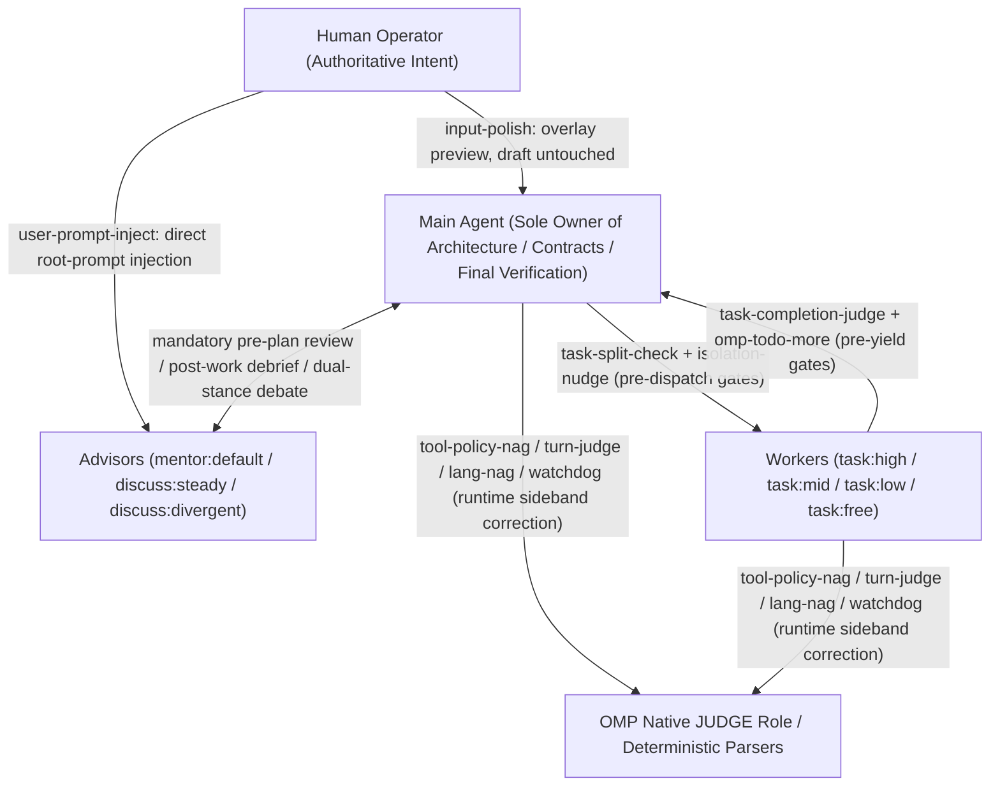
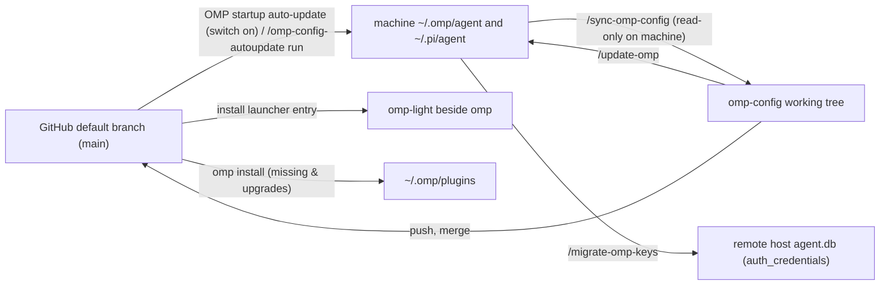

# omp-config

English | [简体中文](README.zh-CN.md)

The reviewable, version-controlled slice of an Oh My Pi (OMP) configuration, tuned for heavy engineering and long-horizon multi-agent workflows. This repository is **not** a full backup of `~/.omp`: databases (`*.db*`), session transcripts, model caches, logs, lock files, installed plugin packages and provider credentials never enter the repository.

- [Repository contents](#repository-contents)
- [Quick start](#quick-start)
- [Design](#design)
- [Sync and migration](#sync-and-migration)
- [Light mode](#light-mode)
- [Subagent system](#subagent-system)
- [Local extensions](#local-extensions)
- [Maintenance notes](#maintenance-notes)

## Repository contents

Files in this repository fall into three ownership and sync categories: repo-managed whole files, field/section-merged shared configs, and machine-owned items:

| Path | Ownership and sync policy | Content and responsibility | Machine location | When changes apply |
|---|---|---|---|---|
| `agent/config.yml` | Repo + machine field-merged | Core OMP config, UI, built-in feature switches and subagent model bindings; `LOCAL_CONFIG_FIELDS` (`modelRoles`, `theme`, `worktree`, `compaction.thresholdTokens`, etc.) and machine entries of `extensions` (such as `~/.claude`) belong to the machine | `~/.omp/agent/config.yml` | Hot-reloaded live by OMP |
| `agent/SYSTEM_TEMPLATE.md` | Repo-managed (whole file) | Vendored Handlebars base system-prompt template derived from OMP's bundled template; live tools, skills, rules and runtime fields are still rendered by OMP | `~/.omp/agent/SYSTEM_TEMPLATE.md` | Next OMP start |
| `agent/APPEND_SYSTEM.md` | Repo-managed (whole file) | Full-mode appended system prompt: user-instruction precedence, final-reply register, full design-document reading rules, and mandatory two-discussant and mentor consultation | `~/.omp/agent/APPEND_SYSTEM.md` | Next OMP start |
| `agent/PERSONALITY.md` | Repo-managed (whole file) | The `{{personality}}` block rendered under `SYSTEM_TEMPLATE.md`'s `# Personality` heading: OMP's `personality: default` preset text verbatim, followed by this repository's high-density `# Writing` register for research and analysis prose (main session only; subagents always run with `none`) | `~/.omp/agent/PERSONALITY.md` | Next OMP start |
| `agent/omomp.yml` | Repo + machine section-merged | Unified extension settings (one top-level section per extension, named after its directory): `lang-nag`, `input-polish`, `tool-policy-nag`, `task-completion-judge`, `task-split-check` and `system-prompt-replace` belong to the repo; `doc-polish`, `model-compaction` and `omp-config-autoupdate` belong to the machine (`LOCAL_OMOMP_SECTIONS`) | `~/.omp/agent/omomp.yml` | Per extension's read timing |
| `agent/thinking-translator.json` | Repo + machine field-merged | 5-model fallback chain and minimum reasoning effort for the [thinking translation](#thinking-translation) plugin (`omp-thinking-translator`) | `~/.omp/agent/thinking-translator.json` | Start of the next message |
| `agent/config-light.yml`, `agent/APPEND_SYSTEM_LIGHT.md`, `agent/omp-light.ts` | Repo-managed (whole file) | [Light mode](#light-mode) config overlay, appended prompt (currently empty) and cross-platform launcher source; the updater also installs the entry into the directory of `omp` on PATH | `~/.omp/agent/` + `omp`'s bin directory | Next `omp-light` run |
| `agent/agents/*.md`, `README*.txt` | Repo-managed (whole file) | 7 custom [subagent definitions](#subagent-system) and verified authoring pitfalls (`README.txt` / `README.zh-CN.txt`) | `~/.omp/agent/agents/` | Next subagent dispatch |
| `agent/extensions/<name>/*.ts`, `agent/extensions/_shared/*.ts` | Repo-managed (whole file) | 19 local extension modules, shared `_shared/` helpers and the standalone updater script `omp-config-autoupdate/omp-config-update.ts` | `~/.omp/agent/extensions/` | Next OMP start |
| `agent/extensions-last/system-prompt-replace/*.ts` | Repo-managed (whole file) | The [system-prompt-replace](#system-prompt-replace) extension, run after every other path-loaded extension (`README*.md` in that directory stay in the repo and are not synced) | `~/.omp/agent/extensions-last/` | Next OMP start |
| `PROMPT-INJECT-*.md`, `TURN-JUDGE-*.md`, `INTENT-*.md` | Repo-owned when shipped by repo; host-owned when created on machine | Injection and judgment templates inside `user-prompt-inject/`, `turn-judge/` and `tool-policy-nag/` | Matching extension directory | Next dispatch / next turn / next call |
| `APPEND_SYSTEM_MODEL.md`, `WATCHDOG-*.md` | Machine-owned (repo ships none) | Per-model prompt blocks under `append-system-model/` and third-party reviewer specs under `watchdog-agent/` | Matching extension directory | Next prompt / re-read on write |
| `pi/agent/pi-bansos-relay-state.json` | Repo + machine field-merged | `pi-bansos` plugin relay state and status-bar setting (holds no credentials) | `~/.pi/agent/pi-bansos-relay-state.json` | Next session start or `/bansos` |
| `install-plugins.sh`, `plugin-audit.sh` | Repo-only scripts | 10 required + 1 optional [plugin declarations](#plugins) and historical drift audit script (plugins install into `~/.omp/plugins/`) | — | Installed/upgraded by updater, active after restart |
| `.omp/commands/*.md` | Repo-only command specs | Full execution rules for `/update-omp`, `/sync-omp-config` and `/migrate-omp-keys` | — | Invoked from a session at repo root |
| `ci/`, `.github/workflows/config-check.yml` | Repo-only CI | Real-session configuration check in an isolated HOME (`bun ci/check.ts`); design and criteria in `ci/README.md` | — | Manual run or GitHub Actions |
| `package.json`, `biome.json`, `tsconfig.json` | Repo-only dev tooling | `bun run check` runs Biome format/lint and strict `tsc --noEmit` type-checking | — | Run during development and sync validation |

## Quick start

Run all maintenance slash commands after starting `omp` at the repository root.

**Setting up a new machine:**

1. Run [`/update-omp`](#update-omp-repo--machine): it preflights and writes all managed configs, extensions and the updater `omp-config-update.ts`, installs the `omp-light` launcher, and runs `omp install` for every plugin declared in `install-plugins.sh` (missing ones are installed, installed ones are upgraded).
2. To use Claude Code's `skills/`, `rules/`, `commands/` and `hooks/` in OMP, add `~/.claude` at the start of `extensions` in the machine's `~/.omp/agent/config.yml`. That entry belongs to the machine (the updater keeps it ahead of repo entries, `/sync-omp-config` never writes it back to the repo, and `omp-light` passes it back via `-e`). Do not add it on a machine without `~/.claude`, or every start reports a load failure.
3. Restart `omp` so base templates, appended prompts, extensions and plugins load.
4. To pull and apply updates from the GitHub default branch at every `omp` start, run `/omp-config-autoupdate on` (machine-local switch, off by default, effective from the next start).
5. Run [Post-migration checks](#post-migration-checks) to confirm the state; to copy provider login credentials from an old machine, run [`/migrate-omp-keys <new machine SSH target>`](#credential-migration-migrate-omp-keys-target) on the old machine.

**Bringing machine edits back into the repository:** run `/sync-omp-config check` to inspect differences, then [`/sync-omp-config`](#sync-omp-config-machine--repo) to write them into the repository, commit and push. When automatic update is on, any new commit on the default branch overwrites the machine's managed items at the next start, so un-synced local edits to managed items are lost.

## Design

### Scope and core premises

This configuration is not an `ultracode`-style black-box solver for large tasks; it is a **closed-loop runtime control system** built around OMP's native workflow. Its design rests on four empirically observed premises:

1. **Models do not follow the system prompt reliably (broken-windows effect)**: frontier models led by Claude follow prompt rules selectively. Once a model starts bypassing built-in tool conventions (for example shelling out to `cat`/`sed`/`rg` or `python -c` instead of `read`/`edit`/`grep`), other engineering constraints (`CLAUDE.md` and `*.rule.md` included) tend to fail with them. Prompting alone is insufficient: the runtime must bind writes to observed snapshots, detect tool drift as it happens, and inject targeted reminders before drift spreads.
2. **Context is aligned intent state, not a mere file cache**: in a long-horizon task, the context holds requirements, trade-offs, ruled-out paths and intent aligned with the human operator. Every compaction — and every lossy shortcut such as grepping instead of reading in full — destroys aligned intent.
3. **Code-generation skill $\neq$ planning judgment or rule-following**: low-cost and free models are unsuitable for a human to drive directly, yet make highly efficient workers on bounded slices once architecture and cross-slice contracts remain with the parent agent and hard gates check both dispatch and completion.
4. **Occasional over-continuation is cheaper than constant operator interruption**: stateful Todo lifecycle reminders and sideband native judgments (OMP's `JUDGE` role) keep the agent moving through minor setbacks, reserving human attention for genuine architectural trade-offs and external blockers.



### Failure-mode and countermeasure matrix

The table below maps every local extension (all 20), core plugin and config mechanism to the exact model failure mode or harness gap it counters:

| Category | Model failure mode / harness gap | Lifecycle hook | Countermeasure (extension / plugin / config) | Action mechanism | Light mode |
|---|---|---|---|---|---|
| **Behavioral drift & side effects** | Model edits files blindly, overwrites unread lines or drifts on line numbers | `read` / `edit` call | `config.yml` (`edit.mode: hashline`) | Requires a non-`:raw` `read` snapshot tag before any anchored `edit` | Yes |
| **Behavioral drift & side effects** | Model edits files without a plan, or stops early to ask the user after a minor setback | Pre-`edit` / turn end | Plugin [omp-todo-more](#todo-more) (`todo`) | Blocks `edit` when Todo is empty; auto-reminds to continue while open items remain (unless asking the user); requires a git commit clause on `DONE` | Yes |
| **Behavioral drift & side effects** | Model bypasses built-in tools via shell/eval (broken-window signal) or chains opaque multi-program write pipelines | Main-session `tool_call` | [tool-policy-nag](#tool-policy-nag) + `INTENT-policy.md` | Never blocks calls; `intent` lane asks native JUDGE which built-in tool owns the call (or `form` counts and nudges); `risk` lane synchronously flags long multi-program write commands | No |
| **Behavioral drift & side effects** | Model drifts from verification rules or substitutes an easier problem mid-run, or claims completion unverified | Every $N$ actions / turn end | [watchdog-agent](#watchdog-agent) + [turn-judge](#turn-judge) | `watchdog-agent` reviews the branch per `target` and injects `<watchdog>`; `turn-judge` asks native JUDGE per turn and types a preset correction prompt past threshold | No |
| **Behavioral drift & side effects** | Model loses its target reply language after server-side or local compaction | Main `agent_end` → next `input` | [lang-nag](#lang-nag) | Classifies the first 200 chars of the reply's final paragraph; on mismatch, prepends `说中文` to the user's next real input without re-running the finished turn | No |
| **Echo chambers & worker shortcuts** | `mentor` and `discuss` see only the spawning agent's selective retelling and become echo amplifiers | Every subagent `context` (IRC wakes included) | [user-prompt-inject](#user-prompt-inject) + `PROMPT-INJECT-user-goal.md` | Walks `parentId` to the root session, extracts all human user prompts and prepends them to every advisor model call to audit the advisee's framing against the user's words | No |
| **Echo chambers & worker shortcuts** | Main agent stuffs multiple unrelated topics into one worker or caps report length, truncating evidence | `task` / `fork_task` `tool_call` | [task-split-check](#task-split-check) | Concurrent `gpt-6-1-sol` check: blocks multi-topic items once (unchanged redispatch passes) and permanently blocks report-length caps | No |
| **Echo chambers & worker shortcuts** | Multiple concurrent writing workers share one working tree and clobber each other's edits | `task` `tool_call` | [isolation-nudge](#isolation-nudge) | Blocks once per prompt hash when $\ge 2$ un-isolated writers would share the directory, asking for `isolated: true` | No |
| **Echo chambers & worker shortcuts** | Low-tier worker (`task:low/mid/free`) calls `yield` before finishing the assignment or updating Todo | Subagent `yield` `tool_call` | [task-completion-judge](#task-completion-judge) | Checks assignment, tool history and submission with `gpt-6-1-sol`: bounces once for `NOT_DONE` and once for open Todo items via `omp-todo-more:read`, attaching `completion_judge` on pass | No |
| **Context loss & amnesia** | 1.5M+ chars of design context or nuanced human alignment cannot be summarized into a short `task` `context` string | Subagent dispatch | [fork-task](#fork-task) (`fork_task`) | Clones the caller's (or a `from` agent's) persisted conversation as the child's starting transcript, with optional `shake: true` elision | No |
| **Context loss & amnesia** | Main session loses completed task history and subagent topology after compaction | On `todo` change / post-compact | Plugin `omp-todo-more`'s [ctx](#ctx) + [Task log](#task-log) | Appends every successful `todo` mutation to `task-log/<agent-id>.md`; automatically injects `ctx list` and the replayed timeline after main-session compaction | Yes |
| **Prompt layering & model variance** | Built-in tool protocols are duplicated across templates or contradict local dispatch/read rules | Every `before_agent_start` (runs last) | [system-prompt-replace](#system-prompt-replace) | Rewrites rendered built-in and plugin tool descriptions in place with `inlineToolDescriptors: "on"` | No |
| **Prompt layering & model variance** | OMP native prompts and compaction thresholds cannot match model families by regex | Every `before_agent_start` | [append-system-model](#append-system-model) + [model-compaction](#model-compaction) | Appends per-model prompt blocks and writes `"provider/id": "f<N>"` runtime compaction triggers by `model`/`provider` regex | Yes |
| **Harness & environment patches** | OMP does not scan repo-level `.claude/rules` or `.pi/rules` by default | `session_start` / `before_agent_start` | [repo-rules](#repo-rules) | Scans `.claude/rules`, `.agents/rules` and `.pi/rules` from `cwd` up to the git root and injects deduplicated rules | Yes |
| **Harness & environment patches** | Only a human can type `/wt`, `/move` or `/restart` in the TUI; the main agent cannot manage its own session worktree or restart | Main TUI session when idle | [wt-tool](#wt-tool) (`wt`/`wt_remove`) + [harness-restart](#harness-restart) | Queues and runs TUI slash-command dispatchers after the turn ends for worktree creation, two-phase verified removal and session-resuming restart | Yes |
| **Harness & environment patches** | Runaway descendant processes (including reparented orphans) exhaust host RAM | macOS every 250 ms | [child-memory-warning](#child-memory-warning) | Samples descendant `phys_footprint` via Bun FFI `libproc` and alerts the main UI and agent past 4 GiB | Yes |
| **Harness & environment patches** | `--model` with a `commandcode` model fails auth due to `models.db` cache shadowing or built-in provider name collision | `session_start` | [commandcode-model-spec](#commandcode-model-spec) | Detects catalog models in `commandcode-models.json` running with `api !== "commandcode-custom"` and rebinds them to the live plugin model | Yes |
| **UX & fleet maintenance** | Operator drafts need motivating polish, long docs need meaning-preserving restructuring, and multi-machine configs need atomic sync | Chord / command / startup | [input-polish](#input-polish) + [doc-polish](#doc-polish) + [omp-config-autoupdate](#omp-config-autoupdate) | `Ctrl+Enter` streams a draft rewrite in an overlay; 3-agent pipeline writes `/tmp/doc-polish` reviews; child process auto-applies default-branch commits at startup | `doc-polish`: No; others: Yes |

### Context management and output registers

- **Never buy apparent context savings with lossy shortcuts**: grepping instead of reading in full hardens partial snippets into false beliefs; chaining many operations into one long bash widens side effects and obscures failures; piping external command output through `head` or `tail` drops decisive evidence. Use built-in tool paging and default ordering, put disposable execution into ordinary `task` subagents, and use `fork_task` when the child needs the full aligned conversation background.
- **Treat the final reply as the sole deliverable (`agent/APPEND_SYSTEM.md`)**: write prose in complete sentences with explicit subjects, identify every object on first mention, place decisive evidence (`path:line`, command and observed output, or before/after values) next to each conclusion, and never explain by analogy.
- **High-density register for research and analysis prose (`agent/PERSONALITY.md` `# Writing`)**: open paragraphs with the finding, number or mechanism; carry time, actor, action, scale and source in one sentence; put multiple objects or metrics in one table without restating rows in prose; cut process narration, repeated explanations, stacked disclaimers and summary recaps. Every paragraph must pass the deletion test: if deleting it leaves the reader's grasp of the facts, numbers, mechanism, conditions and conclusions unchanged, cut it.

## Sync and migration



State moves between the repository and a machine through three maintenance commands (full procedural rules in `.omp/commands/*.md`; exact updater write/delete rules in the header of `agent/extensions/omp-config-autoupdate/omp-config-update.ts`):

| Command / entry | Direction | Trigger | What it writes | `check` mode |
|---|---|---|---|---|
| `omp-config-update.ts auto` | GitHub `main` → machine | Automatically at startup (when `/omp-config-autoupdate on`), or on demand via `/omp-config-autoupdate run` | When the commit changed: updates managed configs, `omp-light`, installs/upgrades plugins, runs git-diff deletions and legacy relocations, then records `.omp-config-applied` | — |
| `/update-omp [check]` | Working tree → machine | Run inside OMP started at repo root | Applies the working tree (uncommitted edits included) to managed items, `omp-light` and plugins; runs `./plugin-audit.sh` to ask about uninstall candidates and missing machine-local init items; **no** git-diff deletions and **never** writes `.omp-config-applied` | Read-only report of differences and uninstall candidates; writes nothing |
| `/sync-omp-config [check]` | Machine → working tree | Run inside OMP started at repo root | **Read-only on the machine** (machine mtimes untouched); edits managed file and plugin-list diffs into the repo, validates, and in full mode commits (`chore: sync snapshot with local omp config`) and pushes | Runs step 1 comparison only and reports differences |
| `/migrate-omp-keys <target>` | Machine → remote host | Run in any local session | Backs up remote `agent.db` over SSH, replaces `auth_credentials` in one transaction and clears cooldown/lease tables | — |

### Rules shared by both directions

1. **Four structured configs are compared and merged by field or section**: `agent/config.yml`, `agent/omomp.yml`, `agent/thinking-translator.json` and `pi/agent/pi-bansos-relay-state.json` must all parse (`Bun.YAML.parse` / `JSON.parse`) before any write. `/sync-omp-config` edits only differing lines in the repository without re-serializing whole files; the updater overlays repository keys onto the machine's mapping, copies the repository file verbatim when the merged result equals it, and otherwise re-serializes keeping key order (via atomic temp-file + `rename`, writing through symlinks to preserve the link). An unparsable machine copy of any of those four files aborts the switch with an error; `config-light.yml` is copied whole as a plain file.
2. **Machine-local fields and list entries are isolated in both directions**:
   - `config.yml`'s `LOCAL_CONFIG_FIELDS` (`providers.webSearchOrder`, `modelRoles`, `defaultThinkingLevel`, `skills`, `symbolPreset`, `theme`, `colorBlindMode`, `hideThinkingBlock`, `statusLine`, `terminal`, `tui`, `display`, `worktree`, `compaction.thresholdTokens`) and host-only keys not present in the repository are untouched in both directions and never filled in from the repository when absent on the host.
   - `config.yml`'s `extensions` (`MACHINE_LIST_FIELDS`) is shared: machine-only entries (such as `~/.claude`) stay **ahead** of repository entries so `extensions-last/system-prompt-replace/index.ts` remains last, and `/sync-omp-config` never writes machine entries into the repository.
   - `omomp.yml`'s machine-local sections `LOCAL_OMOMP_SECTIONS` (`doc-polish`, `model-compaction`, `omp-config-autoupdate`) belong to the machine and are neither written by the updater nor synced back.
3. **Inside extension directories, only code and three shipped template globs belong to the repository**: `extensions/<name>/*.ts`, `extensions-last/<name>/*.ts`, `extensions/user-prompt-inject/PROMPT-INJECT-*.md`, `extensions/turn-judge/TURN-JUDGE-*.md` and `extensions/tool-policy-nag/INTENT-*.md`. `APPEND_SYSTEM_MODEL.md`, `WATCHDOG-*.md` and machine-authored templates in those directories belong to the machine.
4. **App-managed files are skipped in both directions**: any file whose first line is `// @orca-managed-pi-extension` or that contains `marker: _otty` anywhere (such as `orca-*.ts` or `otty-integration.ts`) is checked before every overwrite or delete and left alone.
5. **The machine's `settings.json` and runtime state are never migrated**: `settings.json` (OMP ignores its extension package roots when `config.yml` exists, but still loads its TS/JS module entries), `*.db*`, WAL, `*.lock`, `models.yml`, `commandcode-models.json`, `last-changelog-version`, `sessions/`, `terminal-sessions/`, `blobs/`, `cache/`, `logs/`, `.omp-config-applied` and the `omp-light` / `omp-light.cmd` installed beside `omp` stay out of the repository. When a machine lacks `~/.pi/agent/pi-bansos-relay-state.json` because `/bansos` never wrote it, `/sync-omp-config` leaves the repository's file intact.

### Automatic update at startup

The [omp-config-autoupdate](#omp-config-autoupdate) extension spawns `omp-config-update.ts auto` in the background when the root main session starts, serialized by the lock directory `~/.omp/omp-config-update.lock` (which records the holder PID so a dead process's stale lock is taken over):

1. **Fetch and commit check**: maintains a shallow clone of `https://github.com/oh-my-omp/omp-config.git` (`main`) in `~/.omp/omp-config-src` (automatically repointing a legacy `mouriya-s-lab/omp-config.git` origin, and erroring without touching any other origin). A failed fetch (offline, first clone included) applies nothing: the local clone is never used as a stand-in for GitHub. When the fetched commit matches `<agent dir>/.omp-config-applied`, it exits; when different, it dynamically imports `applySnapshot` from the fetched clone so a commit is applied by its own rules.
2. **Preflight, plugin readiness and write order**: validates all structured files and plans every operation first, runs `omp install` for every entry in `install-plugins.sh`, and queries OMP's owner catalog to confirm `omp-todo-more` is enabled with a valid `./index.ts` entry. Once ready, operations run in order: **moves → plain files → JSON → `config.yml` → deletions**. Any move/write error skips the entire deletion phase and reports `Cutover incomplete; do not restart OMP`; `.omp-config-applied` is written only after an error-free run.
3. **Git-derived deletions and flat-layout relocations (RELOCATIONS)**:
   - `auto` mode computes general deletions from git's `applied..HEAD` diff: removed managed files, dropped structured keys and dropped `extensions` entries.
   - Both `auto` and `/update-omp` run flat-layout relocations: deleting flat `extensions/<name>.ts` modules superseded by `<name>/index.ts` and the old root `omp-config-update.ts`; importing legacy standalone JSON configs (`extensions/<name>/<name>.json`, root `system-prompt-replace.json`, etc.) once into sections of `omomp.yml` and deleting the old files; moving root host data (`APPEND_SYSTEM_MODEL.md`, `WATCHDOG-*.md`, etc.) into their extension directories when free; and dropping the retired `~/.omp/agent/extensions-last/system-prompt-replace.ts` entry from `config.yml`. A machine whose installed updater still sits at the old root path fails auto-update with `has no agent/omp-config-update.ts` and needs one manual `/update-omp`.
4. **Effect timing and notifications**: `config.yml` hot-reloads; `APPEND_SYSTEM_MODEL.md`, the `system-prompt-replace`, `tool-policy-nag`, `task-split-check` and `task-completion-judge` sections of `omomp.yml`, `TURN-JUDGE-*.md`, `PROMPT-INJECT-*.md` and `agents/` apply from the next prompt, turn, tool call or dispatch; `SYSTEM_TEMPLATE.md`, `APPEND_SYSTEM.md`, `PERSONALITY.md`, extension code and plugins require a restart. Error-free changes show one summary info notification (with a restart reminder when needed); errors show a warning (run `/omp-config-autoupdate run` for the itemized report).

### `/update-omp`: repo → machine

Runs `bun agent/extensions/omp-config-autoupdate/omp-config-update.ts apply --source .`. It shares all write, plugin install/upgrade, relocation and Todo/`ctx` retirement rules with automatic update, with four differences:

- No git baseline exists for the working tree, so no general file or structured-key deletions run.
- `.omp-config-applied` is never written (if automatic update is on, push and merge local changes to `main` before the next start or the default branch will overwrite them).
- Runs `./plugin-audit.sh` and asks before uninstalling `[卸载候选]` (uninstall candidates) via `omp plugin uninstall <name>`.
- Checks machine-local initialization items (`omomp.yml`'s `doc-polish` section and `commandcode-models.json`): when missing, asks whether to create them and with what content, skipping without confirmation.

### `/sync-omp-config`: machine → repo

Scans `~/.omp/agent` and `~/.pi/agent/pi-bansos-relay-state.json` read-only:

- Stops immediately if the machine still has flat `extensions/<name>.ts` files (outside the excluded retired Todo/`ctx` paths) and asks for `/update-omp` first, so a flat layout is never misread as deleting the repository's extension directories.
- Diffs managed files and `~/.omp/plugins/package.json` dependencies against `install-plugins.sh` (keeping URL/Git specs verbatim, stripping npm version ranges, and leaving commented optional plugins commented).
- Validates after writing the repository: plain files are `cmp`-identical, structured files match field by field outside machine-local fields, YAML/JSON parse, `bun run check` passes, no plaintext credentials (`sk-`, `ghp_`, overlong `apiKey:` values) or runtime files appear in `git status --short`, and in full mode commits and pushes.

### Plugins

Plugin packages live in `~/.omp/plugins/` as runtime state outside the repository (only `pi-bansos`'s state file `~/.pi/agent/pi-bansos-relay-state.json` is tracked). `install-plugins.sh` declares 10 required plugins and 1 commented-out optional plugin, all unpinned; every updater apply runs `omp install` on each required entry to install missing plugins and upgrade installed ones:

| Declared source (`install-plugins.sh`) | `omp plugin list` package name | Category | Exposed tools / commands / skills / capabilities | Coupling with repository config and extensions |
|---|---|---|---|---|
| `https://github.com/oh-my-omp/omp-todo-more` | `omp-todo-more` | Required (GitHub) | Tools: `todo`, `ctx`; command: `/todo-more`; event: `omp-todo-more:read`; Tern pane widget | Replaces native Todo (`todo.enabled: false`); enforces goal + time budgets, blocks `edit` when Todo is empty, binds `DONE` to git commits, restores `todo` on `task:*` subagents, owns task log + post-compact injection, and serves synchronous read projections to `task-completion-judge` |
| `https://github.com/oh-my-omp/omp-unified-exec` | `omp-unified-exec` | Required (GitHub fork) | `xd://` tools: `exec_command`, `write_stdin`, `set_on_exit`, `monitor`, `kill_session`, `list_sessions` | Maintained fork of `iamwrm/pi-unified-exec`: skips Pi-only `createCodemodeExtension` and uses Bun's native `Bun.Terminal` for PTY on macOS, Linux and Windows under Bun 1.4+ (loading `node-pty` only under Node.js). Uninstall `pi-unified-exec` first if present |
| `https://github.com/mouriya-s-lab/pi-bansos` | `pi-bansos` | Required (GitHub fork) | Provider: `bansos` (OpenCode Zen / KiloCode free-model proxy); command: `/bansos` | Fork of `mannnrachman/pi-bansos`; supplies zero-cost models for `task:free`, with state file `pi-bansos-relay-state.json` synced both ways. Uninstall npm `pi-bansos` first if present |
| `pi-commandcode-provider` | `pi-commandcode-provider` | Required (npm) | Provider: `commandcode` (`api: "commandcode-custom"`); command: `/commandcode-quota` | Generates machine-local `commandcode-models.json` consumed by `thinking-translator.json` and `doc-polish`; paired with local extension `commandcode-model-spec` to fix `--model` startup resolution |
| `https://github.com/oh-my-omp/omp-thinking-translator` | `omp-thinking-translator` | Required (GitHub) | Live Chinese translation renderer for visible thinking blocks + late-row notifications; command: `/thinking-translator` | Reads the ordered model chain in managed `~/.omp/agent/thinking-translator.json` |
| `https://github.com/oh-my-omp/omp-playbooks` | `tern-playbooks` | Required (GitHub) | `xd://` tools: `playbook_open`, `playbook_read`, `playbook_edit`, `playbook_compile`, `playbook_check`, `playbook_run`, `playbook_timeline`, `playbook_launch`; CLI: `tern-playbook` | Collaborative YAML Playbook service and Tern side-pane UI: supports block editing, external reference expansion, `eval` `judge` checks, Run timelines and frozen subagent Launches with live `block_changed` notices |
| `https://github.com/oh-my-omp/omp-codex-image-gen` | `omp-codex-image-gen` | Required (GitHub) | `xd://` tool: `codex_generate_image`; skill: `imagegen` | Uses a ChatGPT Plus/Pro Codex subscription to generate or edit PNGs from 1–5 reference images via `gpt-image-2` |
| `pi-schedule` | `pi-schedule` | Required (npm) | `xd://` tool: `schedule`; skill: `schedule` | Recurring and delayed agent actions (`prompt`/`shell`/`notify`/`message`) with single-flight locks, run ledger and privilege tiers |
| `pi-package-search` | `pi-package-search` | Required (npm) | `xd://` tools: `search_pi_packages`, `install_pi_package`; skill: `pi-package-search` | Searches npm for `pi-package` extensions and installs them when explicitly requested |
| `pi-pretty-codeblocks` | `pi-pretty-codeblocks` | Required (npm) | TUI `Markdown.prototype.render` patch | Hides Markdown code fences in the TUI and removes default 2-column code indentation while preserving ANSI syntax highlighting |
| `# https://github.com/oh-my-omp/omp-remote-build` | `omp-remote-build` | Optional (commented out by default) | `xd://` tools: `container_exec`, `container_write_stdin`, `container_list_sessions`, `container_kill_session` | Per-worktree Mutagen replica and Komodo-managed build container on a remote Docker host; requires `omp-unified-exec`, Mutagen, km CLI and an SSH build host. Deliberately unquoted in the comment so `plugin-audit.sh` classifies a local install as `[保留]` (keep) |

`./plugin-audit.sh` is read-only: it extracts single-quoted entries inside `plugins=( … )` from committed versions of `install-plugins.sh` across `5974c4fa..HEAD` and compares them against `omp plugin list --json` in four categories: `[安装]` (required by script, missing on machine — installed by updater), `[卸载候选]` (in history, removed from `HEAD`, still installed — `/update-omp` asks before uninstalling), `[保留]` (never in script, user-installed — untouched), and `[已同步]` (in sync). Commit changes to `install-plugins.sh` before running the audit.

### Thinking translation

`omp-thinking-translator` reads its candidate chain from `~/.omp/agent/thinking-translator.json`, starting every translation request at the first entry and falling back to the next only on failure (unregistered model, auth error, stream failure or empty output); the file is re-read at the start of the next message. The repository's 5-model chain is:

1. `futureppo-pool/deepseek-v4.1-flash` (`effort: "low"`)
2. `futureppo-pool/grok-4.7` (`effort: "minimal"`)
3. `commandcode/inclusionai/ling-3.1-flash:free` (`effort: "minimal"`)
4. `commandcode/poolside/laguna-s-2.1-free` (`effort: "minimal"`)
5. `commandcode/stealth/glyph-cluster:free` (`effort: "minimal"`)

Auto-discovered compatibility metadata for `futureppo-pool` omits `reasoning_effort` by default. When using the first two models, add per-model overrides under the existing provider in the machine's `~/.omp/agent/models.yml` (machine-local, never synced):

```yaml
providers:
  futureppo-pool:
    modelOverrides:
      deepseek-v4.1-flash:
        compat:
          supportsReasoningEffort: true
      grok-4.7:
        compat:
          supportsReasoningEffort: true
```

After editing `models.yml`, restart OMP, run `/thinking-translator status` to check the candidate order and efforts, and trigger a real thinking translation to verify that upstream requests carry `reasoning_effort`.

### todo-more

[omp-todo-more](https://github.com/oh-my-omp/omp-todo-more) is an independent OMP/Tern plugin loaded in both full and light mode while native Todo remains off (`todo.enabled: false`):

- **State authority and projections**: the `mouriya.omp.todo-more` custom entry on the current session branch is the sole authoritative state (holding the `{objective, measure, doneWhen}` goal and each item's `{title, explanation}`, minute budget and git commit SHA); the host `TodoTracker`, `/todo` UI and historical cards are projections derived from it. Its `planning.ts` wrapper blocks `edit` whenever the Todo list is empty, and `before_agent_start` re-attaches `todo` to `task:*` subagents from which the host executor stripped it.
- **Interactive editor**: `/todo-more` in OMP/Tern edits the goal or item explanations directly (Enter inserts a newline, Tab/Shift+Tab switches fields, Ctrl+Enter saves, Esc discards), committing only the edited field on the current branch without altering status/order or starting a model turn.
- **Cross-module read contract**: `task-completion-judge` queries the current session's read-only projection synchronously via `omp-todo-more:read` without importing plugin internals. The plugin also ships `ctx`, the task-log hook and post-compact injection under `src/ctx/` (see [ctx](#ctx) and [Task log](#task-log)).
- **Safe retirement of legacy local modules**: once the updater confirms `omp-todo-more` is enabled in OMP's catalog with its `./index.ts` entry present, both modes unlink the 8 legacy Todo paths (`extensions/todo-more/{index,tool,render,reminders,planning}.ts`, `extensions/_shared/todo-more.ts`, `extensions/subagent-todo.ts`, `extensions/subagent-todo/index.ts`) and, when the plugin includes `src/ctx`, the 5 legacy ctx paths (`extensions/ctx-tool/{index,inventory,post-compact-hint}.ts`, `extensions/ctx-tasklog/index.ts`, `extensions/_shared/task-log.ts`). Only leaf files/links are unlinked; reverse sync excludes all 13 paths.

### Manual migration

Use whole-file copying **only on a brand-new machine with no existing OMP config and no legacy local Todo modules** (machines with existing config must run `/update-omp`, because `cp -a` does not retire old Todo modules and overwrites machine-local fields in `config.yml` and `omomp.yml`):

```bash
mkdir -p "$HOME/.omp/agent"
cp agent/config.yml agent/SYSTEM_TEMPLATE.md agent/APPEND_SYSTEM.md \
  agent/PERSONALITY.md agent/omomp.yml agent/thinking-translator.json agent/config-light.yml \
  agent/APPEND_SYSTEM_LIGHT.md agent/omp-light.ts \
  "$HOME/.omp/agent/"
cp -a agent/agents agent/extensions agent/extensions-last "$HOME/.omp/agent/"
mkdir -p "$HOME/.pi/agent"
cp pi/agent/pi-bansos-relay-state.json "$HOME/.pi/agent/"
./install-plugins.sh
```

Copying files manually does not install `omp-light` on PATH: run `/update-omp` on the target afterwards (or turn on `/omp-config-autoupdate on` and restart so the first automatic apply installs the launcher).

### Post-migration checks

```bash
omp config list --json
omp plugin list --json
git status --short
```

Confirm that config values and all plugin names, versions and `enabled: true` states match expectations, and that no `*.db*`, WAL, log, session or cache files leaked into the repository working tree.

### Credential migration: `/migrate-omp-keys <target>`

Copies the `auth_credentials` table from the local `~/.omp/agent/agent.db` over SSH into the remote host's `~/.omp/agent/agent.db` (never touching the git repository):

1. Verifies `agent.db`, `ssh` and `sqlite3` on both ends, and confirms with the operator that the remote OMP process is stopped.
2. Backs up the remote database using SQLite `.backup` with a timestamp suffix.
3. Clears remote `auth_credential_blocks` and `auth_credential_refresh_leases` and replaces `auth_credentials` wholesale in a single transaction, without printing credential data or copying sessions, history or model caches.

## Light mode

`omp-light` starts a trimmed OMP process without heavy supervisory hooks for quick questions and small edits. Overrides apply only to that process and modify no files on disk:

| Dimension | Full mode (`omp`) | Light mode (`omp-light`) |
|---|---|---|
| Appended system prompt | `agent/APPEND_SYSTEM.md` | `agent/APPEND_SYSTEM_LIGHT.md` (currently empty) |
| Delegation bias (`task.eager`) | `preferred` | `default` (less proactive delegation; subagents remain available) |
| 10 local extensions disabled via `disabledExtensions` | All enabled | Disabled: `doc-polish`, `fork-task`, `isolation-nudge`, `lang-nag`, `task-completion-judge`, `task-split-check`, `tool-policy-nag`, `turn-judge`, `user-prompt-inject`, `watchdog-agent` |
| Trailing extension excluded via `extensions: []` | `system-prompt-replace` enabled | `config-light.yml` sets `extensions: []` to drop `extensions-last/system-prompt-replace` (`disabledExtensions` cannot filter file-path entries by module name); `omp-light.ts` reads the machine's `config.yml` and passes every non-`/extensions-last/` entry (such as `~/.claude`) back via `-e` |
| 9 local extensions kept enabled | Enabled | Enabled: `append-system-model`, `child-memory-warning`, `commandcode-model-spec`, `harness-restart`, `input-polish`, `model-compaction`, `omp-config-autoupdate`, `repo-rules`, `wt-tool` |
| Installed plugins (`omp-todo-more`'s `todo` and `ctx` included) | All loaded | All loaded (`disabledExtensions` does not filter plugins) |
| Tools absent compared with full mode | — | Only `polish_doc` and `fork_task` are absent; `todo`, `ctx`, `wt`, `wt_remove` and `harness_restart` remain available |

**Launcher installation:** automatic update and `/update-omp` install `agent/omp-light.ts` into the directory of `omp` on PATH (an executable `0755` `omp-light` on POSIX; `omp-light.ts` plus a generated `omp-light.cmd` on Windows). `omp-light` reads `config-light.yml` and `APPEND_SYSTEM_LIGHT.md` from `PI_CODING_AGENT_DIR` (or `~/.omp/agent` when unset), exits immediately if either file is missing, and forwards all trailing CLI arguments to `omp`.

## Subagent system

`agent/config.yml` disables all 5 bundled subagents (`task`, `scout`, `sonic`, `reviewer`, `security-reviewer`) under `task.disabledAgents`; every delegation uses the 7 custom subagents in `agent/agents/*.md`.

### Where each layer is defined

| What to change | Authoritative location |
|---|---|
| Base workflow, engineering contracts, rendered tool inventory and parent `Verify` vs subagent `Hand-off` | `agent/SYSTEM_TEMPLATE.md` (Handlebars override; plain-text `SYSTEM.md` cannot compile expressions) |
| Speaking and writing register block (`{{personality}}`) for the full-mode main session | `agent/PERSONALITY.md` |
| Main-session local policy (user precedence, final-reply rules, mandatory advisors) | `agent/APPEND_SYSTEM.md` (not inherited by subagents) |
| A subagent's tier description (`description`), permissions (`spawns`/`tools`) and role instructions | `agent/agents/<name>.md` (read `agent/agents/README.txt` first; keep notes in that directory as `.txt` to avoid parser warnings) |
| Concrete model and fallback chain per subagent | `agent/config.yml` under `task.agentModelOverrides` |
| In-place rewrites of built-in and plugin tool descriptions | `agent/omomp.yml` section `system-prompt-replace` (requires `inlineToolDescriptors: "on"`) |
| Templates injecting the human user's words into advisor subagents | `agent/extensions/user-prompt-inject/PROMPT-INJECT-*.md` |

### The seven custom subagent tiers and model bindings

The table below shows both the tier/cost contract declared in each agent's `description` (what the main agent reads when choosing a tier) and the actual model chain bound in `agent/config.yml` (update `description` and this table together whenever a binding changes tier or cost class):

| Name | Tier and blended cost in `description` (per 1M tokens) | Actual model chain in `config.yml` | Allowed `spawns` / `tools` | Role and capability boundary |
|---|---|---|---|---|
| `task:high` | Claude Opus 5.5, ~$0.45 | `anthropic/claude-opus-5-5:high` | `spawns: task:mid, task:low, task:free, task:high, discuss:steady, discuss:divergent, mentor:default` | **Forbidden without explicit user permission in the current conversation**; the only worker that may own architecture/core design and fan out one more level (depth 1 → depth 2), owning contracts, acceptance and integration for its batch |
| `task:mid` | Opus class, ~$0.30 | `openai-codex/gpt-6-1-sol:high` | `spawns: mentor:default` | **Default worker tier**: handles delegated implementation, investigation, debugging and verification outside design/core work, and adjudicates disagreements between cheaper tiers |
| `task:low` | Opus class, ~$0.01 | `openai-codex/gpt-5.6-luna:max` | `spawns: mentor:default` | Cost-first deliverable work (bulk mechanical edits, lookups, routine checks) and independent reproduction/validation of `task:free` results |
| `task:free` | Opus class, $0.00, high concurrency | `bansos/muse-spark-1.3-contributor:xhigh, opencode-go/muse-spark-1.3-contributor:xhigh, openai-codex/gpt-6-luna:max` | `spawns: mentor:default` | Zero-trust probe tier: leads, candidates and exploratory probes only; any consequential finding requires independent validation by the parent or `task:low+`, and agreement among `task:free` workers is never validation |
| `discuss:divergent` | — | `anthropic/claude-opus-5-5:medium, openai-codex/gpt-5.6-luna:max` | `tools: read, grep, glob` | Read-only expansive discussant: questions the problem framing and raises materially different alternatives with `path:line` grounding and trade-offs |
| `discuss:steady` | — | `openai-codex/gpt-5.6-sol:medium` | `tools: read, grep, glob` | Read-only conservative discussant: stress-tests proposals against the code with `path:line` citations, surfacing hidden assumptions, unhandled states, blast radius and boring alternatives |
| `mentor:default` | — | `openai-codex/gpt-5.6-sol:high, openai-codex/gpt-5.6-luna:max` | `tools: []` (`yield` only) | Tool-less mentor: sharpens activity plans into decisive questions and minimal observations before work, and audits completed work against the agreed plan before delivery; must put its answer inside the `yield` payload |

### Dispatch, verification and parallel isolation rules

- **Select tiers by cost and required trust, never by task difficulty**: use `task:mid` by default; drop to `task:low` when cost outweighs extra judgment or when validating `task:free`; never assign architecture, domain types, cross-slice contracts, or doc/prompt/skill/agent-definition design to `task:free/low/mid`.
- **Recursion depth caps at 2**: the main agent sits at depth 0 and its workers at depth 1; only `task:high` can spawn depth-2 children, which sit at the recursion cap (their `task` tool is stripped and they cannot spawn `mentor:default`) and must receive directly executable leaf assignments.
- **Always name `agent` explicitly and omit `effort`**: omitting `agent` falls to the first `spawns` entry or a disabled built-in agent; model and effort come from `config.yml` unless the user explicitly requests an override. The `task` and `sonic` overrides in `config.yml` exist solely for Vibe mode's first-level dispatch.
- **Mandatory per-slice loop for every `task:*` worker**: read the code and review a written plan with `mentor:default` before editing (unless at depth 2); initialize and maintain `todo` across the entire assignment, never yielding with open items or using `drop`/`rm` to shrink scope.
- **Verification follows the dispatch route**: ordinary `task` workers skip builds, tests and smoke runs unless explicitly assigned, leaving final verification to the main agent or an independent verifier; `fork_task` workers receive a developer notice that makes scoped build/lint/test checks and runtime verification mandatory before handoff.
- **Worktree isolation for concurrent writers (`isolated: true`)**: whenever $\ge 2$ writing workers run against the same repository concurrently, each writer must set `isolated: true` (`fork_task` defaults to `true`; research-only spawns use `isolated: false` so they remain reachable via `write agent://<id>`; plan mode forces shared directories). Pass repository-relative paths to isolated workers (absolute paths resolve back into the parent checkout), and verify `Applied patches: yes` in the result.

## Local extensions

The repository ships **20 local extensions** (19 under `agent/extensions/<name>/` and 1 under `agent/extensions-last/system-prompt-replace/`), plus the `ctx` / Task log recovery chain provided by the `omp-todo-more` plugin:

| Extension | Category | Scope | Light mode | Registered tools / commands / key hooks | Summary |
|---|---|---|---|---|---|
| [tool-policy-nag](#tool-policy-nag) | Behavior constraints | Main | No | `tool_call` (`bash`, `exec_command`, `eval`, etc.) | 3-lane monitor for built-in tool bypasses (`intent` native JUDGE / `form` counter) and opaque multi-program write commands (`risk`); reminds without blocking |
| [watchdog-agent](#watchdog-agent) | Behavior constraints | Main + Sub | No | `/watchdog` command + action-count hooks | Per-`target` runtime reviewer driven by `WATCHDOG-*.md` (chat reviewer or native JUDGE), injecting `<watchdog>` findings |
| [user-prompt-inject](#user-prompt-inject) | Behavior constraints | Subagents | No | `session_start`, `context` | Injects the root main session's human user prompts into every model call of `mentor` and `discuss` via `PROMPT-INJECT-*.md` |
| [turn-judge](#turn-judge) | Behavior constraints | Main | No | `message_end`, `input` | Judges each main-session turn via native JUDGE against `TURN-JUDGE-*.md`, typing a preset prompt past threshold or showing an info verdict |
| [lang-nag](#lang-nag) | Behavior constraints | Main | No | `agent_end`, `input` | When a reply's final paragraph is not in the target language, prepends `说中文` to the user's next real input |
| [repo-rules](#repo-rules) | Prompts & rules | Main + Sub | Yes | `session_start`, `before_agent_start` | Scans and injects deduplicated repo-level rules from `.claude/rules`, `.agents/rules` and `.pi/rules` |
| [append-system-model](#append-system-model) | Prompts & rules | Main + Sub | Yes | `before_agent_start` | Appends per-model system-prompt blocks matched by `model`/`provider` regex in `APPEND_SYSTEM_MODEL.md` |
| [model-compaction](#model-compaction) | Prompts & rules | Main writes / Sub reads | Yes | `before_agent_start`, `session_shutdown` | Sets fixed per-model automatic-compaction token triggers by regex from `omomp.yml#model-compaction` |
| [system-prompt-replace](#system-prompt-replace) | Prompts & rules | Main + Sub | No | `before_agent_start` (runs last among path-loaded) | Rewrites rendered tool descriptions in the system prompt in place using literal/regex rules in `omomp.yml#system-prompt-replace` |
| [child-memory-warning](#child-memory-warning) | Process resources | Main process-wide | Yes | `session_start`, `session_switch`, `session_shutdown` | Samples macOS descendant `phys_footprint` (surviving orphans included) every 250 ms and warns UI and main agent past 4 GiB |
| [fork-task](#fork-task) | Dispatch & delivery | Main + Sub | No | `fork_task` tool, `before_subagent_spawn` | Spawns native `task` subagents seeded with a copy of the caller's (or a `from` agent's) conversation, with optional `shake: true` |
| [isolation-nudge](#isolation-nudge) | Dispatch & delivery | Main + Sub | No | `tool_call` (`task`), `tool_result` | Blocks once per prompt hash when $\ge 2$ writing workers share the working directory without `isolated: true` |
| [task-split-check](#task-split-check) | Dispatch & delivery | Main (`split`) / Main+Sub (`report-limit`) | No | `tool_call` (`task`, `fork_task`) | Concurrent model gate blocking multi-topic dispatches once (redispatch passes) and permanently blocking report-length caps |
| [task-completion-judge](#task-completion-judge) | Dispatch & delivery | `task:low/mid/free` | No | `tool_call` (`yield`) | Intercepts structured `yield` to verify completion against the assignment, tool calls and Todo state, bouncing at most once per reason |
| [doc-polish](#doc-polish) | User tools | Main + Sub | No | `polish_doc` tool, `/polish-doc` command | 3-stage split/polish/check pipeline that writes before/after/comment reviews under `/tmp/doc-polish/` without touching source files |
| [input-polish](#input-polish) | User tools | Main TUI | Yes | Raw terminal-input listener (`ctrl+enter`) | Streams a motivating draft rewrite into an input-box overlay on the configured chord; `Enter` accepts and submits, `Esc` cancels |
| [wt-tool](#wt-tool) | Session moves | Main TUI | Yes | `wt`, `wt_remove` tools | Lets the main agent run `/wt` after the turn ends to enter a new worktree, or return to main checkout and remove the worktree after a 2-step check |
| [harness-restart](#harness-restart) | Session moves | Main TUI | Yes | `harness_restart` tool | Lets the main agent invoke `/restart` with a durable reason marker that is delivered back into the resumed session |
| [omp-config-autoupdate](#omp-config-autoupdate) | Sync & compat | Root main | Yes | `/omp-config-autoupdate` command, `session_start` | Manages the machine-local startup auto-update switch, spawns `omp-config-update.ts auto`, and posts full reports on `run` |
| [commandcode-model-spec](#commandcode-model-spec) | Sync & compat | Main + Sub | Yes | `session_start` | Rebinds `--model` selections from `commandcode-models.json` back to the plugin's live `commandcode-custom` model when shadowed |

### Layout and development conventions

OMP scans one level under `~/.omp/agent/extensions/`: every extension in this repository uses `<dir>/index.ts` as its sole entry (the directory name is the extension id `extension-module:<name>`), while sibling `.ts` files are private modules. Shared mechanics live in `agent/extensions/_shared/` (no `index.ts`, so never loaded as an extension), keeping retry, timeout, throttling and wording policy in the caller:

| `_shared` module | Exported helpers and responsibility |
|---|---|
| `errors.ts` | `errorText(error)`: converts unknown exceptions into safe strings |
| `messages.ts` | `textOf`, `lastAssistantText`: extracts plain text blocks from messages |
| `omomp.ts` | `defineOmompSection`, `loadOmompSection`, `writeOmompSection`: binds an extension directory name to its section in `omomp.{yml,yaml,json,toml}` (project `<cwd>/.omp/omomp.*` wins over `<agentDir>/omomp.*`; ambiguous or invalid files are recorded in `skipped`) |
| `models.ts` | `resolveModelChain`, `findModel`, `splitLevel`: parses `provider/id[:effort]` and comma fallback chains against available models without sending requests |
| `helper-session.ts` | `runHelperPrompt`: runs a one-shot prompt in a tool-less, extension-less in-memory helper session with `taskDepth: 1` and never throws |
| `judge.ts` | `openNativeJudge`: resolves the current session's `@judge` role through the host role parser and returns a live `Judge` only when the resolved model uses a native judgment API (`isJudgmentApi`) |
| `spec-files.ts` | `discoverSpecFiles`, `parseFrontmatter`, `unquote`: discovers and parses `*-<label>.md` files in the extension directory and from `cwd` up to the git root (including `.omp/` at each level) |

**Code conventions (enforced by `bun run check` and CI's `code` job):**
- **Formatting and types**: Biome only (tabs, double quotes, semicolons, trailing commas, width 140 via `bun run format`); `tsc --noEmit` with `strict` and `noUncheckedIndexedAccess`, no `any`; parse external input once at the boundary with `z` from `@oh-my-pi/pi-coding-agent`, and use `as` only on host types that cannot be checked at runtime with a one-line comment.
- **State and error handling**: model multi-branch state as a union discriminated by `kind` with an exhaustive `switch` and `never` arm; return result unions for expected failures, and catch all exceptions at hook/tool boundaries with `pi.logger.warn(…, { error: errorText(error) })`.
- **Session identity, paths and attribution**: distinguish main vs subagent via `ctx.agent.kind` (`"main" | "sub"`); locate extension-owned templates via `import.meta.dir`; pass `attribution: "agent"` on every extension-injected `sendUserMessage`; import only host package roots (`pi-agent-core`, `pi-ai`, `pi-catalog`, `pi-coding-agent`, `pi-natives`, `pi-tui`, `pi-utils`) or subpaths verified in a real session without `node_modules`.

### Behavior constraints

`turn-judge`, the `intent` lane of `tool-policy-nag` and the option backend of `watchdog-agent` share OMP's **JUDGE model role** (`_shared/judge.ts`). Configure `judge` once in OMP's model selector to a native judgment API model (such as `futureppo-jev/decision-model-preview`) and all three activate automatically; when `judge` points at an ordinary chat model or is unset, native judgments stay silently inactive without falling back to a chat model. Role changes apply on the next trigger without restart.

#### tool-policy-nag

Acts on the main session only, inspecting `bash`, `bash_bg`, `exec_command` (including JSON written to `xd://bash`, `xd://bash_bg`, `xd://exec_command`) and `eval` at `tool_call`; **it only reminds and never blocks a call**. Three independent lanes are configured in the `tool-policy-nag` section of `omomp.yml` (re-read per watched call from project `.omp/omomp.*` then agent-dir `omomp.*`; set a lane to `null` to turn it off; legacy single-detector `{detector: "heuristic"|"jev"}` shapes still parse):

```yaml
tool-policy-nag:
  form:
    detector: heuristic
  intent:
    threshold: 0.5
  risk:
    minCommands: 4
    minChars: 600
    minPrograms: 3
```

- **Shared delivery between the two tool lanes (`intent` vs `form`)**: when `intent` is declared, adjacent `INTENT-policy.md` is valid and enabled, and native JUDGE is available, `intent` owns reminder delivery while `form` still counts, logs and updates its branch state silently; otherwise `form` delivers. If a native JUDGE request fails or hits its 90s timeout, it warns once per reason and does not fall back to `form`.
- **`form` lane (heuristic command/code parser)**:
  - Parses pipes, semicolons, quotes, heredocs, command substitutions and redirects (skipping `sudo`/`doas`/`su`/`ssh`; pipelines effectively ending in `wc` exempt preceding list/read/search steps; `/dev/*` targets exempt read/search/edit/write). Counts six shell violation classes (directory listing `ls`/`find`, file reading `cat`/`head`/`tail`/`sed -n`, searching `grep`/`rg`/`awk`, in-place editing `sed -i`/`perl -i`/`mv`, redirected file writes, inline scripts `python -c`/`node -e`/`bun -e`) and `eval` file/directory calls (`Path.read_text`, `open`, `Bun.file`, `readFileSync`, `os.listdir`, etc.).
  - Records the first 3 hits silently; from the 4th hit on, steers `"你为什么不遵守system prompt。"` with a UI warning, up to 3 times per context before entering `exhausted` until the next compaction, `/clear` or `branch_summary`. State persists in session custom entry `mouriya.omp.tool-policy-nag.state` and rebuilds per branch.
- **`intent` lane (native JUDGE tool-routing classification)**:
  - Sends one non-blocking parallel JUDGE `choice` request per watched call using the question and 12 option rubrics in `agent/extensions/tool-policy-nag/INTENT-policy.md` (`list`, `read`, `search`, `edit`, `write`, `move`, `eval`, `ast`, `pty`, `shell`, `mixed`, `none`, with explicit counterexamples for `km ls`, `ssh host 'cat'`, `npm test > log`, `curl -I`, stream filters, etc.).
  - When a shell call picks anything other than `none` (or an `eval` call picks anything other than `eval`/`none`) with probability $\ge$ `threshold` (`0.5`), injects an `aside` reminder at the next step boundary naming the Chinese intent title, the required built-in tool and the call text, uncapped, and logs `Tool-policy intent verdict`.
- **`risk` lane (deterministic model-free risk check, shell only)**:
  - Runs synchronously inside `tool_call`, independent of the tool lanes. Triggers when all three hold: ① command segments $\ge$ `minCommands` (`4`) or total chars $\ge$ `minChars` (`600`); ② distinct external programs after stripping shell plumbing (`cd`/`echo`/`export`/`mkdir`, etc.) $\ge$ `minPrograms` (`3`); ③ includes a write step (redirect/`tee`/in-place edit, a writing binary such as `rm`/`cp`/`mv`/`tar`/`rsync`/`patch`, or a write subcommand such as `git add|commit|push|reset`, `gh … create|delete`, `docker run|build|push|rm|exec`, `kubectl apply|delete|exec`, `npm|bun install|add`, `tofu apply|destroy`, `curl -o|-d|-X POST` inspected on the first two non-flag arguments).
  - Sends one reminder naming the segment count, character count, external programs and write steps, shows a UI warning and logs `Tool-policy risk`.

#### watchdog-agent

Per-target runtime reviewer driven by `WATCHDOG-<label>.md` files (discovered in `~/.omp/agent/extensions/watchdog-agent/` and `<dir>/WATCHDOG-*.md` or `<dir>/.omp/WATCHDOG-*.md` from `cwd` up to the git root; host-owned, never synced):

| Frontmatter field | Values and default | Meaning |
|---|---|---|
| `target` (required) | `main`, subagent name (e.g. `task:low`), `*`, `subagents` or CSV list | Which sessions run this watchdog |
| `name`, `enabled` | Defaults to file label; `enabled` defaults to `true` | Addressed by `name` in `/watchdog`; duplicate names across discovered files error |
| `delivery` | `aside` (default), `steer`, `nextTurn`, `followUp` | How findings are injected (`nextTurn` waits for the user's next real input or a subagent's next `before_agent_start`) |
| `every`, `scope` | `every` default `30`; `scope` `full` (default) or `window` | Each tool call and each non-empty text reply counts as 1 action; runs immediately at `every` and catches up on the remainder at terminal `agent_end`. `window` reads only messages after the last conclusive review |
| `maxPerContext` | Positive integer, unlimited by default | Max reminders injected between two compactions; compaction resets the cap count without resetting action count or `window` cursor |
| `model`, `tools` | Chat reviewer backend only | `model` falls back through `@advisor`, `advisor`, `@slow` to the session model; `tools` defaults to `[read, grep, glob]` (may grant `ast_grep, web_search, edit, write, bash, eval`). First line starting with `PASS`/`OK`/`LGTM`/`NONE` passes; anything else injects `<watchdog name=… severity=…>` |
| `instructions`, `option.<label>[.prompt\|.delivery]` | Native JUDGE backend only (selected by declaring $\ge 2$ `option.*` keys) | Mutually exclusive with `model`/`tools`/`note`; uses OMP's JUDGE role to pick one option against the body criteria and injects the chosen option's `.prompt` (no `.prompt` = silent pass). Errors or 90s timeouts never fall back to chat |

- **State recovery**: each conclusive review writes its cursor to session custom entry `mouriya.omp.watchdog-agent.cursor`; session resume and branch switches restore the cursor, cap count since last compaction, and trailing action count from the branch.
- **Slash commands**: `/watchdog [list]` inspects status; `/watchdog on|off <name> [session|global]` toggles the session override or rewrites `enabled` in the file; `/watchdog rm <name>` deletes after confirmation; `/watchdog add <request>` and `/watchdog edit <name> [change]` send an `attribution: "agent"` prompt to the active model enforcing a 3-round **1. Draft (expected behavior, settings table, full file text and path; no disk write) → 2. Revise → 3. Write after explicit user confirmation** flow, and any `write`/`edit` touching `WATCHDOG-*.md` automatically appends a live recognition status line to the tool result.

#### user-prompt-inject

On every subagent model call (`context` event, covering initial spawn, IRC `write agent://<id>` wakes and parked resumption), walks `ctx.agent.parentId` through `AgentRegistry` to the root main session, collects all non-empty text messages on its current branch with `role: "user"`, `attribution: "user"` and not `synthetic`, renders matching `PROMPT-INJECT-<label>.md` templates, and prepends one request-only developer message (`<user-prompt-inject name=…>`) to the context without persisting it to the session.

- **Files and placeholders**: discovered like `watchdog-agent`; the repository ships `agent/extensions/user-prompt-inject/PROMPT-INJECT-user-goal.md` (synced both ways) targeting `mentor:default, discuss:steady, discuss:divergent` with `{{user_prompt[0:e]}}`. Supported placeholders are `{{user_prompt[0]}}` (first), `{{user_prompt[-1]}}` (latest) and `{{user_prompt[a:e]}}` (slice rendered as `<user_prompt index="N">…</user_prompt>` lines); any other form skips the file with a warning. Templates are read at subagent session start.

#### turn-judge

After every main-session turn that the model ended itself (`stopReason: "stop"` with non-empty text), evaluates each discovered `TURN-JUDGE-<label>.md` file (repository ships none; host-authored files in the extension directory stay host-owned; silent when no file matches or native JUDGE is unavailable) with one native JUDGE request per file:

- **Frontmatter and state**: `name`, `enabled` (default `true`), `maxChars` (default `30000`), `option.<label>` ($\ge 2$ options; labels may be Chinese without `.` or whitespace), `option.<label>.prompt`, and required `option.<label>.threshold` $\in (0, 1]$ whenever `.prompt` is set; the body is the question. JUDGE receives `{ 过去的记录: [{ 角色: "用户" | "模型", 内容 }], 本轮回复 }` containing only `attribution: "user"` prompts and assistant text replies (oldest entries dropped whole past `maxChars`).
- **Outcome**: among options carrying a `.prompt` whose probability reaches their `.threshold`, the highest-probability option sends its prompt with `attribution: "agent"` (turns triggered by that prompt are judged too, uncapped); untriggered files merge their verdicts into a single UI info notification `turn-judge <name>：<chosen label>（<probabilities>）` once all judgments for the turn settle. If the user types or switches sessions/branches before the verdict returns, only the info notification is shown.

#### lang-nag

Main session only. At `agent_end`, takes the first 200 code points of the last paragraph of the last non-empty assistant reply and checks whether it matches the configured `language` using native JUDGE when available, or a `taskDepth: 1` in-memory helper session calling `omomp.yml#lang-nag.model` (repository values: `model: openai-codex/gpt-6-luna`, `language: 中文`, `instruction: 说中文`). On a mismatch, prepends `"说中文\n\n"` to the user's next real input (slash commands clear the pending verdict; if classification is still running when the user submits, it is aborted and the input goes out unchanged). Config is read at session start or switch.

#### repo-rules

At `session_start`, walks from `cwd` up to the git root scanning non-hidden `.md` / `.mdc` files under `.claude/rules`, `.agents/rules` and `.pi/rules` (nearer `cwd` wins; within a level, `.claude` → `.agents` → `.pi`). On every `before_agent_start`, appends a `<repo-level-rules>` block: rules without frontmatter or with `alwaysApply: true` inject their full body (skipped if already present in the incoming system prompt after whitespace normalization); other frontmatter rules list only name, `description` and path (skipped if `rule://<name>` already appears in the prompt).

#### append-system-model

Re-reads `~/.omp/agent/extensions/append-system-model/APPEND_SYSTEM_MODEL.md` (machine-owned; repository ships none) on every `before_agent_start` in both main and subagent sessions. The file contains `---`-fenced YAML headers with `model` and/or `provider` JavaScript regexes followed by a body; every block whose declared regexes match the session's current model is joined in file order and appended as one system-prompt block (use `***` rather than `---` for horizontal dividers inside a body).

#### model-compaction

On every main-session `before_agent_start`, re-reads the machine-local `model-compaction` section of `omomp.*` in the agent directory (project copies are not read), matches each model in `ctx.models.list()` against the ordered `{provider?, model?, thresholdTokens}` regex rules (first match wins), and writes `"<provider>/<id>": "f<thresholdTokens>"` into the main session's runtime settings layer for `compaction.modelThresholds` (never writing `config.yml`; subagents inherit the main session's live settings):

```yaml
model-compaction:
  rules:
    - provider: "^anthropic$"
      model: "opus"
      thresholdTokens: 150000
    - model: "[gG][pP][tT]"
      thresholdTokens: 650000
```

- **Context-window guard and coexistence**: never changes a model's context-window tier — any rule whose `thresholdTokens` would flip a model between its standard and extended context window is refused for that model with a warning. Preserves pre-existing runtime entries from other sources and restores them when no rules match or on `session_shutdown`; if another writer mutates the runtime map mid-session, warns once and stops managing it.

#### system-prompt-replace

Lives in `agent/extensions-last/system-prompt-replace/` and loads as the final `extensions` entry of `agent/config.yml`, running its `before_agent_start` handler after every native-discovered, hook, plugin and `-e` extension (only OMP's built-in inline factories run later). Re-reads the `system-prompt-replace` section of the agent directory's `omomp.*` on every prompt (requires `inlineToolDescriptors: "on"` in `config.yml`):

```yaml
system-prompt-replace:
  replacements:
    - literal: "exact text"
      replace: "replacement text"
    - regex: "JS regex source"
      replace: "replacement text, $1 allowed"
```

- **Shipped rules**: ① expands `read` into OMP's unified `<source><:selector>` / `<source>?<query>` retrieval and hashline snapshot protocol; ② rewrites `task` to select tiers by cost and required trust (`task:mid` default, `task:low` for cost/validation of `task:free`, explicit `agent`, user-only `effort` override, mandatory `isolated: true` for concurrent writers); ③ strips the native child wrapper's `"Every task MUST skip build/lint/tests..."` and `"No TODO tracking, no progress updates."` sentences so they do not conflict with worker Todo rules or `fork_task` verification; ④ clarifies not rerunning checks to doubt user-reported errors while still reproducing to locate causes and confirm fixes, and adds the missing `add` to the compiled-code rule; ⑤ forbids reading, listing or searching files through `eval`; ⑥ injects binary-execution and PTY (`tty: true` + `write_stdin`) lifecycle rules after the first sentence of `exec_command`; ⑦ states that `xd://<tool>` devices are called only by writing JSON to `xd://<tool>`, never by inventing `xd__<tool>` function names.
- **Drift warning**: when a rule's target is absent from the main session's system prompt (for example after an OMP upgrade changes built-in wording), warns once per rule per process via UI notification (stderr in headless mode) and log without blocking the prompt; subagents are not checked because their prompts legitimately omit tools such as `task`.

#### child-memory-warning

macOS (Darwin) only, enabled in both full and light mode. The first main session's `session_start` opens system `libproc` via Bun FFI and starts one process-wide 250 ms sampling timer (main-session switches refresh the delivery context; main shutdown clears the timer before closing the native handle; non-Darwin platforms log one info line and import no native binding):

- **Footprint accounting and ownership**: reads `ri_phys_footprint` from `proc_pid_rusage` (including compressed and swapped memory, not RSS) and identifies processes by `PID + kernel start time`. Validates the process table across two passes to track all descendants of the OMP process and process groups led by observed descendants; previously observed descendants remain tracked after reparenting (`PPID === 1` orphans) until exit.
- **Alert delivery**: when any owned descendant exceeds `4 GiB` (`phys_footprint > 4 GiB`), alerts once per process identity (one main-UI warning plus one `attribution: "agent"` message to the main agent with PID, PPID, orphan status, GiB/bytes and 240-char command); **it only warns and never signals or kills processes**.

#### fork-task

Registers the `fork_task` tool (taking top-level `context` plus `tasks[]` without `solutionSpace`; requires `async.enabled: true`), spawning native `task` subagents whose initial transcript is a copy of the caller's conversation (or of the agent named by an item's `from: "<agent-id>"`):

- **Differences from `task`**: ① `isolated` defaults to `true` (pass `isolated: false` explicitly for research-only; plan mode forces shared directories); ② optional `shake: true` runs `session.shake("elide")` on the copy (protecting the newest ~4,000 tokens plus `skill://` and `local://PLAN.md` reads while replacing older text tool results, $\ge 400$-token fenced blocks and top-level lowercase XML elements with `[shaken ~N tokens — recover: artifact://<id> (region K)]` stored in the shared artifact dir); ③ optional `from: "<agent-id>"` copies another registered agent's persisted transcript (requires an explicit `agent` field, and binds the child's working tree from the caller rather than the `from` source); ④ appends `<system-notice cause="fork_task">` marking inherited history as background only and **requiring the forked worker to run scoped checks and real runtime verification before handoff**.
- **Mechanism**: stages the cleaned JSONL under `$TMPDIR/omp-fork-task/<uuid>/` (zeroing inherited cost, pairing dangling tool calls, clearing Todo, and stripping `session_init`/`model_change`/`thinking_level_change` entries while re-parenting children), then moves it to `<artifactsDir>/<id>.jsonl` inside `before_subagent_spawn` right before the native executor opens it.

#### isolation-nudge

Inspects `task` calls at `tool_call` in main and subagent sessions (`fork_task` is isolated by default and not checked): when a call would leave $\ge 2$ write-capable agents (`task:*`, built-in `task`, omitted `agent`, `m1`, etc., counting both the batch and still-running shared writer jobs from this session) sharing the current working directory with at least one item leaving `isolated` unset, blocks the call once per SHA-256 of the item's `task` text and asks for `isolated: true` on writers and `isolated: false` on research-only items; an unchanged redispatch passes.

#### task-split-check

At `tool_call`, queries `omomp.yml#task-split-check.model` (repository value `openai-codex/gpt-6-1-sol`, re-read per request, fixed `medium` effort, shared 25s deadline across the batch) to evaluate two yes/no checks per item of `task` / `fork_task` concurrently, blocking the whole call if any item is flagged:

| Check | Scope | Question asked | In-memory cache and redispatch policy |
|---|---|---|---|
| `split` | Items for `task:low`, `task:mid`, `task:free` in main-session `task` calls | Does this item's `task` text pack multiple independent topics into one agent (judged by topic, not file count) | Caches all conclusive verdicts (`pass-repeats`): an unchanged second dispatch of the same prompt passes |
| `report-limit` | Items with `agent` set to `task:*` or omitted, in `task` and `fork_task` of any session | Does the shared `context` or item `task` cap the length of the worker's report (words/lines/tokens/"brief report") | Caches only clear verdicts (`skip-clear`): **the cap must be removed** (long reports can go to `local://<name>.md`); unchanged redispatches remain blocked |

Missing config, unavailable model, request errors or timeouts fail open.

#### task-completion-judge

Intercepts terminal structured `yield` calls inside `task:low`, `task:mid` and `task:free` subagent sessions (`task:high`, main sessions, error yields and incremental yields are not intercepted):

- **Evidence assembly and judgment**: extracts the assignment from the branch's last `session_init` (ignoring inherited `fork_task` history before it), combines the system prompt's shared background, the worker's own Todo `goal`, the submitted `yield` payload (up to 6,000 chars), and the newest unbroken run of tool calls/results after `session_init` that fit a 60k-token budget (up to 800 chars per call argument and result, keeping 60% head + 40% tail when truncated), and asks `omomp.yml#task-completion-judge.model` (repository value `openai-codex/gpt-6-1-sol`, re-read per judgment, fixed `low` effort, 25s timeout) for `DONE` or `NOT_DONE`. A Todo `goal` that narrows the assignment, skips its own stated measure or falls short of `doneWhen` judges `NOT_DONE` (reporting a blocker also counts as `NOT_DONE`).
- **Two single-bounce gates and result annotation**: ① the first `NOT_DONE` verdict blocks `yield` and tells the worker to finish and verify; ② after a `DONE` verdict, it queries `omp-todo-more:read` fresh and blocks once if any `pending` or `in_progress` items remain (`blocked` items do not trigger this), asking the worker to update its Todo list first. Each bounce happens at most once per session; when a yield passes with an open object schema, `data.completion_judge = { verdict, reason, bounced }` is attached (`bounced` reflects only the `NOT_DONE` bounce). All errors fail open.

### Context recovery

The `omp-todo-more` plugin's `todo`, `Task log` and `ctx` form one integrated recovery chain that does not rely on the model summarizing its own progress:

#### ctx

Read-only tool registered by `omp-todo-more` (`src/ctx/inventory.ts`) that stitches the current session, subagent registry, transcripts, compaction summaries, `.md`/`.json` sidecars and the task log into a single context tree:

- **`ctx list [<id>] [all=true]`**: depth-first tree with one context per line showing status, one-line handoff and task counts (`done/total` plus `blocked` when a block carries a reason). By default shows only the main session and `task` / `task:*` subagents (hiding `mentor`, `discuss` and `trace` while promoting their visible descendants), folding non-root subtrees over 8 descendants; `all=true` shows all nodes except the advisor.
- **`ctx show <id>`**: prints the handoff (latest compaction summary for the current session; adjacent `.md` sidecar or 120-char `.json` sidecar summary for other contexts), the last `## Goal` recorded in the task log (Objective / Measure / Done when), and a `## Tasks` timeline replayed from the task log (`Completed` and `Open` sections ordered by the local timestamp of the last accepted operation).
- **Approximation boundary**: counts and timelines are reconstructed from the append-only operation log and approximate `TodoTracker`'s live state (`init`/`append` log counts rather than individual titles, so items never touched by name after creation count toward `ctx list` totals without appearing in the timeline; a task literally titled `all tasks` is treated as a batch selector).

#### Task log

After every state-changing `todo` or native `goal` tool call succeeds, `src/ctx/tasklog.ts` in `omp-todo-more` appends the local timestamp, operation and target to `<local root>/task-log/<agent-id>.md` (a `todo` call carrying a goal also appends `todo-more set: <goal JSON>`; read-only `view`/`get` calls and failed calls are not logged). This binds the work record to verified tool executions rather than model claims.

#### After-compact injection

Handled by `src/ctx/post-compact-hint.ts` in `omp-todo-more`. After the main session finishes `session_compact` or a non-aborted `auto_compaction_end` (debounced to at most one attempt per 5-second window; subagents are never injected), it steers a `<post-compact-ctx>` block containing `## List` (`ctx list`) and `## Current session` (`ctx show` for the main session), restoring the subagent tree and replayed task timeline immediately after compaction.

### User tools

#### doc-polish

Registers the `polish_doc` tool and `/polish-doc <path…>` command to restructure and polish `.md` / `.txt` files for engineer readability without changing their meaning. **It never modifies the source file**, writing its outputs under `/tmp/doc-polish/<timestamp>-<filename>/`: a copy of the original, the split index `split.json`, and the grouped before/after/comment review `review.md`:

- **Three-stage restricted in-memory subagent pipeline** (`taskDepth: 1`, extensions disabled to prevent recursion):
  1. **Split**: holds only `[read, write]`, reads the source file itself, and writes a block index with line ranges plus a full keyword glossary.
  2. **Polish**: tool-less; runs batches of $\le 5000$ code points (an overlong block runs alone, never truncated) with only the batch's relevant glossary terms in parallel, returning polished blocks and glossary-change records; union-find over `sourceIndices` then regroups merged paragraphs.
  3. **Check**: tool-less; verifies meaning preservation per regrouped block at the same concurrency limit.
- **Configuration and machine-local example**: models resolve by **tool parameters > `doc-polish` section of `omomp.*` (project `.omp/omomp.*` before agent dir) > current session model** (comma fallback chains and `:effort` supported; `checkModel` defaults to `splitModel`; concurrency defaults to `6`). The `doc-polish` section is machine-local (not in the repo; `/update-omp` asks before creating a missing one); a typical machine configuration is:

```yaml
doc-polish:
  splitModel: opencode-go/muse-spark-1.3-contributor:xhigh
  polishModel: commandcode/google/gemini-3.7-flash:high
  checkModel: opencode-go/muse-spark-1.3-contributor:xhigh
  concurrency: 8
```

- **Failure policy and receiver contract**: preflights all three models against the available model list before doing any work (erroring immediately without writing `/tmp/doc-polish/` if any is missing); retries runtime model errors up to 3 times, and keeps original text for any batch whose polish output cannot be parsed. The returned tool result / prompt carries a hard rule: the receiving main agent must handle the review personally and read every `review.md` in full without delegating, paging or truncating.

#### input-polish

Main interactive TUI only. Pressing the configured chord (default `Ctrl+Enter`, or `alt+enter` for terminals without Kitty keyboard protocol / `modifyOtherKeys`) intercepts the key in a raw terminal-input listener, calls `omomp.yml#input-polish` (repository values: `model: opencode-go/muse-spark-1.3-contributor:high`, `key: ctrl+enter`, `instruction: 在不改变原意的前提下，改写到听起来会让人更加想努力、能激动人心，但不要太夸张。`) in a tool-less `taskDepth: 1` in-memory helper session, and streams the rewrite into a read-only overlay over the input box while keeping the original draft in the editor:

- **Keys and fidelity**: swallows other keys while streaming/previewing; pressing `Enter` after completion closes the overlay, replaces the editor text with the rewrite and lets that same `Enter` submit through the normal editor path; `Esc` / `Ctrl+C` aborts and closes the overlay leaving the editor untouched. Blank drafts and drafts starting with `/`, `!` or `$` pass through untouched. Any rewrite that alters the count or identity of `[Paste #N …]` / `[Image #N …]` placeholders is rejected and shown as an error in the overlay.

### Session moves

#### wt-tool

Enables `wt` and `wt_remove` in the interactive TUI's main session only (`defaultInactive`, activated on main `session_start`/`session_switch`). Because OMP's `/wt` and `/move` refuse to run while streaming and `ExtensionAPI` does not expose the live `InteractiveMode`, the extension captures `this` through one synchronous `InteractiveMode.prototype.setEditorComponent` swap, queues one request at a time, and tells the model to end its turn immediately; once the turn truly ends (`agent_end` without `willContinue`) and the session is idle, it invokes `executeBuiltinSlashCommand` on the live TUI instance (temporarily wrapping `showError`/`showWarning`/`showStatus`/`present` to capture output while suppressing `editor.addToHistory`, then sending the outcome back as an `attribution: "agent"` message that starts a new turn; pressing Esc cancels the queued request):

- **`wt` (create and move into a linked worktree)**: runs built-in `/wt [<branch>]`. When the session is already inside a linked worktree, the first call **creates nothing** and returns the current worktree path, branch, HEAD, uncommitted count, main checkout path, consequences of forcing a nested fork and a `confirm` hash; only a second call with that `confirm` value queues `/wt`.
- **`wt_remove` (move back to the main checkout and force-remove the linked worktree, keeping the branch)**: requires two calls:
  1. **Without `confirm` (read-only check)**: reports the worktree and main checkout paths, verdict (`SAFE` / `UNSAFE` / `BLOCKED`), files that removal would permanently delete (staged, unstaged, untracked and ignored, up to 50 per category with totals), branch commits unreachable from the main checkout's HEAD (kept on the branch), blockers (running background jobs, running task subagents, or live task subagents whose cwd is inside the worktree), and a deterministic `confirm` hash bound to the worktree fingerprint (HEAD, branch tip, porcelain status, changed-file size/mtime and ignored-entry list).
  2. **With `confirm` (execute)**: re-verifies the fingerprint and blockers before queueing; when idle, executes **re-check → `/move <main checkout>` → verify new cwd → re-check → `worktreeRemove(path, true)`**, stopping immediately and reporting the exact stage if anything changed or blocked.

#### harness-restart

Enables `harness_restart` in the interactive TUI's main session (retained in light mode). Uses the same queue and `InteractiveMode` capture pattern as `wt-tool`: the tool call queues the request and asks the model to end its turn; once idle, right before calling `InteractiveMode.restart()`, it appends a durable custom session entry `mouriya.omp.harness-restart.request` (`reason` and timestamp); when the restarted process resumes the session, `session_start` detects the marker and sends `"Harness restart completed (<time>). Reason was: <reason>. Continue what you were doing."` with `attribution: "agent"`.

### Sync and compatibility

#### omp-config-autoupdate

Registers `/omp-config-autoupdate [status|on|off|run]` and, when the machine-local switch is on (`omp-config-autoupdate: { enabled: true }` in the agent dir's `omomp.*`, off by default, read once at startup), spawns `bun <extension dir>/omp-config-update.ts auto --agent-dir <agentDir> --json` from a managed `ctx.setTimeout` in the root main session's `session_start`. Running in a child process ensures no updater fault can crash OMP; `run` spawns the same child on demand regardless of the switch and posts the full itemized report as a display-only transcript message once the session is idle.

#### commandcode-model-spec

Reads `<agentDir>/commandcode-models.json` (or `COMMANDCODE_MODELS_CACHE`, cached after first read) at `session_start` in main and subagent sessions. When a model chosen via `--model` belongs to the Command Code catalog but resolved with `model.api !== "commandcode-custom"` (either because `models.db` cached it as `openai-completions`/`anthropic-messages` causing a 401, or because an id prefix such as `google/...` or `deepseek/...` collided with a credential-less built-in provider), it calls `setModel` to reselect the live model registered by `pi-commandcode-provider`.

## Maintenance notes

- **Configuration check (CI, `bun ci/check.ts`)**: on pushes to `main`, PRs, daily schedule and manual dispatch, installs the latest `omp` in a throwaway `HOME`, runs the updater's `apply` (installing all declared plugins), wires shadow models in `models.yml` (forwarding every referenced paid model through a loopback proxy to Kilo's keyless free model `nvidia/nemotron-3-ultra-550b-a55b:free`), and runs one real RPC session each in full mode and `omp-light`. Outside the three known host-noise entries in `HOST_LOG_WARNINGS`, any stderr line, `extension_error` or `warn`/`error` log record fails the check with a deduplicated finding keyed by the first 12 hex chars of `SHA-256(category + normalized text)` (exit `1` for config/environment faults, `2` when only the free model provider failed, `0` when clean). Because CI's prompt does not exercise tool calls or TUI interaction, any change to extension logic must still be applied with `/update-omp`, restarted, and exercised in a real session.
- **Adding or removing a managed item requires updating three places together**: ① `managedPlain` / `STRUCTURED` in `agent/extensions/omp-config-autoupdate/omp-config-update.ts`; ② the sync range in `.omp/commands/sync-omp-config.md`; ③ `README.md` and `README.zh-CN.md`. Keep `applySnapshot(options)` and the updater path `extensions/omp-config-autoupdate/omp-config-update.ts` backward-compatible so older installed updaters can import new commits.
- **Never write the Otty marker literal inside `omp-config-update.ts`**: app-managed detection checks whether a file contains `marker:` + `_otty` anywhere; putting the literal inside the updater would mark the updater itself as app-managed and skip all future updates to it.
- **Every extension-created helper session must pass `taskDepth: 1`**: use `runHelperPrompt` in `_shared/helper-session.ts` (`fork-task`'s shake passes `taskDepth: 1` as well). Without it, the SDK classifies the helper as a main session and its `dispose()` tears down the global `AgentLifecycleManager`, turning every idle or parked subagent into `Unknown agent`.
- **Post-OMP-upgrade verification checklist**:
  1. Re-verify in a real TUI session the features that couple to OMP internals: [fork-task](#fork-task), the [todo-more](#todo-more) plugin (`ctx`, task log and post-compact injection included), [user-prompt-inject](#user-prompt-inject), [turn-judge](#turn-judge), [task-completion-judge](#task-completion-judge), [model-compaction](#model-compaction), [wt-tool](#wt-tool) and [harness-restart](#harness-restart).
  2. Diff `agent/SYSTEM_TEMPLATE.md` against OMP's bundled `packages/coding-agent/src/prompts/system/system-prompt.md` and the preset half of `agent/PERSONALITY.md` against OMP's `personality: default` preset, merging relevant upstream changes deliberately.
  3. If `system-prompt-replace: … found no target` warns at main-session `before_agent_start`, update the `system-prompt-replace` section of `agent/omomp.yml` to match the new upstream wording and confirm extension load order has not changed.
- **Bilingual parity contract**: `README.md` (English, default) and `README.zh-CN.md` (Simplified Chinese) must keep identical section order, table rows and heading anchors (`#system-prompt-replace`, `#doc-polish`, `#todo-more`, `#ctx` and all 20 extension anchors included); update both together.
