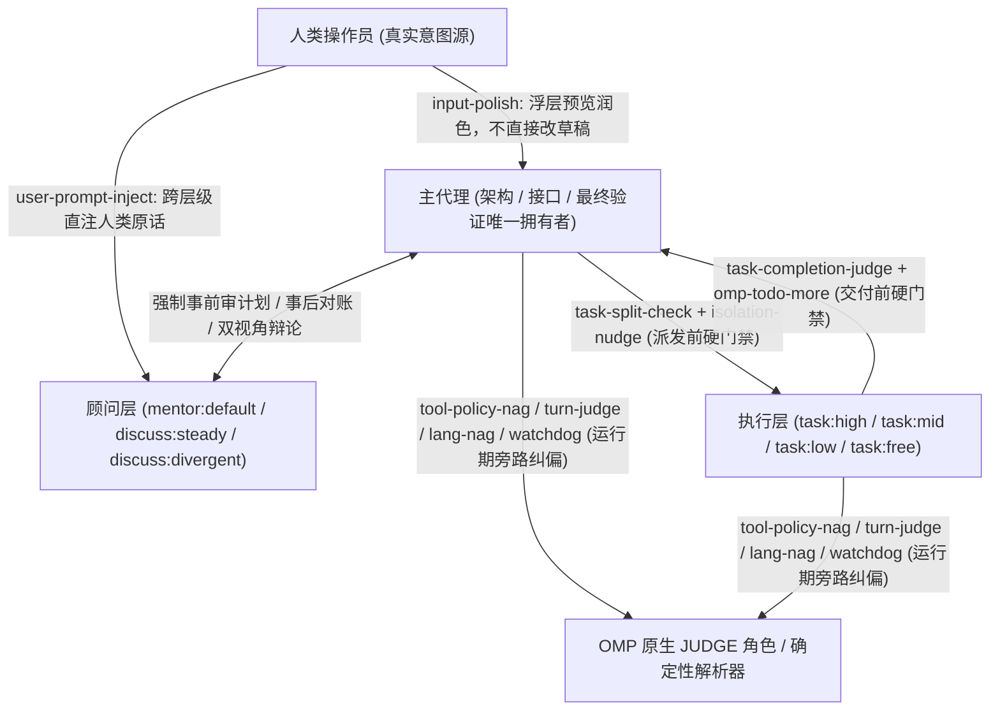
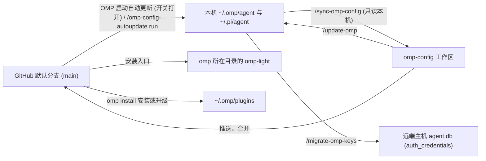

# omp-config

[English](README.md) | 简体中文

Oh My Pi（OMP）配置中可审查、可版本化迁移的切片，面向重型工程与长程多代理协同场景定制。本仓库**不是** `~/.omp` 的完整备份：数据库（`*.db*`）、会话记录、模型缓存、日志、锁文件、插件安装包与供应商凭据均不入库。

- [仓库内容](#仓库内容)
- [快速上手](#快速上手)
- [设计思路](#设计思路)
- [同步与迁移](#同步与迁移)
- [轻量模式](#轻量模式)
- [Subagent 体系](#subagent-体系)
- [本地扩展](#本地扩展)
- [维护须知](#维护须知)

## 仓库内容

仓库管理的文件按权威归属（Owner）与同步策略划分为仓库全量托管、双向按字段合并与本机独占三类：

| 路径 | 权威与同步策略 | 内容与职责 | 本机落盘位置 | 生效时机 |
|---|---|---|---|---|
| `agent/config.yml` | 仓库 + 本机按字段合并 | OMP 核心配置、UI、内置功能开关与 subagent 模型绑定；`LOCAL_CONFIG_FIELDS`（`modelRoles`、`theme`、`worktree`、`compaction.thresholdTokens` 等）与 `extensions` 中的本机条目（如 `~/.claude`）归本机 | `~/.omp/agent/config.yml` | OMP 实时热重载 |
| `agent/SYSTEM_TEMPLATE.md` | 仓库托管（整文件） | 派生自 OMP 内置模板的 Handlebars 基础系统提示词模板；工具、skill、规则和运行时字段仍由 OMP 实时渲染 | `~/.omp/agent/SYSTEM_TEMPLATE.md` | 下次启动 OMP |
| `agent/APPEND_SYSTEM.md` | 仓库托管（整文件） | 完整模式追加系统提示词：用户指令最高优先级、最终回复表达契约、完整阅读设计文档要求、强制双 discussant 与 mentor 咨询 | `~/.omp/agent/APPEND_SYSTEM.md` | 下次启动 OMP |
| `agent/PERSONALITY.md` | 仓库托管（整文件） | 渲染到 `SYSTEM_TEMPLATE.md` `# Personality` 下的 `{{personality}}` 块：前半部分照抄 OMP `personality: default` 预设，后半部分为本仓库针对研究与分析文体的 `# Writing` 高信息密度规范（仅主会话生效，subagent 固定 `none`） | `~/.omp/agent/PERSONALITY.md` | 下次启动 OMP |
| `agent/omomp.yml` | 仓库 + 本机按段合并 | 统一扩展配置（每扩展一段，段名即目录名）：`lang-nag`、`input-polish`、`tool-policy-nag`、`task-completion-judge`、`task-split-check`、`system-prompt-replace` 六段归仓库；`doc-polish`、`model-compaction`、`omp-config-autoupdate` 三段归本机（`LOCAL_OMOMP_SECTIONS`） | `~/.omp/agent/omomp.yml` | 随各扩展读取时机生效 |
| `agent/thinking-translator.json` | 仓库 + 本机按字段合并 | [思考翻译](#思考翻译)插件（`omp-thinking-translator`）的 5 级翻译模型回退链与最低推理强度配置 | `~/.omp/agent/thinking-translator.json` | 下一条消息开始时 |
| `agent/config-light.yml`、`agent/APPEND_SYSTEM_LIGHT.md`、`agent/omp-light.ts` | 仓库托管（整文件） | [轻量模式](#轻量模式)配置覆盖、追加提示词（当前为空）与跨平台启动器源码；更新器同时将启动入口安装到 PATH 上 `omp` 所在目录 | `~/.omp/agent/` + `omp` 所在 bin 目录 | 下次运行 `omp-light` |
| `agent/agents/*.md`、`README*.txt` | 仓库托管（整文件） | 7 个自定义 [subagent 定义](#subagent-体系)及實测编写陷阱说明（`README.txt` / `README.zh-CN.txt`） | `~/.omp/agent/agents/` | 下一次派发 subagent |
| `agent/extensions/<name>/*.ts`、`agent/extensions/_shared/*.ts` | 仓库托管（整文件） | 19 个本地扩展模块、共用基础设施 `_shared/` 以及独立更新器脚本 `omp-config-autoupdate/omp-config-update.ts` | `~/.omp/agent/extensions/` | 下次启动 OMP |
| `agent/extensions-last/system-prompt-replace/*.ts` | 仓库托管（整文件） | 在所有按路径加载扩展之后执行的 [system-prompt-replace](#system-prompt-replace) 扩展（同目录 `README*.md` 仅留仓库，不同步） | `~/.omp/agent/extensions-last/` | 下次启动 OMP |
| `PROMPT-INJECT-*.md`、`TURN-JUDGE-*.md`、`INTENT-*.md` | 仓库带则归仓库，本机自建归本机 | 分别位于 `user-prompt-inject/`、`turn-judge/`、`tool-policy-nag/` 扩展目录内的判定与注入模板 | 对应扩展目录 | 下次派发 / 下一轮 / 下次调用 |
| `APPEND_SYSTEM_MODEL.md`、`WATCHDOG-*.md` | 本机独占（仓库不带） | 分别位于 `append-system-model/` 与 `watchdog-agent/` 下的按模型追加提示词与独立审阅器规则 | 对应扩展目录 | 下一条 prompt / 立即重读 |
| `pi/agent/pi-bansos-relay-state.json` | 仓库 + 本机按字段合并 | `pi-bansos` 插件的 relay 状态与状态栏显示配置（不含凭据） | `~/.pi/agent/pi-bansos-relay-state.json` | 下次会话启动或 `/bansos` |
| `install-plugins.sh`、`plugin-audit.sh` | 仓库仅留脚本 | 10 个必装 + 1 个可选[插件声明](#插件)与历史漂移审计脚本（插件安装在 `~/.omp/plugins/`） | — | 更新器运行时安装/升级，重启生效 |
| `.omp/commands/*.md` | 仓库仅留命令定义 | `/update-omp`、`/sync-omp-config`、`/migrate-omp-keys` 三个维护命令的执行规范 | — | 仓库根目录会话内调用 |
| `ci/`、`.github/workflows/config-check.yml` | 仓库仅留 CI | 隔离 HOME 下的真实会话配置检查（`bun ci/check.ts`），设计与判据见 `ci/README.zh-CN.md` | — | 手动或 GitHub Actions 触发 |
| `package.json`、`biome.json`、`tsconfig.json` | 仓库仅留开发工具 | `bun run check` 执行 Biome 格式、lint 与 `tsc --noEmit` 严格类型检查 | — | 开发与同步校验时运行 |

## 快速上手

所有维护斜杠命令均在仓库根目录启动 `omp` 后执行。

**新机器初始化：**

1. 执行 [`/update-omp`](#update-omp仓库--本机)：预检并写入全部受管配置、扩展与更新器 `omp-config-update.ts`，安装 `omp-light` 启动器，并对 `install-plugins.sh` 中声明的每个插件执行 `omp install`（缺的补装，已装的升级）。
2. 如需在 OMP 中复用 Claude Code 的 `skills/`、`rules/`、`commands/` 与 `hooks/`，在本机 `~/.omp/agent/config.yml` 的 `extensions` 列表开头加入 `~/.claude`。该条目属于本机（更新器保留在仓库条目之前，`/sync-omp-config` 不写回仓库，`omp-light` 也会通过 `-e` 加载）。若本机不存在 `~/.claude` 目录则不要添加，否则每次启动都会报错。
3. 重启 `omp`，使基础模板、追加提示词、扩展与插件生效。
4. 如需每次启动 `omp` 时自动从 GitHub 默认分支拉取更新，执行 `/omp-config-autoupdate on`（本机开关，默认关闭，下次启动起生效）。
5. 运行[迁移后检查](#迁移后检查)确认状态；如需从旧机器迁移供应商登录凭据，在旧机器上执行 [`/migrate-omp-keys <新机器 SSH 目标>`](#凭据迁移migrate-omp-keys-target)。

**本机修改收回仓库：** 先执行 `/sync-omp-config check` 预览差异，再执行 [`/sync-omp-config`](#sync-omp-config本机--仓库) 写回仓库并自动提交推送。若本机已开启自动更新，默认分支一旦产生新提交，下次启动就会用仓库版本覆盖本机受管项，未收回仓库的本机受管修改会被覆盖。

## 设计思路

### 定位与核心假设

这套配置不是 `ultracode` 式的黑盒大任务求解器，而是围绕 OMP 原生工作流构建的**闭环运行时控制系统**。其设计基于四条实测成立的前提：

1. **模型不会稳定遵守 System Prompt（破窗效应）**：以 Claude 为首的模型会选择性无视提示词规则；一旦模型开始绕开内置工具规范（例如用 `cat`/`sed`/`rg` 或 `python -c` 代替 `read`/`edit`/`grep`），其他工程约束（包括 `CLAUDE.md` 与 `*.rule.md`）往往一并失效。因此不能只写提示词，必须同时约束写入副作用、在运行期检测工具偏离并实时注入纠偏提醒。
2. **Context 是与人类对齐的“意图状态”，而非单纯的文件缓存**：长程任务的 Context 承载着需求边界、已排除方案和与操作员对齐过的隐含共识。任何 Compaction（上下文压缩）或用 `grep`/`head` 代替完整阅读，都是高损耗的意图丢失。
3. **代码生成能力 $\neq$ 规划判断力与契约遵循力**：低成本或免费模型不适合由人类直接对话驱动，但只要把架构边界和接口契约锁在父代理手中，并在派发前与交付前设置硬门禁，它们就能在受限切片中充当高性价比 worker。
4. **宁可承担偶发自动续跑的误判，也不频繁打断操作员**：通过有状态的 Todo 生命周期与旁路原生判定器（OMP `JUDGE` 角色）驱动模型自愈，把人工干预留给真正的架构取舍与阻塞项。



### 模型失效模式与系统对策矩阵

下表汇总了全部 20 个本地扩展、核心插件与配置项所针对的真实失效模式或宿主缺口：

| 类别 | 真实失效模式 / 宿主能力缺口 | 介入时机 | 对策载体（扩展 / 插件 / 配置） | 动作机制 | 轻量模式 |
|---|---|---|---|---|---|
| **行为偏离与副作用失控** | 模型盲改文件、覆盖未读区域或偏离行号 | `read` / `edit` 调用时 | `config.yml` (`edit.mode: hashline`) | 强制非 `:raw` `read` 获取快照标签后才能按锚点 `edit` | 启用 |
| **行为偏离与副作用失控** | 模型未立计划就动手改文件，或遇小错半途停下反问用户 | `edit` 调用前 / 回合结束 | 插件 [omp-todo-more](#todo-more) (`todo`) | Todo 为空时封锁 `edit`；仍有未完项且非向用户提问时自动注入继续提醒；`DONE` 强制绑定 git commit | 启用 |
| **行为偏离与副作用失控** | 模型用 shell/eval 代替内置工具（破窗信号），或拼出不可读的高风险长管道 | 主会话 `tool_call` | [tool-policy-nag](#tool-policy-nag) + `INTENT-policy.md` | 不阻断执行；`intent` 通道调原生 JUDGE 点名应替用的内置工具，或由 `form` 计数提醒；`risk` 通道同步警告多程序长写管道 | 禁用 |
| **行为偏离与副作用失控** | 模型在长任务中偏离验证要求或偷换问题，甚至未验证就宣布完成 | 每 $N$ 步动作 / 回合结束 | [watchdog-agent](#watchdog-agent) + [turn-judge](#turn-judge) | `watchdog-agent` 按 `target` 独立审阅分支并注入 `<watchdog>`；`turn-judge` 每轮后用原生 JUDGE 判定并在达阈值时直接输入纠偏 prompt | 禁用 |
| **行为偏离与副作用失控** | 服务端或本地 Compaction 后模型丢失中文回复约束 | 主会话 `agent_end` → 下次 `input` | [lang-nag](#lang-nag) | 检测回复末段前 200 字符语言；不符时在用户下一条输入前静默拼接 `说中文`，不重跑已发回合 | 禁用 |
| **认知回声室與低阶偷懒** | `mentor` 与 `discuss` 只看到派发方裁剪后的转述，沦为回声放大器 | 子代理每次 `context`（含 IRC 唤醒） | [user-prompt-inject](#user-prompt-inject) + `PROMPT-INJECT-user-goal.md` | 沿 `parentId` 追溯根会话，提取全部人类原话注入顾问请求首部，命其按人类原话核对计划偏差 | 禁用 |
| **认知回声室與低阶偷懒** | 主代理把多个无关主题塞给一个 worker，或限制 worker 报告字数导致证据截断 | `task` / `fork_task` 的 `tool_call` | [task-split-check](#task-split-check) | 用 `gpt-6-1-sol` 并发判定：多主题首次拦截（原样重派放行），限制报告长度永久拦截 | 禁用 |
| **认知回声室與低阶偷懒** | 多个并发写入 worker 共享同一目录互相踩踏文件 | `task` 的 `tool_call` | [isolation-nudge](#isolation-nudge) | 存在 $\ge 2$ 个未隔离写入者时按 prompt hash 首次拦截，要求改为 `isolated: true` | 禁用 |
| **认知回声室與低阶偷懒** | 低阶 worker（`task:low/mid/free`）在任务未做完或未更新 Todo 时提前 `yield` | 子代理 `yield` 的 `tool_call` | [task-completion-judge](#task-completion-judge) | 用 `gpt-6-1-sol` 对照派工单、工具记录与提交内容：未完成退回一次，Todo 仍有未完项再退回一次，放行时附 `completion_judge` | 禁用 |
| **上下文损耗与失忆** | 百万字级设计背景或复杂人类对齐意图无法靠短 `context` 文本无损传给子代理 | 子代理派发 | [fork-task](#fork-task) (`fork_task`) | 克隆调用方（或 `from` 指定代理）的对话历史作为子代理起点，支持 `shake: true` 压缩旧工具结果 | 禁用 |
| **上下文损耗与失忆** | 主会话发生 Compaction 后丢失已完成任务进度与子代理全局视图 | `todo` 修改时 / 主会话 compact 后 | 插件 `omp-todo-more` 的 [ctx](#ctx) + [Task log](#task-log) | 每次成功 `todo` 修改写入 `task-log/<agent-id>.md`；compact 后自动把 `ctx list` 与重放时间线注入新上下文 | 启用 |
| **提示词分层与模型差异** | 内置工具协议在基础模板和附录里重复堆砌，或与自定义规则冲突 | 每次 `before_agent_start`（最后执行） | [system-prompt-replace](#system-prompt-replace) | 在 `inlineToolDescriptors: "on"` 下原地改写渲染后的内置/插件工具描述 | 禁用 |
| **提示词分层与模型差异** | OMP 原生提示词和压缩阈值无法按模型家族正则差异化配置 | 每次 `before_agent_start` | [append-system-model](#append-system-model) + [model-compaction](#model-compaction) | 按 `model`/`provider` 正则追加模型专属提示词，并为匹配模型写入原生 `"provider/id": "f<N>"` 压缩触发点 | 启用 |
| **宿主与运行环境补齐** | OMP 默认不扫描仓库 `.claude/rules` 与 `.pi/rules` | `session_start` / `before_agent_start` | [repo-rules](#repo-rules) | 从 `cwd` 向上至 git 根扫描 `.claude/rules`、`.agents/rules`、`.pi/rules` 并去重注入 | 启用 |
| **宿主与运行环境补齐** | 只有人类能在 TUI 输入 `/wt`、`/move`、`/restart`，主代理无法自主切 worktree 或重启生效新配置 | 主 TUI 会话空闲时 | [wt-tool](#wt-tool) (`wt`/`wt_remove`) + [harness-restart](#harness-restart) | 排队并在回合真正结束后复用 TUI 原生命令分发器执行 worktree 切换/安全移除与带原因重启恢复 | 启用 |
| **宿主与运行环境补齐** | 子进程内存暴涨（含脱离父进程的孤儿进程）拖垮宿主机 | macOS 每 250 ms | [child-memory-warning](#child-memory-warning) | 通过 Bun FFI 调 `libproc` 采样后代进程 `phys_footprint`，超过 4 GiB 时告警主 UI 与主 agent | 启用 |
| **宿主与运行环境补齐** | `--model` 指定 `commandcode` 模型时因宿主缓存遮蔽或 provider 同名冲突报鉴权错误 | `session_start` | [commandcode-model-spec](#commandcode-model-spec) | 识别 `commandcode-models.json` 中的模型并在 `api !== "commandcode-custom"` 时重选回插件实时注册模型 | 启用 |
| **交互与多机运维** | 人类草稿需要激励性润色、长文档需要不改原意地重排审校、多机配置需要自动对齐 | 按键 / 命令 / 启动时 | [input-polish](#input-polish) + [doc-polish](#doc-polish) + [omp-config-autoupdate](#omp-config-autoupdate) | `Ctrl+Enter` 浮层流式润色输入；三代理流水线生成 `/tmp/doc-polish` 审校报告；启动时子进程拉取默认分支自动应用 | `doc-polish` 禁用，其余启用 |

### Context 管理与表达契约

- **严禁以有损手段换取表面上的 Context 节省**：用 `grep` 代替通读会把局部片段固化成错误认知；把多步操作拼成一条长 bash 会扩大副作用并丧失可诊断性；用 `head`/`tail` 截断外部命令输出会丢弃关键证据。应始终使用内置工具自带的分页与排序，把可抛弃的执行过程放进 subagent（普通 `task`），而在需要保留完整对齐背景时使用 `fork_task`。
- **把最终回复当作唯一交付物（`agent/APPEND_SYSTEM.md`）**：正文使用带显式主语的完整句子，首次出现时指认对象，每条结论旁附上决定性证据（`path:line`、命令与实际输出或前后对比值），不使用类比。
- **研究与分析文体采用高信息密度规范（`agent/PERSONALITY.md` `# Writing`）**：结论、数字或机制直接开篇；一句话交代时间、主体、行为、规模和来源；多对象或多指标进同一张表，不在表后逐行复述；删除过程自述、重复解释、免责声明叠床架屋与总结段。每个段落执行删除测试：删掉后读者对事实、数字、机制、条件与结论的理解不变，就不保留。

## 同步与迁移



仓库与本机之间通过三条命令维护，完整执行步骤定义在 `.omp/commands/` 同名文件中，更新器的精确读写删除契约定义在 `agent/extensions/omp-config-autoupdate/omp-config-update.ts` 文件头：

| 命令 / 入口 | 方向 | 触发方式 | 写入范围 | `check` 模式 |
|---|---|---|---|---|
| `omp-config-update.ts auto` | GitHub `main` → 本机 | 启动时自动触发（需 `/omp-config-autoupdate on`），或手动 `/omp-config-autoupdate run` | 在提交变化时更新本机受管配置、`omp-light` 入口、安装/升级插件、执行 git 差集删除与旧版迁移，成功后写 `.omp-config-applied` | — |
| `/update-omp [check]` | 仓库工作区 → 本机 | 在仓库根目录启动 OMP 后执行 | 用当前工作区（含未提交改动）更新本机受管项、`omp-light` 与插件；运行 `./plugin-audit.sh` 询问卸载候选，询问是否创建缺失的本机初始化项；**不**做 git 差集删除，**不**改写 `.omp-config-applied` | 只读报告差异与卸载候选，不写文件、不动插件 |
| `/sync-omp-config [check]` | 本机 → 仓库工作区 | 在仓库根目录启动 OMP 后执行 | **只读本机**（本机 mtime 不变），将受管项与插件列表差异写回仓库，校验通过后以 `chore: sync snapshot with local omp config` 提交并推送 | 只做第 1 步比对并报告差异 |
| `/migrate-omp-keys <target>` | 本机 → 远端主机 | 在任意本机会话中执行 | 经 SSH 备份远端 `agent.db` 后整表替换 `auth_credentials` 并清空冷却锁表 | — |

### 两个方向共同的规则

1. **四个结构化配置按字段/按段比对与合并**：`agent/config.yml`、`agent/omomp.yml`、`agent/thinking-translator.json`、`pi/agent/pi-bansos-relay-state.json` 均先用 `Bun.YAML.parse` 或 `JSON.parse` 解析校验。`/sync-omp-config` 写仓库时只用 `edit` 修改有差异的行，绝不整文件重序列化；更新器写本机时将仓库键值覆盖到本机映射上，合并结果与仓库文件完全相同时原样复制仓库文件，否则保留键序重序列化（通过原子临时文件 + `rename` 落盘，目标为 symlink 时写穿到目标文件并保留链接）。本机上述四个文件无法解析时更新器拒绝切换并报错；`config-light.yml` 按普通文件整份覆盖。
2. **本机独占字段与列表条目双向隔离**：
   - `config.yml` 的 `LOCAL_CONFIG_FIELDS`（`providers.webSearchOrder`、`modelRoles`、`defaultThinkingLevel`、`skills`、`symbolPreset`、`theme`、`colorBlindMode`、`hideThinkingBlock`、`statusLine`、`terminal`、`tui`、`display`、`worktree`、`compaction.thresholdTokens`）以及仓库中不存在的本机自定义键，两个方向都不动；即使本机缺失也不从仓库补。
   - `config.yml` 的 `extensions`（`MACHINE_LIST_FIELDS`）由仓库和本机共用：本机独有条目（如 `~/.claude`）由更新器保留在仓库条目**前面**（确保 `extensions-last/system-prompt-replace/index.ts` 始终排在最后），`/sync-omp-config` 不把本机条目写回仓库。
   - `omomp.yml` 的本机段 `LOCAL_OMOMP_SECTIONS`（`doc-polish`、`model-compaction`、`omp-config-autoupdate`）归本机，两个方向都不写、不收回。
3. **扩展目录内只同步源码与三类仓库模板**：仅 `extensions/<name>/*.ts`、`extensions-last/<name>/*.ts`、`extensions/user-prompt-inject/PROMPT-INJECT-*.md`、`extensions/turn-judge/TURN-JUDGE-*.md`、`extensions/tool-policy-nag/INTENT-*.md` 归仓库。同目录下的 `APPEND_SYSTEM_MODEL.md`、`WATCHDOG-*.md` 及本机自建模板归本机。
4. **应用托管文件（App-managed）双向跳过**：首行为 `// @orca-managed-pi-extension` 或任意位置含 `marker: _otty` 的文件（如 `orca-*.ts`、`otty-integration.ts`），更新器在每次覆盖和删除前检查并跳过，`/sync-omp-config` 同样跳过。
5. **本机 `settings.json` 与运行时状态不迁移**：`settings.json`（当 `config.yml` 存在时 OMP 忽略其扩展包根，但仍加载其中的 TS/JS 扩展模块）、`*.db*`、WAL、`*.lock`、`models.yml`、`commandcode-models.json`、`last-changelog-version`、`sessions/`、`terminal-sessions/`、`blobs/`、`cache/`、`logs/`、`.omp-config-applied` 及安装到 `omp` 旁的 `omp-light` / `omp-light.cmd` 均不进仓库。本机从未运行过 `/bansos` 修改状态而缺少 `~/.pi/agent/pi-bansos-relay-state.json` 时，`/sync-omp-config` 不视为删除，保持仓库文件原样。

### 启动时自动更新

[omp-config-autoupdate](#omp-config-autoupdate) 扩展在主会话启动时后台调用 `omp-config-update.ts auto`，由锁目录 `~/.omp/omp-config-update.lock` 串行化（记录持有进程 PID，已退出的死锁可被接管）：

1. **拉取与判定**：在 `~/.omp/omp-config-src` 维护 `https://github.com/oh-my-omp/omp-config.git` 的 `main` 分支浅克隆（若 origin 仍为旧地址 `mouriya-s-lab/omp-config.git` 则自动改指新地址；若为其他仓库则报错不动）。断网或拉取失败时直接放弃本次更新，绝不用旧本地克隆冒充最新远端。拉取成功后对比 `<agent 目录>/.omp-config-applied`：提交未变则直接退出；提交变化时动态导入新提交里的 `applySnapshot` 执行更新。
2. **预检、插件就绪与写入顺序**：先校验所有结构化文件可解析并规划全部操作，再对 `install-plugins.sh` 的每项执行 `omp install`，随后向 OMP 宿主 catalog 核对独立 `omp-todo-more` 插件已启用且入口 `./index.ts` 存在。就绪后按 **移动 → 普通文件 → JSON → `config.yml` → 删除** 顺序执行。只要移动或写入阶段出错，整个删除阶段立即跳过并报告 `Cutover incomplete; do not restart OMP`；仅在全程零错误时才将新提交写入 `.omp-config-applied`。
3. **自动删除与旧版迁移（RELOCATIONS）**：
   - `auto` 模式按“上次应用提交 → 新提交”的 git diff 删除仓库已移除的受管文件、结构化配置键与 `extensions` 条目。
   - `auto` 与 `/update-omp` 均执行旧平铺布局迁移：删除已被 `<name>/index.ts` 取代的平铺 `extensions/<name>.ts` 与根目录旧 `omp-config-update.ts`；将旧独立 JSON 配置（`extensions/<name>/<name>.json`、根目录 `system-prompt-replace.json` 等）一次性导入 `omomp.yml` 对应段后删除旧文件；将根目录下的本机数据（`APPEND_SYSTEM_MODEL.md`、`WATCHDOG-*.md` 等）移入对应扩展目录；移除 `config.yml` `extensions` 中已废弃的 `~/.omp/agent/extensions-last/system-prompt-replace.ts`。若机器上的旧更新器仍在根目录且报 `has no agent/omp-config-update.ts`，在仓库执行一次 `/update-omp` 即可恢复。
4. **生效时机与通知**：`config.yml` 实时重载；`APPEND_SYSTEM_MODEL.md`、`omomp.yml` 的 `system-prompt-replace` / `tool-policy-nag` / `task-split-check` / `task-completion-judge` 段、`TURN-JUDGE-*.md`、`PROMPT-INJECT-*.md` 与 `agents/` 从下一条 prompt、下一轮、下次工具调用或下次派发生效；`SYSTEM_TEMPLATE.md`、`APPEND_SYSTEM.md`、`PERSONALITY.md`、扩展代码与插件变更需重启 OMP。有变更且无错时弹一条 info 汇总（需重启时附提醒），有错时弹 warning（用 `/omp-config-autoupdate run` 查看逐项明细）。

### `/update-omp`：仓库 → 本机

手动执行 `bun agent/extensions/omp-config-autoupdate/omp-config-update.ts apply --source .`。除遵循上述写入、插件安装升级、平铺迁移与 Todo/`ctx` 退休规则外，与自动更新有以下四点区别：

- 无 git 历史基准，因此不做一般文件或结构化键的差集删除。
- 不修改 `.omp-config-applied`（若开启了自动更新，本地改动需推送合并到 `main`，否则下次启动会被默认分支覆盖）。
- 运行 `./plugin-audit.sh`，对 `[卸载候选]` 询问用户确认后执行 `omp plugin uninstall <name>`。
- 检查本机初始化项（`omomp.yml` 的 `doc-polish` 段与 `commandcode-models.json`）：缺失时询问用户是否创建及填写内容，未确认则跳过。

### `/sync-omp-config`：本机 → 仓库

只读扫描 `~/.omp/agent` 与 `~/.pi/agent/pi-bansos-relay-state.json`：

- 若本机仍存在平铺布局的同名扩展 `.ts`（已排除的退休 Todo/`ctx` 路径除外），立即停止并要求先运行 `/update-omp` 迁移，防止把仓库的目录结构误判为本机已删除。
- 比对受管文件与 `~/.omp/plugins/package.json` 依赖列表（URL/Git 依赖原样保留，npm 依赖去版本号，注释掉的可选插件保持注释）。
- 写回仓库后执行五项校验：普通文件 `cmp` 一致、结构化文件非本机字段逐项一致、YAML/JSON 可解析、`bun run check` 通过、无明文凭据（`sk-`、`ghp_`、超长 `apiKey:`）与运行时残留文件，完整模式下最后提交并推送。

### 插件

插件包安装在 `~/.omp/plugins/`，属于运行时状态，不入库（仅 `~/.pi/agent/pi-bansos-relay-state.json` 状态文件入库）。`install-plugins.sh` 声明 10 个默认必装插件与 1 个注释态可选插件，全部不钉版本，每次更新器运行都会对必装项执行 `omp install` 以补装缺失项并升级已装项：

| 声明源（`install-plugins.sh`） | `omp plugin list` 包名 | 类别 | 提供的工具 / 命令 / 技能 / 能力 | 与本仓库配置及扩展的耦合关系 |
|---|---|---|---|---|
| `https://github.com/oh-my-omp/omp-todo-more` | `omp-todo-more` | 必装（GitHub） | 工具：`todo`, `ctx`；命令：`/todo-more`；事件：`omp-todo-more:read`；Tern 面板组件 | 替代被 `config.yml` 关闭的原生 Todo；强制带 goal 与时间预算、空列表封锁 `edit`、`DONE` 绑定 git commit、为 `task:*` 恢复 `todo`、维护 task log 与 compact 后注入，向 `task-completion-judge` 提供只读状态投影 |
| `https://github.com/oh-my-omp/omp-unified-exec` | `omp-unified-exec` | 必装（GitHub fork） | `xd://` 工具：`exec_command`, `write_stdin`, `set_on_exit`, `monitor`, `kill_session`, `list_sessions` | `iamwrm/pi-unified-exec` 的自维护 fork：跳过 OMP 不支持的 `createCodemodeExtension`，在 Bun 1.4+ 下统一使用原生 `Bun.Terminal` 实现跨平台 PTY（Node.js 下才按需加载 `node-pty`）。装前需先卸载同名工具的 `pi-unified-exec` |
| `https://github.com/mouriya-s-lab/pi-bansos` | `pi-bansos` | 必装（GitHub fork） | Provider：`bansos`（OpenCode Zen / KiloCode 免费模型代理）；命令：`/bansos` | `mannnrachman/pi-bansos` 的 fork；为 `task:free` 提供零成本模型，状态文件 `pi-bansos-relay-state.json` 双向同步。装前需先卸载 npm 版 `pi-bansos` |
| `pi-commandcode-provider` | `pi-commandcode-provider` | 必装（npm） | Provider：`commandcode`（`api: "commandcode-custom"`）；命令：`/commandcode-quota` | 生成本机 `commandcode-models.json`，供 `thinking-translator.json` 与 `doc-polish` 调用；由本地扩展 `commandcode-model-spec` 修复 `--model` 启动时的传输层与命名冲突 |
| `https://github.com/oh-my-omp/omp-thinking-translator` | `omp-thinking-translator` | 必装（GitHub） | 可见 thinking 块实时中文翻译渲染器 + 迟到译文补发通知；命令：`/thinking-translator` | 读取受管配置 `~/.omp/agent/thinking-translator.json` 的有序模型链 |
| `https://github.com/oh-my-omp/omp-playbooks` | `tern-playbooks` | 必装（GitHub） | `xd://` 工具：`playbook_open`, `playbook_read`, `playbook_edit`, `playbook_compile`, `playbook_check`, `playbook_run`, `playbook_timeline`, `playbook_launch`；CLI：`tern-playbook` | Tern 分屏协同 YAML Playbook 服务：支持块编辑、外部引用展开、结合 `eval` `judge` 校验、Run 时间线与子代理 Launch 绑定（人类改块时推送 `block_changed`） |
| `https://github.com/oh-my-omp/omp-codex-image-gen` | `omp-codex-image-gen` | 必装（GitHub） | `xd://` 工具：`codex_generate_image`；Skill：`imagegen` | 复用 ChatGPT Plus/Pro Codex 订阅凭据调用 `gpt-image-2` 生成或基于 1–5 张参考图编辑 PNG |
| `pi-schedule` | `pi-schedule` | 必装（npm） | `xd://` 工具：`schedule`；Skill：`schedule` | 周期性与延时任务调度（`prompt`/`shell`/`notify`/`message`），带单飞锁、运行账本与权限分级 |
| `pi-package-search` | `pi-package-search` | 必装（npm） | `xd://` 工具：`search_pi_packages`, `install_pi_package`；Skill：`pi-package-search` | 在会话内检索并按用户指令安装 npm 上的 `pi-package` 扩展包 |
| `pi-pretty-codeblocks` | `pi-pretty-codeblocks` | 必装（npm） | TUI `Markdown.prototype.render` 补丁 | 隐藏 TUI Markdown 代码块围栏行并移除默认 2 列缩进，保留 ANSI 语法高亮 |
| `# https://github.com/oh-my-omp/omp-remote-build` | `omp-remote-build` | 可选（默认注释不装） | `xd://` 工具：`container_exec`, `container_write_stdin`, `container_list_sessions`, `container_kill_session` | 为每个 git worktree 在远端 Docker 主机维护 Mutagen 同步副本与 Komodo 构建容器；依赖 `omp-unified-exec`、Mutagen、km CLI 与 SSH 主机。注释行刻意不加单引号，使已安装机器在 `plugin-audit.sh` 中归入 `[保留]` |

`./plugin-audit.sh` 只读扫描从基准提交 `5974c4fa` 至 `HEAD` 已提交 `install-plugins.sh` 中 `plugins=( … )` 内的单引号条目，并与 `omp plugin list --json` 对比输出四类结果：`[安装]`（脚本要求但本机缺失，由更新器补装）、`[卸载候选]`（历史曾有但当前脚本已删且本机仍装，仅 `/update-omp` 询问后卸载）、`[保留]`（脚本从未登记的用户自装插件，不动）、`[已同步]`（一致）。修改 `install-plugins.sh` 后须先 git commit 再运行审计。

### 思考翻译

`omp-thinking-translator` 从 `~/.omp/agent/thinking-translator.json` 读取有序候选链，每次翻译请求均从第一项开始尝试，失败（未注册、鉴权失败、流错误、空响应）才回退下一项；配置在下一条消息开始时重读。仓库当前配置的 5 级候选链依次为：

1. `futureppo-pool/deepseek-v4.1-flash`（`effort: "low"`）
2. `futureppo-pool/grok-4.7`（`effort: "minimal"`）
3. `commandcode/inclusionai/ling-3.1-flash:free`（`effort: "minimal"`）
4. `commandcode/poolside/laguna-s-2.1-free`（`effort: "minimal"`）
5. `commandcode/stealth/glyph-cluster:free`（`effort: "minimal"`）

`futureppo-pool` 自动发现的模型兼容信息默认省略 `reasoning_effort`。使用前两项时，需在本机 `~/.omp/agent/models.yml`（本机文件，不同步）的既有 provider 下补充逐模型覆盖：

```yaml
providers:
  futureppo-pool:
    modelOverrides:
      deepseek-v4.1-flash:
        compat:
          supportsReasoningEffort: true
      grok-4.7:
        compat:
          supportsReasoningEffort: true
```

修改 `models.yml` 后需重启 OMP，运行 `/thinking-translator status` 核对顺序与强度，并触发一次真实思考翻译确认上游请求携带了 `reasoning_effort`。

### todo-more

[omp-todo-more](https://github.com/oh-my-omp/omp-todo-more) 是独立 OMP/Tern 插件，完整模式和轻量模式均加载，原生 Todo 保持 `todo.enabled: false`：

- **状态权威与投影**：当前会话分支上的 `mouriya.omp.todo-more` 自定义条目是唯一权威状态（包含 `{objective, measure, doneWhen}` 目标，以及每项 `{title, explanation}`、分钟级预算与 git commit SHA）；宿主 `TodoTracker`、`/todo` 面板与历史卡片仅是从该状态派生的投影。插件的 `planning.ts` 在 Todo 列表为空时直接拦截 `edit` 工具，并在 `before_agent_start` 为被宿主剥离 `todo` 的 `task:*` 子代理重新挂回独立 `todo`。
- **交互编辑**：在 OMP/Tern 输入 `/todo-more` 可直接编辑 goal 或各项 explanation（Enter 换行、Tab/Shift+Tab 切换、Ctrl+Enter 保存、Esc 丢弃），只提交目标字段而不改动最新状态与顺序，也不触发模型回合。
- **跨模块只读契约**：配置仓库的 `task-completion-judge` 仅通过同步事件 `omp-todo-more:read` 读取当前会话的只读投影，不导入插件内部源码。插件同时内置了 `ctx` 工具、task log 记录器与主会话 compact 后注入（源码位于插件 `src/ctx/`），详见 [ctx](#ctx) 与 [Task log](#task-log)。
- **旧本地模块安全退休**：更新器在确认 `omp-todo-more` 插件已在宿主 catalog 启用且入口就绪后，自动 unlink 旧版 8 个 Todo 路径（`extensions/todo-more/{index,tool,render,reminders,planning}.ts`、`extensions/_shared/todo-more.ts`、`extensions/subagent-todo.ts`、`extensions/subagent-todo/index.ts`），并在插件含 `src/ctx` 时一并 unlink 旧版 5 个 ctx 路径（`extensions/ctx-tool/{index,inventory,post-compact-hint}.ts`、`extensions/ctx-tasklog/index.ts`、`extensions/_shared/task-log.ts`）。仅删除叶文件本身，不删目录或链接目标；逆向同步同样排除这 13 个路径。

### 手动迁移

仅适用于**没有任何现有 OMP 配置和旧本地 Todo 模块的全新机器**（已有配置的机器必须使用 `/update-omp`，否则直接 `cp -a` 不会清理旧本地 Todo 模块，且会整文件覆盖本机 `config.yml` 与 `omomp.yml` 的本机段）：

```bash
mkdir -p "$HOME/.omp/agent"
cp agent/config.yml agent/SYSTEM_TEMPLATE.md agent/APPEND_SYSTEM.md \
  agent/PERSONALITY.md agent/omomp.yml agent/thinking-translator.json agent/config-light.yml \
  agent/APPEND_SYSTEM_LIGHT.md agent/omp-light.ts \
  "$HOME/.omp/agent/"
cp -a agent/agents agent/extensions agent/extensions-last "$HOME/.omp/agent/"
mkdir -p "$HOME/.pi/agent"
cp pi/agent/pi-bansos-relay-state.json "$HOME/.pi/agent/"
./install-plugins.sh
```

手工复制不会在 PATH 上安装 `omp-light` 入口：复制后需在目标机执行一次 `/update-omp`（或打开 `/omp-config-autoupdate on` 后重启让首次自动更新安装入口）。

### 迁移后检查

```bash
omp config list --json
omp plugin list --json
git status --short
```

确认配置值、全部插件名称/版本/`enabled: true` 状态正常，且仓库工作区未混入 `*.db*`、WAL、日志、会话或缓存文件。

### 凭据迁移：`/migrate-omp-keys <target>`

将本机 `~/.omp/agent/agent.db` 中的 `auth_credentials` 表经 SSH 覆盖到远端主机同路径的 `agent.db`（不经过 git 仓库）：

1. 检查两端 `agent.db`、`ssh` 与 `sqlite3` 可用；写前需操作员确认远端 OMP 已关闭。
2. 远端先用 `sqlite3` `.backup` 生成带时间戳的数据库备份。
3. 在单个事务内清空远端 `auth_credential_blocks` 与 `auth_credential_refresh_leases`，并用本机 `auth_credentials` 全表替换；全程不打印凭据内容，也不迁移会话、历史或模型缓存。

## 轻量模式

`omp-light` 启动一个卸下重度监督钩子、适合快速问答与简单修改的 OMP 进程。它只对当前进程生效，不修改任何磁盘文件：

| 维度 | 完整模式（`omp`） | 轻量模式（`omp-light`） |
|---|---|---|
| 追加系统提示词 | `agent/APPEND_SYSTEM.md` | `agent/APPEND_SYSTEM_LIGHT.md`（当前为空） |
| 委派倾向 (`task.eager`) | `preferred` | `default`（减弱主动派工，但不禁用 subagent） |
| `disabledExtensions` 禁用的 10 个本地扩展 | 全部启用 | 禁用：`doc-polish`、`fork-task`、`isolation-nudge`、`lang-nag`、`task-completion-judge`、`task-split-check`、`tool-policy-nag`、`turn-judge`、`user-prompt-inject`、`watchdog-agent` |
| `extensions: []` 排除的末尾扩展 | 启用 `system-prompt-replace` | `config-light.yml` 将 `extensions` 置空以排除 `extensions-last/system-prompt-replace`（`disabledExtensions` 无法按模块名过滤写成文件路径的条目）；`omp-light.ts` 读取本机 `config.yml` 并将其余非 `/extensions-last/` 的本机条目（如 `~/.claude`）通过 `-e` 补回 |
| 保留启用的 9 个本地扩展 | 启用 | 启用：`append-system-model`、`child-memory-warning`、`commandcode-model-spec`、`harness-restart`、`input-polish`、`model-compaction`、`omp-config-autoupdate`、`repo-rules`、`wt-tool` |
| 已安装插件（含 `omp-todo-more` 的 `todo` 与 `ctx`） | 全部加载 | 全部加载（`disabledExtensions` 不作用于插件） |
| 相比完整模式消失的工具 | — | 仅 `polish_doc` 与 `fork_task` 消失；`todo`、`ctx`、`wt`、`wt_remove`、`harness_restart` 均照常可用 |

**入口安装：** 自动更新与 `/update-omp` 会将 `agent/omp-light.ts` 安装到 PATH 上 `omp` 可执行文件所在目录（POSIX 为 `0755` 可执行文件 `omp-light`；Windows 为 `omp-light.ts` 加生成的 `omp-light.cmd`）。`omp-light` 从 `PI_CODING_AGENT_DIR`（未设则 `~/.omp/agent`）读取 `config-light.yml` 与 `APPEND_SYSTEM_LIGHT.md`，任一缺失即直接退出，后续命令行参数原样透传给 `omp`。

## Subagent 体系

配置在 `agent/config.yml` 的 `task.disabledAgents` 中禁用了全部 5 个内置子代理（`task`、`scout`、`sonic`、`reviewer`、`security-reviewer`），所有委派统一走 `agent/agents/*.md` 定义的 7 个自定义子代理。

### 职责与提示词分层

| 修改目标 | 权威文件位置 |
|---|---|
| 基础工作流、通用工程契约、渲染工具清单与父/子代理第 4 步切换 | `agent/SYSTEM_TEMPLATE.md`（Handlebars 覆盖模板；纯文本 `SYSTEM.md` 无法编译表达式） |
| 完整模式主会话的说话与写作风格块（`{{personality}}`） | `agent/PERSONALITY.md` |
| 主会话本地策略（用户指令优先级、最终回复规范、强制顾问支持） | `agent/APPEND_SYSTEM.md`（子代理收不到此文件） |
| 各子代理的选档依据（`description`）、权限（`spawns`/`tools`）与角色规程 | `agent/agents/<name>.md`（修改前必读 `agent/agents/README.txt`；目录内笔记须用 `.txt` 防解析告警） |
| 各子代理绑定的具体模型与回退链 | `agent/config.yml` 的 `task.agentModelOverrides` |
| 内置与插件工具描述的原地修订 | `agent/omomp.yml` 的 `system-prompt-replace` 段（需 `inlineToolDescriptors: "on"`） |
| 向顾问子代理注入的人类原话模板 | `agent/extensions/user-prompt-inject/PROMPT-INJECT-*.md` |

### 七个自定义子代理分档与模型绑定

下表同时列出 `agent/agents/*.md` `description` 中声明给主代理看的档次/成本契约，以及 `agent/config.yml` 当前绑定的实际模型链（更换模型时不改变职责，但若改变了档次或成本量级需同步更新 `description` 与本表）：

| 名称 | `description` 声明的档次与综合成本（每 1M token） | `config.yml` 当前实际绑定模型链 | 允许派生 (`spawns`) / 工具限制 (`tools`) | 角色定位与能力边界 |
|---|---|---|---|---|
| `task:high` | Claude Opus 5.5，约 $0.45 | `anthropic/claude-opus-5-5:high` | `spawns: task:mid, task:low, task:free, task:high, discuss:steady, discuss:divergent, mentor:default` | **未获用户在当前对话显式允许严禁派发**；唯一可承担架构/核心设计并向下二次派工（depth 1 → depth 2）的顶级 worker，负责子批次契约、验收与集成 |
| `task:mid` | Opus 级，约 $0.30 | `openai-codex/gpt-6-1-sol:high` | `spawns: mentor:default` | **默认主力 worker**：承担除架构与核心设计外的一切实现、调查、调试与验证，并负责裁决低档次 worker 之间的分歧 |
| `task:low` | Opus 级，约 $0.01 | `openai-codex/gpt-5.6-luna:max` | `spawns: mentor:default` | 成本优先且结果可直接交付的工作（批量机械修改、查找、例行检查），以及对 `task:free` 产出做独立复现与核验 |
| `task:free` | Opus 级，零成本，高并发 | `bansos/muse-spark-1.3-contributor:xhigh, opencode-go/muse-spark-1.3-contributor:xhigh, openai-codex/gpt-6-luna:max` | `spawns: mentor:default` | 零信任探针层：仅用于容错线索收集与候选探索；任何实质性结论必须经父代理或 `task:low+` 独立验证，多个 `task:free` 一致不构成验证 |
| `discuss:divergent` | — | `anthropic/claude-opus-5-5:medium, openai-codex/gpt-5.6-luna:max` | `tools: read, grep, glob` | 只读发散派辩手：质疑既有问题边界，在存在真正不同解空间时给出带 `path:line` 证据与代价的替代方案 |
| `discuss:steady` | — | `openai-codex/gpt-5.6-sol:medium` | `tools: read, grep, glob` | 只读保守派辩手：对方案做压力测试，以 `path:line` 举证排查隐含假设、遗漏状态、爆炸半径与更平庸安全的做法 |
| `mentor:default` | — | `openai-codex/gpt-5.6-sol:high, openai-codex/gpt-5.6-luna:max` | `tools: []`（仅 `yield`） | 无工具导师：调查前把活动型计划压成可判定的问题并找最廉价决定性观测点，交付前对照原计划逐项对账复盘；答案必须放入 `yield` 载荷防丢失 |

### 派发、验证与并行隔离规则

- **按成本与所需可信度选档，不按任务难度选档**：默认派 `task:mid`；成本敏感或核验 `task:free` 时派 `task:low`；`task:free/low/mid` 严禁承担架构、领域类型、跨切片接口及文档/prompt/skill/agent 定义的设计。
- **递归上限为 2 层**：主代理为 depth 0，派出的 worker 为 depth 1；只有 `task:high` 能再派 depth 2 子代，且 depth 2 处在递归上限（无 `task` 工具，也派不出 `mentor:default`），只能接收可直接执行的叶子任务。
- **显式指定 `agent`，不覆盖 `effort`**：每次派发必须显式填写 `agent`（省略会落到 `spawns` 首项或被禁用的内置 `task` 上）；模型与推理强度由 `config.yml` 决定，除非用户明确要求否则不传 `effort`。内置 `task` 与 `sonic` 在 `config.yml` 中保留模型绑定仅服务于 Vibe 模式首层派发。
- **每个 `task:*` 切片的强制闭环**：开工前先读代码写计划并交 `mentor:default` 审阅（depth 2 除外）；全程使用 `todo` 初始化完整步骤并实时更新，未完成前严禁 `yield` 或用 `drop`/`rm` 缩水范围。
- **验证职责随派发路径区分**：普通 `task` worker 默认不跑构建/测试/smoke（除非派工单明确指派验证），由主代理亲自或委派独立验证者完成最终验证；而 `fork_task` 派出的 worker 会收到专属 developer notice，强制要求在 handoff 前完成相关构建、检查与真实 runtime 验证。
- **并行写入隔离（`isolated: true`）**：同一仓库同时存在 $\ge 2$ 个写入 worker 时，每个写入者必须设 `isolated: true`（`fork_task` 默认 `true`；只读调查设 `isolated: false` 以便后续用 `write agent://<id>` 续聊；父会话处于 plan mode 时一律共享目录）。给隔离 worker 的路径必须用仓库相对路径（写绝对路径会让命令跑回父工作区），且返回结果须确认 `Applied patches: yes`。

## 本地扩展

仓库共包含 **20 个本地扩展**（19 个位于 `agent/extensions/<name>/`，1 个位于 `agent/extensions-last/system-prompt-replace/`），加 `omp-todo-more` 插件内置的 `ctx` / Task log 恢复链路：

| 扩展目录 | 分类 | 作用域 | 轻量模式 | 注册工具 / 命令 / 关键钩子 | 一句话职责 |
|---|---|---|---|---|---|
| [tool-policy-nag](#tool-policy-nag) | 行为约束 | 主会话 | 否 | `tool_call` (`bash`, `exec_command`, `eval` 等) | 三通道检测绕开内置工具的调用（`intent` 原生 JUDGE / `form` 计数）与高风险长写管道（`risk`），只提醒不阻断 |
| [watchdog-agent](#watchdog-agent) | 行为约束 | 主 + 子 | 否 | `/watchdog` 命令 + 动作计数钩子 | 按 `WATCHDOG-*.md` 的 `target` 独立审阅分支（聊天 reviewer 或原生 JUDGE），按策略注入 `<watchdog>` |
| [user-prompt-inject](#user-prompt-inject) | 行为约束 | 子代理 | 否 | `session_start`, `context` | 将根主会话的人类原话按 `PROMPT-INJECT-*.md` 模板注入 `mentor` 与 `discuss` 的每次模型请求 |
| [turn-judge](#turn-judge) | 行为约束 | 主会话 | 否 | `message_end`, `input` | 主会话每轮正常结束后用原生 JUDGE 按 `TURN-JUDGE-*.md` 判定，达阈值直接输入预设 prompt，否则弹 info |
| [lang-nag](#lang-nag) | 行为约束 | 主会话 | 否 | `agent_end`, `input` | 回复末段语言不符时，在用户下一条真实输入前静默加上 `说中文` |
| [repo-rules](#repo-rules) | 提示词与规则 | 主 + 子 | 是 | `session_start`, `before_agent_start` | 向上扫描并去重注入 OMP 默认忽略的 `.claude/rules`、`.agents/rules`、`.pi/rules` |
| [append-system-model](#append-system-model) | 提示词与规则 | 主 + 子 | 是 | `before_agent_start` | 按 `APPEND_SYSTEM_MODEL.md` 的 `model`/`provider` 正则追加模型专属系统提示词 |
| [model-compaction](#model-compaction) | 提示词与规则 | 主写 / 子读 | 是 | `before_agent_start`, `session_shutdown` | 按 `omomp.yml#model-compaction` 正则规则为每个匹配模型设置固定的自动 compact 触发 token 数 |
| [system-prompt-replace](#system-prompt-replace) | 提示词与规则 | 主 + 子 | 否 | `before_agent_start`（按路径最后执行） | 按 `omomp.yml#system-prompt-replace` 的字面量/正则规则原地改写系统提示词中的工具描述 |
| [child-memory-warning](#child-memory-warning) | 进程资源 | 主进程全局 | 是 | `session_start`, `session_switch`, `session_shutdown` | macOS 下每 250 ms 采样后代进程（含已观测存活孤儿）`phys_footprint`，超过 4 GiB 时告警 UI 与主 agent |
| [fork-task](#fork-task) | 派发与交付 | 主 + 子 | 否 | `fork_task` 工具, `before_subagent_spawn` | 复制当前会话（或 `from` 指定代理）的对话历史作为原生 `task` 子代理的起始上下文，支持 `shake: true` |
| [isolation-nudge](#isolation-nudge) | 派发与交付 | 主 + 子 | 否 | `tool_call` (`task`), `tool_result` | 两个及以上写入 worker 未开启隔离共享目录时按 prompt hash 首次拦截提醒 |
| [task-split-check](#task-split-check) | 派发与交付 | 主 (`split`) / 主+子 (`report-limit`) | 否 | `tool_call` (`task`, `fork_task`) | 用模型并发拦截塞入多主题的派发项（重派放行）与限制 worker 报告长度的派发项（必须移除限制） |
| [task-completion-judge](#task-completion-judge) | 派发与交付 | `task:low/mid/free` | 否 | `tool_call` (`yield`) | 拦截结构化 `yield`，用模型核对派工单、工具记录与 Todo 完成度，未做完或未更新 Todo 各最多退回一次 |
| [doc-polish](#doc-polish) | 用户工具 | 主 + 子 | 否 | `polish_doc` 工具, `/polish-doc` 命令 | 拆分、并发润色、语义校验三阶段重写文档，在 `/tmp/doc-polish/` 生成对照审校报告而不改源文件 |
| [input-polish](#input-polish) | 用户工具 | 主 TUI | 是 | 终端原始按键监听 (`ctrl+enter`) | 按组合键在输入框 overlay 浮层中流式润色草稿，`Enter` 接受并提交，`Esc` 取消且原草稿不变 |
| [wt-tool](#wt-tool) | 会话迁移 | 主 TUI | 是 | `wt`, `wt_remove` 工具 | 让主代理在回合空闲后调用人类 `/wt` 切入新 worktree，或经两次确认检查后移回主 checkout 并删除 worktree |
| [harness-restart](#harness-restart) | 会话迁移 | 主 TUI | 是 | `harness_restart` 工具 | 让主代理调用人类 `/restart` 原参数重启 OMP 并恢复会话，重启后自动带回原因通知 |
| [omp-config-autoupdate](#omp-config-autoupdate) | 同步与兼容 | 根主会话 | 是 | `/omp-config-autoupdate` 命令, `session_start` | 管理本机启动自动更新开关，后台运行 `omp-config-update.ts auto` 并在 `run` 子命令下输出完整明细报告 |
| [commandcode-model-spec](#commandcode-model-spec) | 同步与兼容 | 主 + 子 | 是 | `session_start` | 修复 `--model` 指定 `commandcode` 模型时因缓存遮蔽或内置 provider 同名冲突导致的鉴权失败 |

### 目录结构与开发规范

OMP 从 `~/.omp/agent/extensions/` 只向下扫描一层，本仓库统一使用 `<目录>/index.ts` 作为唯一入口（目录名即扩展 ID `extension-module:<name>`），同目录其他 `.ts` 为私有模块，不会重复加载。跨扩展共用代码集中在 `agent/extensions/_shared/`（无 `index.ts`），仅提供机制而不包含重试、超时或文案策略：

| `_shared` 模块 | 导出接口与职责 |
|---|---|
| `errors.ts` | `errorText(error)`：将未知异常安全转为文本 |
| `messages.ts` | `textOf`、`lastAssistantText`：提取消息中的纯文本块 |
| `omomp.ts` | `defineOmompSection`、`loadOmompSection`、`writeOmompSection`：按扩展目录名绑定并读写 `omomp.{yml,yaml,json,toml}` 对应段（项目 `<cwd>/.omp/omomp.*` 优先于 `<agentDir>/omomp.*`，同目录多文件或解析失败记入 `skipped`） |
| `models.ts` | `resolveModelChain`、`findModel`、`splitLevel`：解析 `provider/id[:effort]` 与逗号候选链（仅查可用列表，不发请求） |
| `helper-session.ts` | `runHelperPrompt`：在无工具、无扩展、空系统提示词的内存辅助会话中执行单次模型调用，强制传 `taskDepth: 1` 且永不抛异常 |
| `judge.ts` | `openNativeJudge`：通过宿主角色解析器解析当前会话 `@judge` 角色，仅当其为原生 judgment API 模型（`isJudgmentApi`）时返回可用 `Judge` 实例 |
| `spec-files.ts` | `discoverSpecFiles`、`parseFrontmatter`、`unquote`：扫描扩展目录及 `cwd` 至 git 根各层（含 `.omp/`）的 `*-<label>.md` 规格文件 |

**强制开发规范（由 `bun run check` 与 CI `code` job 检查）：**
- **格式与类型**：仅用 Biome（tab、双引号、分号、尾逗号、行宽 140，`bun run format`）；`tsc --noEmit` 开启 `strict` 与 `noUncheckedIndexedAccess`，严禁 `any`；外部输入在边界用 `@oh-my-pi/pi-coding-agent` 导出的 `z` 解析一次，`as` 仅限无法运行时检查的宿主类型并附单行注释说明原因。
- **状态与错误处理**：多分支状态使用以 `kind` 区分的联合类型加带 `never` 的穷尽 `switch`；预期失败返回结果联合类型，钩子与工具入口捕获一切异常并记 `pi.logger.warn(…, { error: errorText(error) })`，绝不抛入宿主。
- **会话身份、路径与消息归因**：用 `ctx.agent.kind`（`"main" | "sub"`）判断主/子会话；扩展自有模板用 `import.meta.dir` 定位；扩展主动发送的用户消息一律传 `attribution: "agent"`；imports 仅使用宿主根包（`pi-agent-core`、`pi-ai`、`pi-catalog`、`pi-coding-agent`、`pi-natives`、`pi-tui`、`pi-utils`）或已在真实无 `node_modules` 会话中验证可加载的子路径。

### 行为约束

`turn-judge`、`tool-policy-nag` 的 `intent` 通道与 `watchdog-agent` 的选项判定后端共用 OMP 的 **JUDGE 模型角色**（`_shared/judge.ts`）。只需在 OMP 模型角色中将 `judge` 设为原生判定模型（如 `futureppo-jev/decision-model-preview`），三处功能即自动激活；若角色指向普通聊天模型或未配置，相关原生判定静默跳过且不回退聊天模型。角色配置在每次触发时实时读取，无需重启。

#### tool-policy-nag

仅作用于主会话，在 `tool_call` 阶段监视 `bash`、`bash_bg`、`exec_command`（含写往 `xd://bash`、`xd://bash_bg`、`xd://exec_command` 的调用）与 `eval`，**只发提醒、绝不阻断调用**。由 `omomp.yml` 的 `tool-policy-nag` 段配置三条独立通道（按项目 `.omp/omomp.*` → agent 目录 `omomp.*` 顺序每次调用重读；设为 `null` 关闭对应通道，兼容旧版单检测器 `{detector: "heuristic"|"jev"}` 写法）：

```yaml
tool-policy-nag:
  form:
    detector: heuristic
  intent:
    threshold: 0.5
  risk:
    minCommands: 4
    minChars: 600
    minPrograms: 3
```

- **工具提醒投递规则（`intent` 与 `form` 二选一投递）**：当 `intent` 已声明、同目录 `INTENT-policy.md` 有效且启用、且宿主原生 JUDGE 可用时，由 `intent` 负责投递，`form` 仍照常计数、记日志并维护分支状态但不发消息；否则由 `form` 投递通用提醒。原生 JUDGE 请求失败或 90s 超时时记一次 warning，不补发 `form` 提醒。
- **`form` 通道（启发式语法解析）**：
  - 识别管道、分号、引号、heredoc、命令替换与重定向（跳过 `sudo`/`doas`/`su`/`ssh`；有效终点为 `wc` 的统计管道豁免前面的列目录/读/搜；`/dev/*` 豁免读/搜/改/写）。统计六类 shell 违规（列目录 `ls`/`find`、读文件 `cat`/`head`/`tail`/`sed -n` 等、搜索 `grep`/`rg`/`awk`、就地编辑 `sed -i`/`perl -i`/`mv`、重定向写文件、内联脚本 `python -c`/`node -e`/`bun -e` 等）及 `eval` 内读写列目录调用（`Path.read_text`、`open`、`Bun.file`、`readFileSync`、`os.listdir` 等）。
  - 前 3 次命中仅计数；第 4 次起每次发 steer 消息 `"你为什么不遵守system prompt。"` 并弹 UI 警告，每个 context 最多发 3 条后进入 `exhausted` 停止检测，直至下次 compaction、`/clear` 或 `branch_summary`。状态持久化于会话条目 `mouriya.omp.tool-policy-nag.state`，跨分支跳转时按当前分支重建。
- **`intent` 通道（原生 JUDGE 工具路由判定）**：
  - 每次被监视调用并发发起一次不阻塞命令的 JUDGE `choice` 请求，题目与 12 个选项判据读取自 `agent/extensions/tool-policy-nag/INTENT-policy.md`（选项：`list`、`read`、`search`、`edit`、`write`、`move`、`eval`、`ast`、`pty`、`shell`、`mixed`、`none`，内含针对 `km ls`、`ssh host 'cat'`、`npm test > log`、`curl -I`、管道过滤等真实误报类的反例说明）。
  - Shell 调用选中非 `none`、或 `eval` 调用选中非 `eval`/`none` 且概率 $\ge$ `threshold`（`0.5`）时，在下一个 step 边界以 `aside` 注入具体提醒（指出所属中文意图名、应替用的内置工具及调用原文），不计数、不封顶，并记 `Tool-policy intent verdict` 日志。
- **`risk` 通道（无模型确定性风险检测，仅针对 shell）**：
  - 在 `tool_call` 内同步判定，与前两条通道完全独立。同时满足以下三条即触发：① 命令段数 $\ge$ `minCommands`（`4`）或总字符数 $\ge$ `minChars`（`600`）；② 剔除 shell 内建管道件（`cd`/`echo`/`export`/`mkdir` 等）后涉及的不同外部程序数 $\ge$ `minPrograms`（`3`）；③ 含写入步骤（重定向/`tee`/就地编辑、`rm`/`cp`/`mv`/`tar`/`rsync`/`patch` 等写程序，或 `git add|commit|push|reset`、`gh … create|delete`、`docker run|build|push|rm|exec`、`kubectl apply|delete|exec`、`npm|bun install|add`、`tofu apply|destroy`、`curl -o|-d|-X POST` 等带写子命令的程序，子命令只取前两个非 `-` 参数词）。
  - 命中即发送一条指明段数、字符数、外部程序列表与写入步骤的拆解提醒，弹 UI 警告并记 `Tool-policy risk` warn 日志。

#### watchdog-agent

按目标会话独立运行的第三方运行时审阅器，由 `WATCHDOG-<label>.md` 驱动（扫描 `~/.omp/agent/extensions/watchdog-agent/` 及 `cwd` 向上至 git 根各层的 `<dir>/WATCHDOG-*.md` 与 `<dir>/.omp/WATCHDOG-*.md`，属于本机文件，不同步）：

| Frontmatter 字段 | 取值与默认值 | 说明 |
|---|---|---|
| `target`（必填） | `main`、子代理名（如 `task:low`）、`*`、`subagents` 或逗号列表 | 决定哪些会话挂载该 watchdog |
| `name`、`enabled` | 默认文件名标签；`enabled` 默认 `true` | `/watchdog` 按 `name` 寻址；同目录或跨目录重名时命令报错 |
| `delivery` | `aside`（默认）、`steer`、`nextTurn`、`followUp` | 发现问题后的注入时机（`nextTurn` 等待用户下次真实输入或子代理下次 `before_agent_start`） |
| `every`、`scope` | `every` 默认 `30`；`scope` 为 `full`（默认）或 `window` | 每条工具调用与每条非空文字回复各计 1 步；满 `every` 立即后台审阅，回合结束（非 `willContinue`）时对余数补跑一次。`window` 只看上次得出结论后的新消息 |
| `maxPerContext` | 正整数，默认不限 | 两次 compaction 之间最多注入几条提醒；compaction 后清零封顶计数，但不重置操作计数与 `window` 游标 |
| `model`、`tools` | 聊天 reviewer 后端专用 | `model` 缺省依次试 `@advisor`、`advisor`、`@slow`、当前会话模型；`tools` 默认 `[read, grep, glob]`（可选授 `ast_grep, web_search, edit, write, bash, eval`）。首行回答 `PASS`/`OK`/`LGTM`/`NONE` 为通过，其余注入 `<watchdog name=… severity=…>` |
| `instructions`、`option.<标签>[.prompt\|.delivery]` | 原生 JUDGE 后端专用（声明 `option.*` 即启用，至少 2 个选项） | 不能与 `model`/`tools`/`note` 同用；跟随宿主 JUDGE 角色，按正文准则选一个选项，选中带 `.prompt` 的选项时注入该预设文本（无 `.prompt` 视为静默通过）。失败或 90s 超时不回退聊天 reviewer |

- **状态恢复**：每次审阅得出结论后推进游标并写入会话条目 `mouriya.omp.watchdog-agent.cursor`，切换分支或恢复会话时从当前分支还原游标、封顶计数与未审操作数。
- **管理命令**：`/watchdog [list]` 查看状态；`/watchdog on|off <name> [session|global]` 切换本会话覆盖或改写文件 `enabled`；`/watchdog rm <name>` 确认后删除文件；`/watchdog add <需求>` 与 `/watchdog edit <name> [改动]` 向当前模型发 `attribution: "agent"` 消息，强制按 **1. 起草（给预期行为、设置表、完整内容与路径，不写盘）→ 2. 修改 → 3. 用户显式确认后写盘** 三轮推进，且任何对 `WATCHDOG-*.md` 的 `write`/`edit` 工具结果末尾都会由扩展自动附加上即刻重读后的识别状态行。

#### user-prompt-inject

在每次子代理模型调用（`context` 事件，涵盖首次派发、IRC `write agent://<id>` 唤醒与 parked 恢复）时，沿 `ctx.agent.parentId` 在 `AgentRegistry` 中追溯根主会话，提取其当前分支上所有 `role: "user"`、`attribution: "user"` 且非 `synthetic` 的非空文本消息，渲染进 `PROMPT-INJECT-<label>.md` 模板并作为不落盘的请求级 developer 消息（`<user-prompt-inject name=…>`）置于上下文最前面。

- **文件与字段**：扫描路径同 `watchdog-agent`；仓库自带 `agent/extensions/user-prompt-inject/PROMPT-INJECT-user-goal.md`（同步管理），配置 `target: mentor:default, discuss:steady, discuss:divergent`、`name: user-goal`、`enabled: true`，正文使用 `{{user_prompt[0:e]}}` 注入全部人类原话。
- **占位符语法**：`{{user_prompt[0]}}`（首条）、`{{user_prompt[-1]}}`（最新一条）、`{{user_prompt[a:e]}}`（左闭右开切片，渲染为多行 `<user_prompt index="N">…</user_prompt>`）；其他写法视为格式错误并跳过该文件。模板在子代理会话启动时读取，文件改动从下一个派出的子代理生效。

#### turn-judge

主会话每轮正常结束（assistant 消息 `stopReason: "stop"` 且有正文）后，扫描扩展目录及项目各层的 `TURN-JUDGE-<label>.md`（仓库不带文件，本机自建归本机；无匹配文件或无原生 JUDGE 时静默不运行），每个文件向原生 JUDGE 发起一次独立请求：

- **Frontmatter 与输入状态**：支持 `name`、`enabled`（默认 `true`）、`maxChars`（默认 `30000`）、`option.<标签>`（至少 2 个，标签可为中文但禁含 `.` 或空白）、`option.<标签>.prompt` 与必填的 `option.<标签>.threshold`（$\in (0, 1]$），正文为判定问题。传给 JUDGE 的状态为 `{ 过去的记录: [{ 角色: "用户" | "模型", 内容 }], 本轮回复 }`（仅含 `attribution: "user"` 的用户输入与模型纯文本回复，超出 `maxChars` 从最早记录整条丢弃）。
- **触发与通知**：所有带 `.prompt` 且概率 $\ge$ 自身 `.threshold` 的选项中，取概率最高者以 `attribution: "agent"` 自动发送其 prompt（引起的新一轮同样会被判定，无次数上限）；未触发的文件等当轮全部判定返回后合并弹出一条 UI info 通知 `turn-judge <name>：<选中标签>（<各选项概率>）`。判定返回前若用户已发新输入或切换了会话/分支，则只弹 info 不再自动输入。

#### lang-nag

仅作用于主会话。在 `agent_end` 截取最后一条非空回复最后一个自然段的前 200 个字符，优先用宿主原生 JUDGE（不可用时用 `taskDepth: 1` 内存辅助会话调用 `omomp.yml#lang-nag.model`）判断是否为目标语言（仓库配置：`model: openai-codex/gpt-6-luna`、`language: 中文`、`instruction: 说中文`）。若判定为否且用户在判定完成后发送下一条真实消息（非斜杠命令），扩展在该消息最前面拼接 `"说中文\n\n"`。会话开始或切换时读取配置；若用户发送消息时判定仍未完成，则直接中止判定并原样放行用户消息。

#### repo-rules

在 `session_start` 从 `cwd` 向上至 git 根目录逐层递归扫描 `.claude/rules`、`.agents/rules`、`.pi/rules` 下的非隐藏 `.md` / `.mdc` 文件（离 `cwd` 越近优先级越高，同层按 `.claude` → `.agents` → `.pi` 排序）。每次 `before_agent_start` 追加 `<repo-level-rules>` 块：无 frontmatter 或 `alwaysApply: true` 的规则注入全文（若空白归一后已存在于当前 system prompt 则跳过，避免与原生规则重复）；其余带 frontmatter 的规则仅列出名称、`description` 与路径（若 system prompt 已含子串 `rule://<文件名>` 则跳过）。

#### append-system-model

在每次 `before_agent_start`（主会话与每个 subagent 均按各自当前模型匹配）重读 `~/.omp/agent/extensions/append-system-model/APPEND_SYSTEM_MODEL.md`（本机文件，仓库不带）。文件由多个 `---` 分隔的块组成，每个块的 YAML 头声明 `model`（匹配模型 ID 的 JS 正则）和/或 `provider`（匹配提供商 ID 的 JS 正则），所有匹配块的正文按文件顺序拼接为一个额外 system prompt 块追加在末尾（正文内如需分隔线请用 `***` 而非 `---`）。

#### model-compaction

仅在主会话每次 `before_agent_start` 重读 agent 目录 `omomp.*` 中的本机 `model-compaction` 段（不读项目 `.omp/` 副本），按文件顺序用首条匹配的 `{provider?, model?, thresholdTokens}` 正则规则展开 `ctx.models.list()`，将 `"<provider>/<id>": "f<thresholdTokens>"` 写入主会话 `compaction.modelThresholds` 的运行时设置层（不写 `config.yml`，子代理实时继承主会话设置）：

```yaml
model-compaction:
  rules:
    - provider: "^anthropic$"
      model: "opus"
      thresholdTokens: 150000
    - model: "[gG][pP][tT]"
      thresholdTokens: 650000
```

- **窗口保护与共存**：绝不改变模型的上下文窗口档位——若某条规则的 `thresholdTokens` 会在标准窗口与 extended 窗口之间切换模型档位，则对该模型拒绝应用并记 warning。保留其他来源预先设置的运行时条目，并在无匹配规则或 `session_shutdown` 时恢复原值；若运行时层被外部修改则警告一次并停止管理。

#### system-prompt-replace

位于 `agent/extensions-last/system-prompt-replace/`，作为 `agent/config.yml` `extensions` 列表的最后一项加载，确保在所有 native 发现扩展、hooks、插件扩展与 `-e` 扩展之后串行执行 `before_agent_start`（仅 OMP 内置 inline 扩展在其后）。每次 prompt 重读 agent 目录 `omomp.*` 的 `system-prompt-replace` 段（依赖 `inlineToolDescriptors: "on"` 将工具描述内联进 system prompt）：

```yaml
system-prompt-replace:
  replacements:
    - literal: "原文"
      replace: "替换文字"
    - regex: "JS 正则源码"
      replace: "替换文字，可用 $1"
```

- **仓库当前的替换规则**：① 将 `read` 扩展为统一的 `<source><:selector>` / `<source>?<query>` 检索与 hashline 快照协议说明；② 将 `task` 选档规则改为按成本与所需可信度选档（默认 `task:mid`、`task:low` 省成本与验 `task:free`、显式填 `agent`、禁随意覆写 `effort`、并发写入强制 `isolated: true`）；③ 移除原生子代理包装层中的 `"Every task MUST skip build/lint/tests..."` 与 `"No TODO tracking, no progress updates."`，消除与 worker 强制 Todo 及 `fork_task` 验证要求的冲突；④ 澄清用户报错“不复跑去怀疑报告，但可为定位复现并确认修复”，补齐编译代码规则的 `add`；⑤ 严禁通过 `eval` 读写搜本地文件；⑥ 在 `exec_command` 首句后注入二进制执行与真实 PTY（`tty: true` + `write_stdin`）边界说明；⑦ 明确 `xd://<tool>` 设备仅能通过 `write` JSON 调用，严禁编造 `xd__<tool>` 函数名。
- **漂移报警**：当某条规则在主会话 system prompt 中找不到匹配目标时（例如升级 OMP 后上游改了内置文案），每个进程每条规则弹一次 UI 警告（headless 写 stderr）并记日志，绝不阻塞 prompt；subagent 因本就可能不含 `task` 等工具描述而不做缺失报警。

#### child-memory-warning

macOS（Darwin）专属，完整模式与轻量模式均启用。首个主会话在 `session_start` 通过 Bun FFI 打开系统 `libproc` 并启动进程级唯一的 250 ms 采样定时器（主会话切换只刷新投递上下文，主会话关闭时先清定时器再关句柄；非 Darwin 平台仅记一条 info 日志）：

- **物理内存口径与归属追踪**：读取 `proc_pid_rusage` 的 `ri_phys_footprint`（含压缩与换出内存，非 RSS），以 `PID + 内核启动时间` 唯一标识进程。经两遍进程表核对后追踪当前 OMP 的全部后代进程及后代组长创建的进程组；已被观测到的后代即使脱离父进程（`PPID === 1` 成为孤儿）仍保留归属直至退出。
- **告警投递**：当任一归属后代的 `phys_footprint > 4 GiB` 时，每个进程身份告警一次（弹主 UI warning 并向主 agent 发送 `attribution: "agent"` 消息，含 PID、PPID、是否孤儿、GiB/bytes 读数与 240 字符命令），**只告警、不发信号杀进程**。

#### fork-task

注册 `fork_task` 工具（参数为顶层 `context` 加不含 `solutionSpace` 的 `tasks[]`，需 `async.enabled: true`），用于将调用方当前对话（或某项通过 `from: "<agent-id>"` 指定的已注册代理对话）克隆为原生 `task` 子代理的起始上下文：

- **与普通 `task` 的差异**：① `isolated` 默认 `true`（仅调查时显式写 `isolated: false`；plan mode 下强制共享）；② 支持 `shake: true`，对克隆副本执行与 `/shake` 相同的 `session.shake("elide")`（保护最近约 4,000 token 及 `skill://`、`local://PLAN.md` 读取，将其余早期的工具文本结果、$\ge 400$ token 代码块与小写 XML 块替换为 `[shaken ~N tokens — recover: artifact://<id> (region K)]` 存入共享 artifact 目录）；③ 支持 `from: "<agent-id>"` 复制其他代理的落盘 transcript（此时必填 `agent`，且工作目录仍取自调用方而非 `from` 来源）；④ 自动注入 `<system-notice cause="fork_task">`，声明前置历史仅作背景，并**强制要求 fork worker 在 handoff 前完成相关检查与真实 runtime 验证**。
- **底层机制**：先在 `$TMPDIR/omp-fork-task/<uuid>/` 生成清洗后的 JSONL（清零继承费用、配对中断的工具调用、清空源 Todo、剥离 `session_init`/`model_change`/`thinking_level_change` 等运行时条目并重挂父子链），再在 `before_subagent_spawn` 钩子中将其移入 `<artifactsDir>/<id>.jsonl` 供原生执行器打开。

#### isolation-nudge

在主会话与子会话的 `tool_call` 阶段检查 `task` 调用（不查默认已隔离的 `fork_task`）：当本次调用会导致 $\ge 2$ 个具备写权限的代理（`task:*`、内置 `task`、省略 `agent` 的项、`m1` 等，加上本会话此前派出仍在运行的共享写入 job）在未设置 `isolated: true` 的情况下共用当前工作目录，且存在未显式指定 `isolated` 的项时，按每项 `task` 文本的 SHA-256 首次拦截整次调用，提示为写入者加 `isolated: true`、只读调查加 `isolated: false`；原样重派则直接放行。

#### task-split-check

在 `tool_call` 阶段调用 `omomp.yml#task-split-check.model`（仓库配置 `openai-codex/gpt-6-1-sol`，每次请求重读，固定 `medium` 推理，全批次共用 25s 超时）对 `task` / `fork_task` 的每个派发项并发执行两项是非检查，任一项不通过即拦截整次调用：

| 检查项 | 覆盖范围 | 判定问题 | 进程内缓存与重派策略 |
|---|---|---|---|
| `split` | 主会话 `task` 调用中派给 `task:low`、`task:mid`、`task:free` 的项 | 该项 `task` 文本是否塞入了多个互不依赖的主题（按主题而非文件数判断） | 缓存所有确定结论（`pass-repeats`）：同一 prompt 第二次原样重派直接放行 |
| `report-limit` | 任何会话 `task` 与 `fork_task` 中派给 `task:*` 或省略 `agent` 的项 | 共享 `context` 或该项 `task` 是否限制了 worker 汇报的长度（字数/行数/token/“简短汇报”） | 仅缓存无限制结论（`skip-clear`）：被拦截后**必须删掉长度限制**（长报告可让 worker 写 `local://<name>.md`），原样重派继续拦截 |

模型不可用、配置缺失、请求失败或超时一律 Fail-open 放行。

#### task-completion-judge

在 `task:low`、`task:mid`、`task:free` 子代理会话内部拦截结构化 `yield`（`task:high`、主会话、带错误的 `yield` 或增量提交不拦截）：

- **证据组装与模型判定**：从当前分支最后一条 `session_init` 提取派工单（忽略 `fork_task` 继承的前置父对话），结合 system prompt 共享背景、worker 自身 Todo 的 `goal`、提交的 `yield` 内容（上限 6,000 字符），以及从最新一条往前装入 60k token 预算窗口的本轮工具调用与结果（单条参数与结果各保留最多 800 字符，超长按前 60% + 后 40% 截断），发给 `omomp.yml#task-completion-judge.model`（仓库配置 `openai-codex/gpt-6-1-sol`，每次重读，固定 `low` 推理，25s 超时）回答 `DONE` 或 `NOT_DONE`。若 worker 的 Todo `goal` 窄化了派工单范围、未执行 `goal` 声明的验证或未达完成条件，均判 `NOT_DONE`（如实汇报 blocker 也算 `NOT_DONE`）。
- **双重单次退回（Bounce）与附注**：① 首次判为 `NOT_DONE` 时拦截 `yield` 要求继续完成并验证；② 判为 `DONE` 后立即通过 `omp-todo-more:read` 重新读取该会话的最新 Todo 投影，若仍有 `pending` 或 `in_progress` 项（`blocked` 不算），则再拦截一次要求先更新 Todo 状态。两类退回在每个子代理会话中各最多发生一次；放行时若 `yield` 数据为无自定义 schema 的开放对象，自动附上 `data.completion_judge = { verdict, reason, bounced }`（`bounced` 仅标记是否发生过 `NOT_DONE` 退回）。一切异常均 Fail-open 放行。

### Context 恢复

`omp-todo-more` 插件内置的 `todo`、`Task log` 与 `ctx` 构成一条不依赖模型主观总结的上下文恢复链路：

#### ctx

由 `omp-todo-more` 插件注册（`src/ctx/inventory.ts`）的只读工具，将当前会话、subagent registry、磁盘 transcript、compaction 摘要、`.md`/`.json` sidecar 与 task log 拼接为上下文树：

- **`ctx list [<id>] [all=true]`**：深度优先列出每个 context 的状态、单行摘要与任务计数（`done/total` 及带原因的 `blocked`）。默认仅显示主会话与 `task` / `task:*` 子代理（隐藏 `mentor`、`discuss`、`trace` 并将其可见后代提升一级），非根节点后代超过 8 个时折叠；`all=true` 显示除 advisor 外的全部节点。
- **`ctx show <id>`**：输出该 context 的 handoff（主会话取最新 compaction 摘要，其他 context 优先读相邻 `.md` sidecar 全文，次选 `.json` sidecar 的 120 字摘要）、task log 中最后一条 `## Goal`（Objective / Measure / Done when），以及由 task log 重放生成的 `## Tasks` 时间线（分为 `Completed` 与 `Open` 两段，按最后一次采纳操作的本地时间排序）。
- **近似值边界**：`ctx` 的计数与时间线由操作日志重放重建，是近似视图而非 `TodoTracker` 的实时精确状态（`init`/`append` 仅记数量不记任务名，因此创建后从未被单独按名操作的任务计入总数但不出现在时间线中；名为 `all tasks` 的任务会被视为批量操作）。

#### Task log

插件的 `src/ctx/tasklog.ts` 在每次改变状态的 `todo` 或原生 `goal` 工具调用成功后，将本地时间、操作与目标追加写入 `<local root>/task-log/<agent-id>.md`（带 goal 的 `todo` 调用额外追加一行 `todo-more set: <goal JSON>`；只读的 `view`/`get` 与失败调用不记）。这使得行事记录严格绑定到已发生的成功工具调用，而非模型的自述。

#### compact 后注入

插件的 `src/ctx/post-compact-hint.ts` 监听主会话的 `session_compact` 与成功的 `auto_compaction_end`（5 秒防抖窗口内最多触发一次，subagent 不注入），在压缩完成后自动以 steer 消息注入 `<post-compact-ctx>` 块（内含完整的 `## List` 即 `ctx list`，以及主会话的 `## Current session` 即 `ctx show`），强制在新上下文开头恢复全局子代理树与任务时间线。

### 用户工具

#### doc-polish

注册 `polish_doc` 工具与 `/polish-doc <path…>` 命令，在不改变原意的前提下重排、润色 `.md` / `.txt` 文档。**绝不修改源文件**，而是在 `/tmp/doc-polish/<时间戳>-<文件名>/` 下生成原文副本、切分索引 `split.json` 与逐组对照审校报告 `review.md`：

- **三阶段受限内存子代理流水线**（均传 `taskDepth: 1`、禁加载扩展防递归）：
  1. **Split（拆分）**：仅持 `[read, write]` 工具，自行读取源文件并写出带起止行号的段落块索引与全文术语表。
  2. **Polish（润色）**：无工具，按每批正文 $\le 5000$ 码点（超长单段独立成批，绝不截断）及该批命中的术语表并发润色，返回改写文本与术语变更记录；程序随后用并查集（Union-Find）按 `sourceIndices` 识别跨段合并并重新编组。
  3. **Check（校验）**：无工具，按同一并发上限逐组核对改写后语义是否完整保留。
- **配置与本机示例**：模型按 **工具参数 > `omomp.*` 的 `doc-polish` 段（项目 `.omp/omomp.*` 优先于 agent 目录）> 当前会话模型** 解析（支持逗号候选链与 `:effort`；`checkModel` 省略时复用 `splitModel`；并发数默认 `6`）。`doc-polish` 段属于本机（仓库不带，`/update-omp` 在缺失时会询问是否创建），典型本机配置示例：

```yaml
doc-polish:
  splitModel: opencode-go/muse-spark-1.3-contributor:xhigh
  polishModel: commandcode/google/gemini-3.7-flash:high
  checkModel: opencode-go/muse-spark-1.3-contributor:xhigh
  concurrency: 8
```

- **失败与交付要求**：调用前先在可用模型列表中预检三个角色的模型，任一缺失立即报错退出（不写 `/tmp/doc-polish/`）；运行期请求失败最多重试 3 次，润色输出无法解析的批次保留原文并在报告中标出。返回结果会附上硬性指令：接收方（主 agent）必须亲自完整通读每份 `review.md`，严禁转交子代理或只读摘要/截断分页。

#### input-polish

仅作用于主会话交互式 TUI。在输入框按下配置组合键（默认 `Ctrl+Enter`，不支持 Kitty 协议或 `modifyOtherKeys` 的终端可配为 `alt+enter`）时，通过 raw terminal-input 监听器拦截按键，调用 `omomp.yml#input-polish` 配置的模型（仓库配置：`model: opencode-go/muse-spark-1.3-contributor:high`、`key: ctrl+enter`、`instruction: 在不改变原意的前提下，改写到听起来会让人更加想努力、能激动人心，但不要太夸张。`）在 `taskDepth: 1` 无工具内存会话中流式改写草稿，并显示在覆盖输入框的只读 overlay 浮层中：

- **交互与保真**：润色完成前吞掉其他按键；完成后按 `Enter` 关闭浮层、将润色稿写入输入框并放行同一次回车走原生提交流程，按 `Esc` / `Ctrl+C` 关闭浮层且原草稿毫发无损。空白草稿或以 `/`、`!`、`$` 开头的命令草稿不触发润色。若改写结果丢失或新增了 `[Paste #N …]` / `[Image #N …]` 占位符，直接按失败处理并在浮层显示原因，不污染输入框。

### 会话迁移

#### wt-tool

仅在交互式 TUI 主会话中启用 `wt` 与 `wt_remove` 两个工具（默认 `defaultInactive`，在主会话 `session_start`/`session_switch` 时激活）。由于 OMP 的 `/wt` 与 `/move` 在流式生成期间拒绝执行，且 ExtensionAPI 不直接暴露 TUI 实例，扩展通过一次同步的 `InteractiveMode.prototype.setEditorComponent` 原型替换捕获当前 `InteractiveMode` 实例，将请求排入单槽队列，并在工具返回中要求模型立即结束本轮；待回合真正结束（非 `willContinue` 的 `agent_end`）且会话空闲时，调用 TUI 内置的 `executeBuiltinSlashCommand` 原样执行（期间临时包装 `showError`/`showWarning`/`showStatus`/`present` 捕获提示文本并屏蔽 `editor.addToHistory`，完成后以 `attribution: "agent"` 消息开启新一轮回报结果；若用户按 Esc 中断回合则取消排队）：

- **`wt`（创建并切入 linked worktree）**：调用内置 `/wt [<branch>]`。若当前会话已在某个 linked worktree 中，首次调用**不创建**任何东西，仅返回当前 worktree 路径、分支、HEAD、未提交项数、主 checkout 路径、强行再建的后果及一个状态 `confirm` 哈希；确需从当前 worktree 再分叉时，须带该 `confirm` 二次调用才入队。
- **`wt_remove`（移回主 checkout 并强制删除当前 linked worktree，保留分支）**：必须分两步调用：
  1. **不带 `confirm`（只读检查）**：报告 worktree 与主 checkout 路径、安全性判定（`SAFE` / `UNSAFE` / `BLOCKED`）、删除将永久丢失的文件清单（staged、unstaged、untracked、ignored，每类最多列 50 条及总数）、主 checkout HEAD 不可达的分支提交（保留在分支上）、阻塞项（本会话运行中的后台任务、运行中或 cwd 落在该 worktree 的活跃 task subagent），以及绑定当前工作区指纹（HEAD、分支 tip、porcelain 状态、改动文件大小/mtime、ignore 清单）的确定性 `confirm` 哈希。
  2. **带 `confirm`（确认执行）**：再次核对指纹与阻塞项，一致才入队；空闲执行时按 **重检指纹 → 执行 `/move <主 checkout>` → 确认新 cwd → 再检指纹 → 调用宿主 `worktreeRemove(path, true)` 删除目录** 顺序完成，任何一步状态变化或出现阻塞即刻停下并如实回报停在哪一步。

#### harness-restart

仅在交互式 TUI 主会话中启用 `harness_restart` 工具（轻量模式同样保留）。与 `wt-tool` 采用相同的排队与原型捕获机制：模型调用后登记请求并立即结束当前回合；会话空闲后，在调用活体 `InteractiveMode.restart()` 前一刻向当前分支追加一条持久化自定义条目 `mouriya.omp.harness-restart.request`（含 `reason` 与时间戳）；新进程恢复同一会话启动时，扩展扫描到该标记并自动发送一条 `attribution: "agent"` 消息 `"Harness restart completed (<时间>). Reason was: <原因>. Continue what you were doing."`，实现跨进程重启的无缝续跑。

### 同步与兼容

#### omp-config-autoupdate

注册 `/omp-config-autoupdate [status|on|off|run]` 命令，并在本机开关打开时（读写 agent 目录 `omomp.*` 的本机段 `omp-config-autoupdate: { enabled: true }`，默认关闭，下次启动生效）于根主会话 `session_start` 通过 `ctx.setTimeout` 异步派生子进程 `bun <扩展目录>/omp-config-update.ts auto --agent-dir <agentDir> --json`。子进程隔离确保更新器任何异常都不会拖垮主进程；`run` 子命令无视开关当场拉取 GitHub 默认分支执行一次自动更新，并在会话空闲时将包含提交区间、写入/移动/删除/跳过明细与插件状态的完整报告作为只显示、不触发模型回合的消息写入对话。

#### commandcode-model-spec

在主会话与子代理 `session_start` 阶段读取 `<agentDir>/commandcode-models.json`（可由 `COMMANDCODE_MODELS_CACHE` 覆盖，首次读取后缓存）。当检测到用户通过 `--model` 选中的模型属于 Command Code 目录，但当前解析出的 `model.api !== "commandcode-custom"` 时（无论因 `models.db` 缓存将其改写成了 `openai-completions`/`anthropic-messages` 导致 401，还是因 `google/...`、`deepseek/...` 等 ID 前缀撞上无凭据的内置同名 provider），立即调用 `setModel` 将其重绑回 `pi-commandcode-provider` 插件实时注册的同名模型。

## 维护须知

- **配置检查（CI，`bun ci/check.ts`）**：在 `main` 推送、PR、每日定时与手动触发时，于临时隔离 `HOME` 中安装最新 `omp`、运行更新器 `apply`（含安装全部声明插件）、配置影子模型（将配置引用的所有付费模型映射到本机回环代理并转发至 Kilo 免费模型 `nvidia/nemotron-3-ultra-550b-a55b:free`），再以 RPC 模式各跑一轮完整模式与 `omp-light` 真实会话。除 `HOST_LOG_WARNINGS` 列出的三项已知环境噪声外，任何一行 stderr、`extension_error` 或 `warn`/`error` 日志都会按 `SHA-256(类别 + 归一化文本)` 前 12 位去重报错（退出码 `1` 为配置/环境故障，`2` 为免费模型上游不可用，`0` 为通过）。CI 不触发工具调用或 TUI 交互，因此改动扩展逻辑后仍须在本机执行 `/update-omp`、重启 `omp` 并实际触发对应功能完成 runtime 验证。
- **增删受管项必须三处同步修改**：① `agent/extensions/omp-config-autoupdate/omp-config-update.ts` 的 `managedPlain` / `STRUCTURED`；② `.omp/commands/sync-omp-config.md` 的同步范围；③ `README.md` 与 `README.zh-CN.md`。更新器的导出签名 `applySnapshot(options)` 与相对路径 `extensions/omp-config-autoupdate/omp-config-update.ts` 必须保持向后兼容，供已安装的旧版更新器跨提交调用。
- **严禁在 `omp-config-update.ts` 中写出 Otty 标记的完整字面量**：应用托管检查匹配文件任意位置的 `marker:` + `_otty`，一旦在更新器源码中写出字面量，更新器自身会被识别为应用托管文件而永久跳过后续更新。
- **扩展自建的内存辅助会话必须传 `taskDepth: 1`**：统一使用 `_shared/helper-session.ts` 的 `runHelperPrompt`（`fork-task` 的 shake 同样已传 `taskDepth: 1`）。漏传会导致 SDK 将辅助会话当成主会话，在其 `dispose()` 时销毁全局 `AgentLifecycleManager`，使所有空闲或 parked 的 subagent 变成 `Unknown agent` 而失联。
- **升级 OMP 宿主版本后的必查清单**：
  1. 在真实 TUI 会话中回归验证依赖 OMP 内部实现的功能：[fork-task](#fork-task)、[todo-more](#todo-more) 插件（含 `ctx`、task log 与 compact 后注入）、[user-prompt-inject](#user-prompt-inject)、[turn-judge](#turn-judge)、[task-completion-judge](#task-completion-judge)、[model-compaction](#model-compaction)、[wt-tool](#wt-tool) 与 [harness-restart](#harness-restart)。
  2. 将 `agent/SYSTEM_TEMPLATE.md` 与 OMP 内置的 `packages/coding-agent/src/prompts/system/system-prompt.md` 对比，将 `agent/PERSONALITY.md` 前半部分与 OMP `personality: default` 预设对比，按需合并上游改动。
  3. 若主会话启动时弹出 `system-prompt-replace: … found no target` 警告，说明上游工具描述文案发生变更，同步更新 `agent/omomp.yml` 的 `system-prompt-replace` 段并确认扩展加载顺序未变。
- **文档双向一致性契约**：`README.md`（英文默认）与 `README.zh-CN.md`（简体中文）必须保持章节顺序、表格行集合与标题锚点（特别是 `#system-prompt-replace`、`#doc-polish`、`#todo-more`、`#ctx` 及全部 20 个扩展名锚点）严格一致，修改时同步更新。
